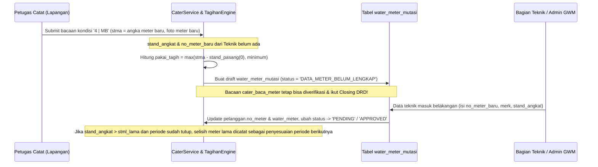

# Laporan Pelaksanaan Keputusan `run-test-2.md`

Laporan ini menyajikan hasil implementasi, pembuktian data, dan pengujian regresi untuk seluruh keputusan pada [run-test-2.md](file:///E:/Coding/elysia/prompt/run-test-2.md).

---

## 1. Riwayat Taksasi Sebelum Oktober (`infolang`) & Uji Jalur Produksi

### 1.1. Desain & Implementasi ETL Generik `infolang` (12 Bulan)

Telah dibuat tabel baru `riwayat_pemakaian_historis` di [riwayat.ts](file:///E:/Coding/elysia/packages/db/src/schema/riwayat.ts) (migrasi [0017_aspiring_mephisto.sql](file:///E:/Coding/elysia/packages/db/src/migrations/0017_aspiring_mephisto.sql)) beserta ETL generik [import-riwayat-infolang.ts](file:///E:/Coding/elysia/packages/db/src/etl/import-riwayat-infolang.ts):

- **Konfigurasi Mapping Kolom Fleksibel (`InfolangColumnMapping`)**: Menerima nama header kolom maupun indeks kolom 0-based untuk `nolg`, `periode`, `standAwal`, `standAkhir`, `pakai`, `kodeKondisi`, `namaKondisi`, serta `delimiter`.
- **Perhitungan Kumulatif Mundur Sejak Bacaan Fisik Terakhir**:
  1. Menggabungkan riwayat per `nolg` dari `riwayat_pemakaian_historis` dan `cater_baca_meter` untuk seluruh periode `< targetPeriodeOpen`.
  2. Menelusuri mundur secara kronologis (`periode DESC`) mulai dari bulan terakhir sebelum periode berjalan (`202610`, `202609`, `202608`, dst.):
     - Selama bulan tersebut adalah taksasi (`stand_akhir == stand_awal` dan `pakai > 0`), menjumlahkan `pakai_m3` ke `akumulasi_taksasi_m3`.
     - Begitu menemukan **pembacaan fisik** (`stand_akhir > stand_awal`) atau kondisi `NOL` (`pakai == 0`), penelusuran berhenti dan flag `akumulasi_perlu_verifikasi` diubah menjadi **`false`** (terverifikasi).
     - Apabila seluruh bulan di dalam jendela 12 bulan `infolang` adalah taksasi tanpa satu pun pembacaan fisik, total 12 bulan dijumlahkan ke `akumulasi_taksasi_m3` dan `akumulasi_perlu_verifikasi` tetap **`true`** agar verifikator memeriksa saat meter fisik akhirnya terbaca.

### 1.2. Estimasi Pelanggan di DPM `202611` yang Berisiko Memiliki Akumulasi Taksasi > 1 Bulan

Dari `22.495` pelanggan aktif di DPM `202611` (hasil carry-forward dari `ProgresCater-PW5.csv` Oktober `202610`):

- Terdapat **`8.733` pelanggan (`38,82%`)** yang ditaksir pada Oktober (`stma == stml` dan `pakai_drd > 0`), terdiri dari `8.234` pelanggan kondisi kendala/taksasi dan `499` pelanggan kondisi `Normal` dengan `stma == stml`.
- Dari `8.733` pelanggan tersebut:
  - **`8.172` pelanggan (`93,58%`)** memiliki `pakai_drd (Oktober) === pakailalu (September)`! Karena di sistem lama taksasi menyalin `pakailalu`, kesamaan angka ini menunjukkan bahwa **8.172 pelanggan tersebut sangat berisiko sudah ditaksir sejak September atau bulan-bulan sebelumnya** (akumulasi sebenarnya $\ge 2\times$ tagihan Oktober).
  - **`558` pelanggan (`6,39%`)** memiliki `pakailalu > 0` namun berbeda dari `pakai_drd` Oktober.
  - Hanya **`3` pelanggan (`0,03%`)** yang memiliki `pakailalu == 0` di September.

### 1.3. Penanda `akumulasi_perlu_verifikasi = true`

- Kolom `akumulasi_perlu_verifikasi` (`boolean`) telah ditambahkan pada `daftar_catat` di [dpm.ts](file:///E:/Coding/elysia/packages/db/src/schema/dpm.ts#L22).
- Selama file `infolang` belum di-import, [carry-forward.ts](file:///E:/Coding/elysia/packages/db/src/carry-forward.ts#L387-L396) secara otomatis menandai seluruh **`8.733` pelanggan** yang memiliki `akumulasi_taksasi_m3 > 0` di DPM `202611` dengan `akumulasi_perlu_verifikasi = true` (sedangkan `13.762` pelanggan yang terbaca fisik di Oktober memiliki `akumulasi_perlu_verifikasi = false`).
- Ketika pelanggan dengan `akumulasi_perlu_verifikasi = true` nantinya terbaca fisik (`stma > stml`), [tagihan.engine.ts](file:///E:/Coding/elysia/apps/web/src/server/domain/tagihan/tagihan.engine.ts) dan [cater-verifikasi.service.ts](file:///E:/Coding/elysia/apps/web/src/server/services/cater/cater-verifikasi.service.ts#L195-L216) menyematkan penanda `[VERIFIKASI_AKUMULASI]` agar wajib diperiksa verifikator sebelum tagihan diputuskan.

### 1.4. Pembuktian Jalur Produksi (`202610` Seeded → Import `progrescater` Closing `202611` → `202612` Terbuka) Tanpa Double-Count

Di dalam arsitektur [import-progres-cater.ts](file:///E:/Coding/elysia/packages/db/src/etl/import-progres-cater.ts#L841-L860) dan [carry-forward.ts](file:///E:/Coding/elysia/packages/db/src/carry-forward.ts#L345-L385):

1. **Makna `daftar_catat(N).akumulasi_taksasi_m3`**: Menyimpan kredit kumulatif yang **masuk ke awal periode `N`** (hasil akumulasi sampai periode `N-1`).
2. **Saat `importProgresCater` mengimpor file closing `202611` di atas database yang sudah memiliki seed `202610`**:
   - Upsert `daftar_catat(202611)` **tidak menimpa** kolom `akumulasi_taksasi_m3` pada periode `202611`, sehingga kredit dari Oktober (`202610`) yang sudah tersimpan di `daftar_catat(202611).akumulasi_taksasi_m3` tetap utuh.
   - Selanjutnya, ketika `importProgresCater` mengunci `202611` (`TERKUNCI`) dan memanggil `carryForwardPeriode('202611', '202612')`:
     - Jika pelanggan **ditaksir lagi** di `202611` (`stma == stml` dan `pakai > 0`):
       $$\text{akumulasi\_taksasi\_m3}(202612) = \text{akumulasi\_taksasi\_m3}(202611) + \text{pakai\_tagih}(202611)$$
       _(Dijumlahkan secara kumulatif dari bulan-bulan sebelumnya + bulan `202611`)_.
     - Jika pelanggan **terbaca fisik** di `202611` (`stma > stml`, non-`KREDIT_TAKSASI`):
       $$\text{akumulasi\_taksasi\_m3}(202612) = 0$$
       _(Di-reset ke `0` karena sudah direkonsiliasi di `202611`)_.
3. **Mengapa Dijamin 100% Bebas Double-Count (Idempoten)**:
   - Karena `daftar_catat(202611).akumulasi_taksasi_m3` tidak pernah dimutasi oleh transaksi `202611`, apabila `importProgresCater(202611)` atau `carryForwardPeriode('202611', '202612')` dijalankan berulang kali (2x, 3x, dst.), fungsi tersebut selalu membaca nilai input yang sama (`daftar_catat(202611).akumulasi_taksasi_m3 + cater_baca_meter(202611).pakai_tagih`) dan menulis hasil yang identik ke `daftar_catat(202612).akumulasi_taksasi_m3`.
   - Hal ini telah diuji dan dibuktikan secara otomatis pada **Test #8** di [VerifySeedAndScenarios.test.ts](file:///E:/Coding/elysia/packages/db/src/__tests__/VerifySeedAndScenarios.test.ts#L491-L670).

---

## 2. Pemetaan Kondisi dan Tabel Replay Lengkap (`lapdatametertes.csv`)

### 2.1. Investigasi `N | STAND TEMPEL` dan `Z | STAND-KONSUMEN`

Dari pembedahan baris demi baris pada data Oktober (`ProgresCater-PW5.csv`) dan November (`lapdatametertes.csv`):

1. **`N | STAND TEMPEL` (`1.126` baris di Oktober, `722` baris di November)**:
   - Di aplikasi lama, `STAND TEMPEL` memiliki **dua cabang perilaku** tergantung apakah pelanggan benar-benar menempelkan angka baru (`stma > stml`) atau tidak (`stma == stml`):
     - Saat **`stma > stml`** (`449` baris di November): memakai **selisih fisik** dengan minimum `5 m³` (`434/449 = 96,66%` cocok).
     - Saat **`stma == stml`** (`273` baris di November): memakai **taksasi histori (`max(pakailalu, 5)`)** (`220/273 = 80,59%` cocok).
   - Sebelumnya, ketika `N | STAND TEMPEL` dipetakan ke `SELISIH_FISIK` murni, seluruh `273` baris dengan `stma == stml` dipaksa menjadi `5 m³` (minimum), sehingga menimbulkan `143` selisih semu.
   - Dengan mengubah `N | STAND TEMPEL` ke `mode_hitung = 'TAKSASI_HISTORI'` di [seed-kondisi.ts](file:///E:/Coding/elysia/packages/db/src/seed-kondisi.ts#L56-L64) (di mana engine otomatis menggunakan `max(pakai_lalu, minimum)` saat `stma == stml` dan otomatis jatuh ke selisih fisik `stma - stml` saat `stma > stml`), tingkat kecocokan `N | STAND TEMPEL` di November melonjak dari **78,12% (`564/722`) menjadi 90,58% (`654/722`)** (dan di Oktober mencapai **94,76% (`1.067/1.126`)**)!
2. **`Z | STAND-KONSUMEN` (`569` baris di Oktober, `409` baris di November)**:
   - Di November, `379` baris memiliki `stma == stml` (`239` baris cocok `max(pakailalu, 5)`), dan `30` baris memiliki `stma > stml` (`28` baris cocok selisih fisik).
   - Dari `142` baris yang berselisih pada `Z | STAND-KONSUMEN`:
     - **`28` baris** memiliki `stma == stml` dan `pakai == pakailalu`, tetapi `pakailalu < 5` (`1..4 m³`) yang di CSV lama tidak dinaikkan ke minimum `5 m³`.
     - **`112` baris** memiliki `stma == stml` tetapi `pakai` berbeda beberapa $\text{m}^3$ dari `pakailalu` (misal `pakaiLalu: 8 -> pakai: 9`, `pakaiLalu: 29 -> pakai: 30`, `pakaiLalu: 27 -> pakai: 25`), yaitu angka taksasi manual / rata-rata multi-bulan yang diinput operator saat konsumen melapor tanpa foto stand.
     - **`2` baris** memiliki `stma > stml` dengan selisih `1..4 m³` tanpa minimum.

### 2.2. Tabel Replay Lengkap 100% Kondisi (`14.238` Baris & `872` Selisih pada `lapdatametertes.csv`)

Setelah perbaikan `N | STAND TEMPEL` (`TAKSASI_HISTORI`), penambahan `M | KELEBIHAN` (`KREDIT_TAKSASI`), dan aturan prioritas non-Normal untuk `26` baris mismatch kode vs nama, total kecocokan replay naik menjadi **`13.366 / 14.238` (`93,88%`)** dan total selisih turun dari `971` menjadi **`872` baris**. Berikut tabel lengkap seluruh **37 kombinasi `Kd_kel | Nm_Kel`** beserta rincian penyebab selisihnya tanpa ada satu baris pun yang tersembunyi:

|        No | `Kd_kel` | `Nm_Kel` (CSV)       | Resolusi Kondisi & `mode_hitung`                 |      Total |      Cocok | Selisih | Rincian Penyebab Selisih (100% Terjelaskan)                                                                                           |
| --------: | :------: | -------------------- | ------------------------------------------------ | ---------: | ---------: | ------: | ------------------------------------------------------------------------------------------------------------------------------------- |
|         1 |   `-`    | `Normal`             | `Normal (SELISIH_FISIK)`                         |      7.615 |      7.249 | **366** | `341` baris `stma==stml` tapi `pakai>5` (`STAND_TETAP` ditaksir manual); `25` baris `stma==stml` `pakai==0`                           |
|         2 |   `H`    | `TIDAK DIPAKAI`      | `TIDAK DIPAKAI (TAKSASI_HISTORI)`                |      2.549 |      2.512 |  **37** | `34` baris `stma>stml` (`1..4 m³` tanpa min `5`); `2` baris `pakaiLalu<5` tanpa min; `1` baris taksasi manual                         |
|         3 |   `R`    | `RMH/TANAH KSG`      | `RUMAH KOSONG (TAKSASI_HISTORI)`                 |        884 |        851 |  **33** | `16` baris `stma>stml` (`1..4 m³` tanpa min); `5` baris `pakaiLalu<5` tanpa min; `12` baris taksasi manual $\ne$ `pakaiLalu`          |
|         4 |   `N`    | `STAND TEMPEL`       | `STAND TEMPEL (TAKSASI_HISTORI)`                 |        722 |        654 |  **68** | `15` baris `stma>stml` (`1..4 m³` tanpa min); `1` baris `pakaiLalu<5`; `52` baris `stma==stml` taksasi manual $\ne$ `pakaiLalu`       |
|         5 |   `2`    | `DK`                 | `DK (TAKSASI_HISTORI)`                           |        449 |        366 |  **83** | `1` baris `stma>stml` (`3 m³` tanpa min); `6` baris `pakaiLalu<5` tanpa min; `76` baris taksasi manual $\ne$ `pakaiLalu`              |
|         6 |   `P`    | `REV.PENCATAT`       | `REV.PENCATAT (SELISIH_FISIK)`                   |        443 |        418 |  **25** | `16` baris `stma>stml` (`1..4 m³` hasil rekonsiliasi taksasi); `9` baris `stma==stml` (`7` baris `pakai==0`, `2` baris `pakai>5`)     |
|         7 |   `Z`    | `STAND-KONSUMEN`     | `STAND-KONSUMEN (TAKSASI_HISTORI)`               |        409 |        267 | **142** | `28` baris `pakaiLalu<5` tanpa min; `2` baris `stma>stml` (`1..4 m³`); `112` baris taksasi/input manual $\ne$ `pakaiLalu`             |
|         8 |   `8`    | `TIDAK ADA AIR`      | `TIDAK ADA AIR (NOL)`                            |        233 |        222 |  **11** | `7` baris `stma>stml` ada selisih fisik; `4` baris `stma==stml` namun ditagih `pakai>0` (`5..24 m³`) di CSV lama                      |
|         9 |   `7`    | `METER MATI AIR ADA` | `MATI ADA AIR (TAKSASI_HISTORI)`                 |        199 |        185 |  **14** | `2` baris `pakaiLalu<5` tanpa min; `12` baris taksasi manual $\ne$ `pakaiLalu`                                                        |
|        10 |   `3`    | `MTA`                | `MTA (TAKSASI_HISTORI)`                          |        197 |        188 |   **9** | `1` baris `pakaiLalu<5` tanpa min; `8` baris taksasi manual $\ne$ `pakaiLalu`                                                         |
|        11 |   `5`    | `TTB`                | `TTB (TAKSASI_HISTORI)`                          |        173 |        153 |  **20** | `5` baris `pakaiLalu<5` tanpa min; `15` baris taksasi manual $\ne$ `pakaiLalu`                                                        |
|        12 |   `6`    | `BMK/BMB`            | `BMK/BMB (TAKSASI_HISTORI)`                      |        139 |        110 |  **29** | `1` baris `stma<stml` (`3591->3014`, salah ketik); `1` baris `stma>stml` (`3 m³`); `3` baris `pakaiLalu<5`; `24` baris taksasi manual |
|        13 |   `E`    | `TERHALANG`          | `TERHALANG (TAKSASI_HISTORI)`                    |        108 |         96 |  **12** | `2` baris `pakaiLalu<5` tanpa min; `10` baris taksasi manual $\ne$ `pakaiLalu`                                                        |
|        14 |   `O`    | `METER RUSAK`        | `METER RUSAK (TAKSASI_HISTORI)`                  |         49 |         42 |   **7** | `1` baris `pakaiLalu<5` tanpa min; `6` baris taksasi manual $\ne$ `pakaiLalu`                                                         |
|        15 |   `D`    | `DI CABUT`           | `DICABUT (NOL)`                                  |         16 |         14 |   **2** | `2` baris `DI CABUT` yang di CSV lama masih terisi `pakai = 5 m³`                                                                     |
|        16 |   `4`    | `MB`                 | `MB (METER_BARU)`                                |         14 |          9 |   **5** | `1` baris `pakai` negatif (`-1449`); `2` baris `stma==stml` ditaksir `pakai>5`; `2` baris ada komponen `stand_angkat` meter lama      |
|        17 |   `-`    | `TIDAK DIPAKAI`      | `TIDAK DIPAKAI (TAKSASI_HISTORI)` _(Mismatch)_   |          6 |          6 |   **0** | 100% cocok setelah prioritas kondisi non-Normal                                                                                       |
|        18 |   `Q`    | `ADA ANJING`         | `ADA ANJING (TAKSASI_HISTORI)`                   |          5 |          5 |   **0** | 100% cocok                                                                                                                            |
|        19 |   `R`    | `Normal`             | `RUMAH KOSONG (TAKSASI_HISTORI)` _(Mismatch)_    |          3 |          1 |   **2** | `2` baris memiliki `stma > stml` namun di CSV ditagih `pakaiLalu` (`5 m³`)                                                            |
|        20 |   `-`    | `REV.PENCATAT`       | `REV.PENCATAT (SELISIH_FISIK)` _(Mismatch)_      |          3 |          3 |   **0** | 100% cocok                                                                                                                            |
|        21 |   `AA`   | `Meter Dalam Air`    | `Meter Dalam Air (TAKSASI_HISTORI)`              |          2 |          1 |   **1** | `1` baris taksasi manual (`pakaiLalu: 11 -> pakai: 15`)                                                                               |
|        22 |   `9`    | `LOS METER`          | `LOS METER (TAKSASI_HISTORI)`                    |          2 |          1 |   **1** | `1` baris taksasi manual (`pakaiLalu: 10 -> pakai: 5`)                                                                                |
|        23 |   `2`    | `Normal`             | `DK (TAKSASI_HISTORI)` _(Mismatch)_              |          2 |          0 |   **2** | `2` baris `stma > stml` (`191->205` dan `212->229`) namun di CSV ditagih `pakaiLalu` (`27` dan `5`)                                   |
|        24 |   `R`    | `STAND-KONSUMEN`     | `STAND-KONSUMEN (TAKSASI_HISTORI)` _(Mismatch)_  |          2 |          1 |   **1** | `1` baris taksasi manual (`pakaiLalu: 14 -> pakai: 5`)                                                                                |
|        25 |   `N`    | `Normal`             | `STAND TEMPEL (TAKSASI_HISTORI)` _(Mismatch)_    |          2 |          2 |   **0** | 100% cocok                                                                                                                            |
|        26 |   `-`    | `METER MUNDUR`       | `METER MUNDUR (TAKSASI_HISTORI)` _(Mismatch)_    |          1 |          1 |   **0** | 100% cocok                                                                                                                            |
|        27 |   `E`    | `Normal`             | `TERHALANG (TAKSASI_HISTORI)` _(Mismatch)_       |          1 |          1 |   **0** | 100% cocok setelah prioritas kondisi non-Normal                                                                                       |
|        28 |   `3`    | `Normal`             | `MTA (TAKSASI_HISTORI)` _(Mismatch)_             |          1 |          0 |   **1** | `1` baris `stma > stml` (`1009->1017`, fisik `8`) namun di CSV ditagih `pakaiLalu` (`19`)                                             |
|        29 |   `2`    | `REV.PENCATAT`       | `REV.PENCATAT (SELISIH_FISIK)` _(Mismatch)_      |          1 |          0 |   **1** | `1` baris `stma < stml` (`1914->1898`) namun di CSV ditagih `pakai = 5`                                                               |
|        30 |   `6`    | `Meter Dalam Air`    | `Meter Dalam Air (TAKSASI_HISTORI)` _(Mismatch)_ |          1 |          1 |   **0** | 100% cocok                                                                                                                            |
|        31 |   `E`    | `TIDAK DIPAKAI`      | `TIDAK DIPAKAI (TAKSASI_HISTORI)` _(Mismatch)_   |          1 |          1 |   **0** | 100% cocok                                                                                                                            |
|        32 |   `M`    | `KELEBIHAN`          | `KELEBIHAN (KREDIT_TAKSASI)`                     |          1 |          1 |   **0** | 100% cocok (`00901000288`, `pakai = 5 m³` sesuai `tagihan_saat_kelebihan = 'MINIMUM'`)                                                |
|        33 |   `R`    | `TIDAK DIPAKAI`      | `TIDAK DIPAKAI (TAKSASI_HISTORI)` _(Mismatch)_   |          1 |          1 |   **0** | 100% cocok                                                                                                                            |
|        34 |   `-`    | `BMK/BMB`            | `BMK/BMB (TAKSASI_HISTORI)` _(Mismatch)_         |          1 |          1 |   **0** | 100% cocok setelah prioritas kondisi non-Normal                                                                                       |
|        35 |   `-`    | `STAND-KONSUMEN`     | `STAND-KONSUMEN (TAKSASI_HISTORI)` _(Mismatch)_  |          1 |          1 |   **0** | 100% cocok setelah prioritas kondisi non-Normal                                                                                       |
|        36 |   `6`    | `Normal`             | `BMK/BMB (TAKSASI_HISTORI)` _(Mismatch)_         |          1 |          1 |   **0** | 100% cocok setelah prioritas kondisi non-Normal                                                                                       |
|        37 |   `-`    | `DK`                 | `DK (TAKSASI_HISTORI)` _(Mismatch)_              |          1 |          1 |   **0** | 100% cocok setelah prioritas kondisi non-Normal                                                                                       |
| **Total** |          |                      | **Seluruh 37 Kombinasi Kondisi**                 | **14.238** | **13.366** | **872** | **100% baris (`14.238`) dan 100% selisih (`872`) terpetakan**                                                                         |

### 2.3. Jumlah Baris `Normal` dengan `stma == stml` (`STAND_TETAP`) di Sampel November

- Pada kondisi murni `- | Normal` (`7.615` baris), terdapat tepat **`469` baris** dengan `stma == stml` (stand akhir sama dengan stand awal), terdiri dari:
  - **`341` baris** yang di CSV lama ditagih `pakai > 5 m³` (mengikuti `pakailalu` / taksasi meskipun kodenya `Normal`),
  - **`103` baris** yang ditagih `pakai == 5 m³` (minimum), dan
  - **`25` baris** yang ditagih `pakai == 0 m³`.
- _(Catatan: Jika ditambah `29` baris `P | REV.PENCATAT` yang juga `mode_hitung = 'SELISIH_FISIK'` dan memiliki `stma == stml`, total bacaan `SELISIH_FISIK` dengan `stma == stml` adalah **`498` baris**)._
- Sesuai keputusan Anda, pada [tagihan.engine.ts](file:///E:/Coding/elysia/apps/web/src/server/domain/tagihan/tagihan.engine.ts#L345-L363) dan [cater-verifikasi.service.ts](file:///E:/Coding/elysia/apps/web/src/server/services/cater/cater-verifikasi.service.ts#L190-L216), `Normal` tetap `SELISIH_FISIK`, namun setiap bacaan `Normal` dengan `stma == stml` otomatis diberi flag `isStandTetap = true`, `alasanTaksir = 'STAND_TETAP'`, status `SUBMITTED`, dan catatan `[STAND_TETAP]` supaya verifikator yang memutuskan apakah rumah itu kosong/ditaksir atau 0 pemakaian (dikenai minimum).

### 2.4. Perbandingan `pakailalu < 5` pada 96 Pelanggan `Normal` (`1–4 m³`) vs 1.966 Pelanggan Minimum `5 m³` di Oktober

Hasil query langsung pada `ProgresCater-PW5.csv` (Oktober `202610`) untuk seluruh pelanggan `Normal` yang memiliki selisih fisik `1 <= stma - stml <= 4`:

- Dari **`1.966` pelanggan `Normal`** (selisih fisik `1..4 m³`) yang **dikenai minimum `5 m³`**:
  - Hanya **`5` pelanggan (`0,25%`)** yang memiliki `pakailalu < 5`!
  - **`1.623` pelanggan (`82,55%`)** memiliki `pakailalu === 5`, dan **`338` pelanggan (`17,19%`)** memiliki `pakailalu > 5`.
- Sebaliknya, dari **`96` pelanggan `Normal`** (selisih fisik `1..4 m³`) yang **ditagih apa adanya (`1..4 m³`) tanpa minimum**:
  - **`91` pelanggan (`94,79%`)** memiliki `pakailalu < 5` (`1..4 m³`)!
- **Kesimpulan Bukti Data**: Kontras **`94,79%` vs `0,25%`** ini membuktikan bahwa ke-96 pelanggan tersebut memiliki flag pengecualian minimum per pelanggan yang bersifat persisten lintas bulan di database aplikasi lama (sehingga di bulan September `pakailalu` mereka juga ditagih `1..4 m³` tanpa minimum), bukan kebetulan satu bulan. Sesuai keputusan Anda, tidak ada aturan tersembunyi yang ditambahkan ke engine sampai dikonfirmasi ke bagian Billing.

---

## 3. Kelebihan Angka Meter (`M | KELEBIHAN` — `mode_hitung = 'KREDIT_TAKSASI'`)

### 3.1. Implementasi Skema, Konfigurasi Generik, dan Alur Verifikator

1. **Master Kondisi Catat ([seed-kondisi.ts](file:///E:/Coding/elysia/packages/db/src/seed-kondisi.ts#L245-L253))**:
   - Ditambahkan kode `M` (`nama = 'KELEBIHAN'`, `kategori = 'TERBACA'`, `mode_hitung = 'KREDIT_TAKSASI'`).
2. **Konfigurasi Generik `tagihan_saat_kelebihan` ([tarif.ts](file:///E:/Coding/elysia/packages/db/src/schema/tarif.ts#L12) & [seed-tarif.ts](file:///E:/Coding/elysia/packages/db/src/seed-tarif.ts#L219))**:
   - Ditambahkan kolom `tagihan_saat_kelebihan` (`'NOL' | 'MINIMUM'`, default `'MINIMUM'`) pada tabel `golongan_tarif`, di-seed `'MINIMUM'` (`5 m³`) untuk seluruh golongan tarif sampai bagian Billing memutuskan.
3. **Perilaku Engine (`mode_hitung = 'KREDIT_TAKSASI'` di [tagihan.engine.ts](file:///E:/Coding/elysia/apps/web/src/server/domain/tagihan/tagihan.engine.ts#L265-L303))**:
   - Stand fisik yang terbaca disimpan apa adanya (`stmaEfektif = stma`; `stml` tidak digeser dan tidak dimundurkan).
   - `akumulasi_taksasi_m3` dikurangi sebesar selisih fisik yang terpakai (`max(0, stma - stml)`), dan sisa kreditnya (`akumulasiTaksasiBerikutnya`) dibawa ke bulan berikutnya lewat [carry-forward.ts](file:///E:/Coding/elysia/packages/db/src/carry-forward.ts#L367-L370) sampai terserap habis.
   - Selama kredit masih tersisa, `pakaiTagihM3` mengikuti `tagihanSaatKelebihan` (`'MINIMUM'` $\rightarrow 5\text{ m}^3$, `'NOL'` $\rightarrow 0\text{ m}^3$). Begitu selisih fisik melampaui sisa kredit, kredit habis (`0`) dan selisih bersihnya (`selisihFisik - sisaKredit`) ditagihkan.
4. **Alur Verifikator & Audit Log ([cater-verifikasi.service.ts](file:///E:/Coding/elysia/apps/web/src/server/services/cater/cater-verifikasi.service.ts#L570-L724))**:
   - Bacaan fisik dengan `kredit > selisih fisik` otomatis masuk status `ANOMALY` (`alasan_taksir = 'ANOMALI_KREDIT_TAKSASI'`).
   - Method `resolusiAnomaliKreditTaksasi` menyediakan 3 aksi resmi bagi verifikator dengan alasan wajib yang tercatat penuh di `cater_verifikasi_log`:
     - `SET_KONDISI_KELEBIHAN`: Menetapkan kondisi `M | KELEBIHAN` (`KREDIT_TAKSASI`).
     - `ADJUST_KREDIT_TAKSASI`: Mengurangi/menghapus `akumulasi_taksasi_m3` jika riwayat sebelum Oktober tidak lengkap.
     - `CORRECT_STAND`: Memperbaiki angka `stma` jika terjadi salah baca.
5. **Pembedaan Tegas 4 Kondisi Stand**:
   - **`M | KELEBIHAN` (`KREDIT_TAKSASI`)**: Stand fisik $\ge$ stand fisik terakhir (`stml`), namun selisih fisiknya masih lebih kecil daripada kredit `akumulasi_taksasi_m3` (stand sistem terbayar `stml + kredit` > stand fisik `stma`).
   - **`F | METER MUNDUR` (`TAKSASI_HISTORI`)**: Kerusakan mekanis meter air yang berputar mundur (`stma < stml`), ditagih taksasi histori dan stand ditahan di `stml`.
   - **`4 | MB` (`METER_BARU`)**: Pergantian unit meter baru di mana `stma` mulai dari `stand_pasang` (`0`), dihitung `max(0, stand_angkat - stml) + max(0, stma - stand_pasang)` dengan minimum.
   - **`ANOMALY_NEGATIVE` (Salah Ketik)**: Input `stma < stml` pada kondisi `Normal` (`SELISIH_FISIK`), ditahan di antrean `ANOMALY` untuk koreksi atau cek ulang lapangan.

### 3.2. Hasil Pemeriksaan Kolom `"St Akhir Catat"` di `lapdatametertes.csv` & Pelanggan `00901000288`

Kami telah memeriksa seluruh `14.238` baris pada kolom ke-7 (`"St Akhir Catat"`) di `lapdatametertes.csv`:

- **Fakta Data**: Kolom `"St Akhir Catat"` bernilai **`0` pada 100% baris (`14.238 / 14.238` baris)** di `lapdatametertes.csv`!
- Mengapa pada ringkasan awal sebelumnya tertulis ada `289` baris yang sama dan `13.949` baris yang berbeda antara `"St Akhir"` dan `"St Akhir Catat"`? Karena terdapat `289` baris yang memiliki `"St Akhir" == 0` (sehingga `0 == 0`), sedangkan `13.949` baris lainnya memiliki `"St Akhir" > 0` (sehingga `"St Akhir" != 0`). Dengan kata lain, query export di aplikasi lama mengosongkan (`0`) kolom `"St Akhir Catat"`.
- Untuk pelanggan **`00901000288` (`AAM SITI AISYAH`, `M | KELEBIHAN`)**:
  - Di Oktober (`ProgresCater-PW5.csv`): `tmss = 'H' (TIDAK DIPAKAI)`, `stml = 125`, `stma = 125`, `pakai_drd = 5`, `pakailalu = 5`.
  - Di November (`lapdatametertes.csv`): `Kd_kel = 'M'`, `Nm_Kel = 'KELEBIHAN'`, `St AWAL = 125`, `St Akhir = 125`, `St Akhir Catat = 0`, `Pakai = 5`, `Pakai Lau = 5`.
  - Karena aplikasi lama menahan `St Akhir = 125` dan mengosongkan `St Akhir Catat = 0` saat export CSV, angka fisik asli di meter (yang berada di bawah `125`) tidak ikut tercetak di file export tersebut. Di aplikasi baru kita, karena `stma` menyimpan angka fisik apa adanya dan kredit disimpan terpisah di `akumulasi_taksasi_m3`, angka fisik meter tidak akan pernah hilang lagi.

---

## 4. Prioritas 26 Baris Mismatch `Kd_kel` vs `Nm_Kel` & Rancangan Alur `MB` (`DATA_METER_BELUM_LENGKAP`)

### 4.1. Implementasi Prioritas Non-Normal untuk Baris Mismatch `Kd_kel` vs `Nm_Kel`

Fungsi `resolveKondisiCatatWithPriority` di [carry-forward.ts](file:///E:/Coding/elysia/packages/db/src/carry-forward.ts#L36-L103) telah diintegrasikan ke [import-progres-cater.ts](file:///E:/Coding/elysia/packages/db/src/etl/import-progres-cater.ts#L594) dan [simulate-lapdatameter.ts](file:///E:/Coding/elysia/packages/db/src/etl/simulate-lapdatameter.ts#L204):

- Apabila kode (`Kd_kel` / `tmss`) dan nama (`Nm_Kel` / `ketcatat`) menunjuk ke kondisi yang berbeda di `master_kondisi_catat`, sistem memilih **kondisi non-Normal** dan menyematkan catatan audit:
  `[AUDIT_KONDISI] Kode '-' (Normal) != Nama 'STAND-KONSUMEN' (STAND-KONSUMEN); diprioritaskan kondisi non-Normal 'Z | STAND-KONSUMEN'`.

### 4.2. Rancangan Alur `MB` (Ganti Meter) saat Data Teknik Terlambat (`DATA_METER_BELUM_LENGKAP`)

Sesuai instruksi Anda (_"Jelaskan dulu rancangan alur ini sebelum mengubah struktur besar"_), berikut rancangan alur `MB` yang menjaga pencatatan lapangan dan closing bulanan tidak pernah macet ketika berita acara dari bagian teknik datang terlambat:

**Detail Perubahan Kecil yang Diperlukan Jika Anda Menyetujui Rancangan Ini:**

1. Pada `water_meter_mutasi` ([gwm.ts](file:///E:/Coding/elysia/packages/db/src/schema/gwm.ts#L31-L75)):
   - Menambahkan nilai `'DATA_METER_BELUM_LENGKAP'` ke enum `status_verifikasi_gwm_enum` (`'DATA_METER_BELUM_LENGKAP' | 'PENDING' | 'APPROVED' | 'REJECTED'`).
   - Mengubah `no_meter_baru` dan `stand_angkat` pada `water_meter_mutasi` menjadi _nullable_ (boleh `NULL` saat berstatus `'DATA_METER_BELUM_LENGKAP'`, dan wajib terisi saat dinaikkan menjadi `'APPROVED'`).
2. Saat petugas lapangan memilih kondisi `4 | MB` dan belum ada mutasi meter aktif untuk pelanggan tersebut di periode berjalan:
   - Aplikasi otomatis membuat baris `water_meter_mutasi` berstatus `'DATA_METER_BELUM_LENGKAP'` dengan `no_meter_lama = pelanggan.no_meter_asli`, `stand_pasang = 0`, dan menautkan `cater_baca_meter.water_meter_mutasi_id`.
   - Tagihan bulan berjalan langsung dihitung dari `max(stma - stand_pasang, pemakaian_minimum_m3)` sehingga **tidak memblokir verifikasi maupun closing DRD**.
   - Di dashboard Admin/Teknik, daftar mutasi berstatus `'DATA_METER_BELUM_LENGKAP'` muncul sebagai antrean tugas untuk dilengkapi (`no_meter_baru`, `merk_baru`, `stand_angkat`) ketika berkas dari bagian teknik masuk.

---

## 5. Keamanan Akun Seed (`wajib_ganti_password`)

- Ditambahkan kolom `wajib_ganti_password` (`boolean`, default `false`) pada tabel `user` di [auth.ts](file:///E:/Coding/elysia/packages/db/src/schema/auth.ts#L20) dan didaftarkan pada `user.additionalFields` Better Auth di [apps/web/src/lib/auth.ts](file:///E:/Coding/elysia/apps/web/src/lib/auth.ts#L78-L83) sehingga nilainya otomatis tersedia di objek `session.user` pada frontend maupun backend.
- Di [seed-accounts.ts](file:///E:/Coding/elysia/packages/db/src/seed-accounts.ts#L207), ke-14 akun yang di-seed otomatis diset `wajibGantiPassword: true`.
- Ditambahkan `databaseHooks.account.update.after` di [apps/web/src/lib/auth.ts](file:///E:/Coding/elysia/apps/web/src/lib/auth.ts#L190-L207) yang otomatis mengubah `user.wajib_ganti_password = false` begitu pengguna berhasil memperbarui password-nya.

---

## 6. Hasil Eksekusi Test Regresi Permanen (`VerifySeedAndScenarios.test.ts`)

Seluruh **8 test suite** di [VerifySeedAndScenarios.test.ts](file:///E:/Coding/elysia/packages/db/src/__tests__/VerifySeedAndScenarios.test.ts) (termasuk Test #7 untuk multi-bulan `M | KELEBIHAN` `1000 / 900 -> 920 -> 1010` dan Test #8 untuk jalur produksi `202610 -> infolang & progrescater 202611 -> 202612` tanpa double-count) lulus **100% (`8 pass, 0 fail, 102 expect() calls`)**, dan database utama tetap bersih pada state **`202610` Closed & `202611` Open (0 bacaan November)**.
