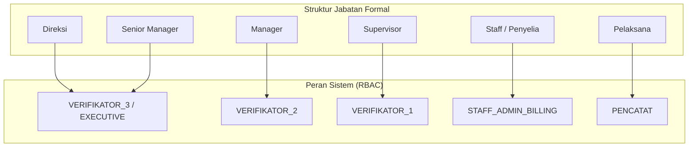
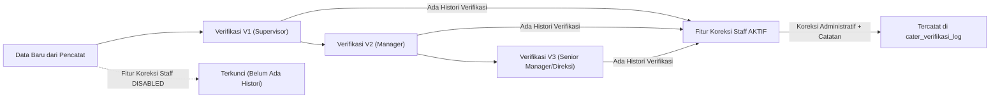

# Arsitektur Pondasi: Struktur Kepegawaian, RBAC & Workflow Verifikasi Baca Meter

Dokumen ini mendefinisikan arsitektur pondasi resmi aplikasi Baca Meter (Cater), menggabungkan aturan operasional eksisting dan tata kelola keamanan modern:
1. **Hirarki Jabatan Kepegawaian (HR)**
2. **Pemetaan Role Sistem & Verifikator (V1, V2, V3, Pencatat, Staff)**
3. **Kewenangan Khusus Staff Administrasi / Billing (Rute, Pemetaan, Closing, & Koreksi Pasca-Verifikasi)**
4. **Guard Kondisional & Audit Trail Integritas Data**

---

## 1. Pemetaan Struktur Kepegawaian ke Peran Sistem

Berdasarkan aturan operasional nyata:



### Tabel Rincian Kewenangan

| Jabatan | Role Sistem | Tingkat Verifikasi | Lingkup Kewenangan Utama |
| :--- | :--- | :---: | :--- |
| **Pelaksana** | `PENCATAT` | Input Awal | Melakukan pembacaan lapangan via mobile app, ambil foto stand meter, lock koordinat GPS. |
| **Supervisor** | `VERIFIKATOR_1` | **V1** | Validasi awal anomali harian tingkat seksi/rute (pemakaian lonjak, mundur, foto kabur). Perintah cek fisik ulang (*re-survey*). |
| **Manager** | `VERIFIKATOR_2` | **V2** | Validasi dan persetujuan tingkat cabang/wilayah atas eskalasi V1, approval penyesuaian (*adjustment*) stand cabang. |
| **Senior Manager** | `VERIFIKATOR_3` | **V3** | Pengesahan akhir penutupan buku periode cater per divisi. |
| **Direksi** | `VERIFIKATOR_3` / `EXECUTIVE` | **V3** (Override) | Dashboard analitik KPI eksekutif, dengan hak override V3 bila dibutuhkan pada kondisi khusus. |
| **Staff / Penyelia**| `STAFF_ADMIN_BILLING` | **Non-Verifikator Reguler** (Koreksi Kondisional) | **1.** Administrasi Rute (pindah/gabung/pecah rute)<br>**2.** Pemetaan Spasial (GIS pelanggan & rute)<br>**3.** Input manual stand susulan<br>**4.** Eksekusi closing periode menjadi DRD<br>**5.** **Koreksi Pasca-Verifikasi** (hanya aktif jika data memiliki histori verifikasi V1-V3). |

---

## 2. Aturan Kritis: Peran Strategis & Koreksi Kondisional "Staff"

Staff **bukan verifikator harian**. Staff tidak memverifikasi data mentah yang baru masuk dari lapangan agar alur berjenjang (Supervisor $\rightarrow$ Manager) tidak dilompati (*bypass*).

Namun, Staff memegang kendali operasional administrasi dan **koreksi rekonsiliasi pasca-verifikasi**:



### Aturan Bisnis Guard Kondisional:
1. **Data Mentah (`status: SUBMITTED`, `histori_verifikasi == 0`)**:
   - Fitur edit/koreksi stand meter oleh Staff **TIDAK AKTIF (DISABLED)**. Data wajib diverifikasi terlebih dahulu oleh Supervisor (V1).
2. **Data Sudah Diverifikasi (`status: VERIFIED_L1 / L2 / L3`, `histori_verifikasi > 0`)**:
   - Tombol/Menu **"Koreksi Administratif / Rekonsiliasi"** oleh Staff menjadi **AKTIF**.
   - Contoh kasus: Komplain pelanggan di loket pelayanan bahwa meter bocor setelah diverifikasi, atau ditemukan salah baca saat rekonsiliasi pra-closing.
   - **Kewajiban Audit**: Staff wajib mengisi nomor tiket komplain / dasar nota dinas serta alasan koreksi. Data sebelum dan sesudah perubahan dicatat permanen di log audit.
3. **Closing Data**:
   - Staff memiliki kewenangan memicu proses *batch closing* data yang sudah berstatus `APPROVED_FINAL` untuk di-generate menjadi tagihan rekening air (DRD).

---

## 3. Matriks Hak Akses Fitur Aplikasi

| Modul & Fitur | PENCATAT | V1 (Supervisor) | V2 (Manager) | V3 (Sr. Mgr / Direksi) | STAFF ADMIN |
| :--- | :---: | :---: | :---: | :---: | :---: |
| **Input Stand & Foto (Mobile)** | ✅ | ❌ | ❌ | ❌ | ❌ |
| **Verifikasi Reguler Harian** | ❌ | ✅ (V1) | ✅ (V2) | ✅ (V3) | ❌ |
| **Perintah Re-Survey Lapangan** | ❌ | ✅ | ✅ | ❌ | ❌ |
| **Koreksi Stand di Alur Reguler** | ❌ | ❌ | ✅ | ✅ | ❌ |
| **Pindah & Gabung Rute Cater** | ❌ | ❌ | ❌ | ❌ | ✅ |
| **Pemetaan & GIS Koordinat** | ❌ | ❌ | ❌ | ❌ | ✅ |
| **Manual Input Stand (Susulan)**| ❌ | ❌ | ❌ | ❌ | ✅ |
| **Koreksi Pasca-Verifikasi** | ❌ | ❌ | ❌ | ❌ | ✅ *(Kondisional)* |
| **Eksekusi Closing Periode (DRD)**| ❌ | ❌ | ❌ | ❌ | ✅ |
| **Executive Dashboard & KPI** | ❌ | ❌ | ❌ | ✅ | ❌ |

---

## 4. Spesifikasi Skema Database (Drizzle ORM)

### A. Enum Hirarki & Peran Sistem

```typescript
import { pgEnum } from 'drizzle-orm/pg-core';

// 1. Tingkatan Jabatan Kepegawaian (HR)
export const employeeLevelEnum = pgEnum('employee_level', [
  'DIREKSI',
  'SENIOR_MANAGER',
  'MANAGER',
  'SUPERVISOR',
  'STAFF_PENYELIA',
  'PELAKSANA',
]);

// 2. Peran Sistem RBAC
export const appRoleEnum = pgEnum('app_role', [
  'SUPERADMIN',
  'EXECUTIVE',            // Direksi (Analitik & Override V3)
  'VERIFIKATOR_3',        // Senior Manager (Final Release)
  'VERIFIKATOR_2',        // Manager Cabang (Regional Approval)
  'VERIFIKATOR_1',        // Supervisor (Initial Screening)
  'STAFF_ADMIN_BILLING',  // Staff Administrasi Rute, GIS, Closing & Koreksi Pasca-Verifikasi
  'PENCATAT',             // Pelaksana Lapangan (Mobile App)
]);

// 3. Status Siklus Verifikasi
export const caterVerificationStatusEnum = pgEnum('cater_verification_status', [
  'DRAFT',                // Draft offline di ponsel
  'SUBMITTED',            // Diunggah, menunggu V1
  'NEED_RESURVEY',        // Perintah cek ulang lapangan
  'VERIFIED_L1',          // Disetujui Supervisor
  'VERIFIED_L2',          // Disetujui Manager
  'APPROVED_FINAL',       // Disahkan Senior Manager / Direksi
  'CORRECTED_POST_VERIF', // Telah dikoreksi administratif oleh Staff
  'LOCKED_BILLING',       // Sudah dieksekusi closing ke DRD (Locked permanen)
]);
```

### B. Tabel Riwayat & Audit Trail Verifikasi (`cater_verifikasi_log`)

```typescript
import { pgTable, text, varchar, numeric, timestamp } from 'drizzle-orm/pg-core';
import { user } from './auth';
import { caterBacaMeter } from './cater';

export const caterVerifikasiLog = pgTable('cater_verifikasi_log', {
  id: text('id').primaryKey().$defaultFn(() => crypto.randomUUID()),
  caterId: text('cater_id')
    .notNull()
    .references(() => caterBacaMeter.id, { onDelete: 'cascade' }),
  userId: text('user_id')
    .notNull()
    .references(() => user.id),
  
  // Tingkat tindakan: 'V1', 'V2', 'V3', atau 'STAFF_CORRECTION'
  stage: varchar('stage', { length: 20 }).notNull(),
  
  // Aksi: 'APPROVE', 'REQUEST_RESURVEY', 'ADJUST_STAND', 'STAFF_POST_CORRECT'
  action: varchar('action', { length: 30 }).notNull(),
  
  // Pencatatan sebelum & sesudah koreksi
  stmaSebelum: numeric('stma_sebelum', { precision: 10, scale: 2 }),
  stmaSesudah: numeric('stma_sesudah', { precision: 10, scale: 2 }),
  pakaiSebelum: numeric('pakai_sebelum', { precision: 10, scale: 2 }),
  pakaiSesudah: numeric('pakai_sesudah', { precision: 10, scale: 2 }),
  
  // Dasar / Bukti Koreksi
  nomorTiketKomplain: varchar('nomor_tiket_komplain', { length: 50 }),
  alasan: text('alasan').notNull(),
  
  createdAt: timestamp('created_at').notNull().defaultNow(),
});
```

---

## 5. Implementasi Logika Guard Koreksi Staff di Backend ElysiaJS

Logika penguncian kondisional (*conditional guard*) memastikan Staff tidak dapat mengutak-atik data yang belum pernah masuk alur verifikasi V1-V3:

```typescript
import { Elysia, t } from 'elysia';
import { db } from '@elysia/db';
import { caterBacaMeter, caterVerifikasiLog } from '@elysia/db/schema';
import { eq, desc } from 'drizzle-orm';

export const staffCorrectionPlugin = new Elysia({ prefix: '/cater/staff' })
  .post(
    '/correct-stand/:caterId',
    async ({ params: { caterId }, body, user, error }) => {
      // 1. Ambil data cater saat ini
      const cater = await db.query.caterBacaMeter.findFirst({
        where: eq(caterBacaMeter.id, caterId),
      });

      if (!cater) return error(404, { message: 'Data cater tidak ditemukan' });

      // 2. Ambil histori verifikasi data ini
      const logs = await db
        .select()
        .from(caterVerifikasiLog)
        .where(eq(caterVerifikasiLog.caterId, caterId));

      // 3. ATURAN KRITIS: Jika belum pernah ada histori verifikasi, TOLAK!
      if (!logs || logs.length === 0) {
        return error(400, {
          message: 'Fitur tidak aktif: Data ini belum pernah diverifikasi oleh V1-V3. Koreksi tidak dapat dilakukan.',
        });
      }

      // 4. Jika periode sudah closing/terkunci di billing, tolak kecuali ada izin khusus
      if (cater.statusVerifikasi === 'LOCKED_BILLING') {
        return error(403, {
          message: 'Data sudah terkunci dalam Rekening Tagihan (DRD). Gunakan prosedur Berita Acara Khusus.',
        });
      }

      // 5. Eksekusi koreksi dan catat audit log
      await db.transaction(async (tx) => {
        // Log riwayat koreksi
        await tx.insert(caterVerifikasiLog).values({
          caterId,
          userId: user.id,
          stage: 'STAFF_CORRECTION',
          action: 'STAFF_POST_CORRECT',
          stmaSebelum: cater.stma,
          stmaSesudah: String(body.stmaBaru),
          pakaiSebelum: cater.pakaiM3,
          pakaiSesudah: String(body.pakaiM3Baru),
          nomorTiketKomplain: body.nomorTiketKomplain,
          alasan: body.alasan,
        });

        // Update stand meter & status
        await tx
          .update(caterBacaMeter)
          .set({
            stma: String(body.stmaBaru),
            pakaiM3: String(body.pakaiM3Baru),
            statusVerifikasi: 'CORRECTED_POST_VERIF',
            catatan: `Koreksi oleh Staff: ${body.alasan}`,
            updatedAt: new Date(),
          })
          .where(eq(caterBacaMeter.id, caterId));
      });

      return { success: true, message: 'Koreksi administratif berhasil disimpan.' };
    },
    {
      body: t.Object({
        stmaBaru: t.Numeric(),
        pakaiM3Baru: t.Numeric(),
        nomorTiketKomplain: t.Optional(t.String()),
        alasan: t.String({ minLength: 10 }),
      }),
    }
  );
```

---

## 6. Ringkasan Keuntungan Desain Ini

1. **Mempertahankan Alur Asli & Menjaga Disiplin**: Supervisor (V1), Manager (V2), dan Senior Manager/Direksi (V3) tetap menjadi benteng verifikasi utama.
2. **Tidak Melanggar *Separation of Duties***: Staff tidak bisa menyusup ke data mentah lapangan. Fitur koreksi hanya menjadi jalan keluar administratif (*exception handling*) untuk kasus komplain atau rekonsiliasi pasca-verifikasi.
3. **Audit Trail Mutlak**: Setiap desimal angka yang dikoreksi Staff tercatat lengkap bersama identitas staf, nomor pengaduan, dan nilai meter sebelumnya.
