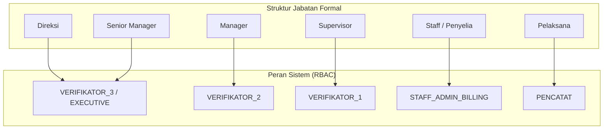
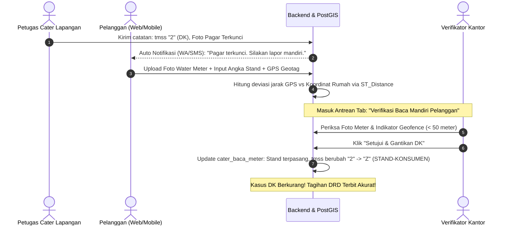

# Arsitektur Pondasi: Struktur Kepegawaian, RBAC, Kamus Kondisi Catat & Workflow Baca Mandiri

Dokumen ini mendefinisikan arsitektur pondasi resmi aplikasi Baca Meter (Cater):
1. **Hirarki Jabatan Kepegawaian (HR Level - 6 Tingkat)**
2. **Pemetaan Role Sistem & Verifikator (V1, V2, V3, Pencatat, Staff)**
3. **Kewenangan Khusus Staff Administrasi / Billing & Koreksi Pasca-Verifikasi**
4. **Kamus Standar 22 Kondisi Catat Lapangan (Hasil Audit Data Riil STI)**
5. **Arsitektur Modul Baca Meter Mandiri Pelanggan (Pengurangan Kasus DK via PostGIS Geofencing)**

---

## 1. Pemetaan Struktur Kepegawaian ke Peran Sistem

| Jabatan | Role Sistem | Tingkat Verifikasi | Lingkup Kewenangan Utama |
| :--- | :--- | :---: | :--- |
| **Pelaksana** | `PENCATAT` | Input Awal | Melakukan pembacaan lapangan via mobile app, ambil foto stand meter, lock koordinat GPS. |
| **Supervisor** | `VERIFIKATOR_1` | **V1** | Validasi awal anomali harian tingkat seksi/rute (pemakaian lonjak, mundur, foto kabur). Perintah cek fisik ulang (*re-survey*). |
| **Manager** | `VERIFIKATOR_2` | **V2** | Validasi dan persetujuan tingkat cabang/wilayah atas eskalasi V1, approval penyesuaian (*adjustment*) stand cabang. |
| **Senior Manager** | `VERIFIKATOR_3` | **V3** | Pengesahan akhir penutupan buku periode cater per divisi. |
| **Direksi** | `VERIFIKATOR_3` / `EXECUTIVE` | **V3** (Override) | Dashboard analitik KPI eksekutif, dengan hak override V3 bila dibutuhkan pada kondisi khusus. |
| **Staff / Penyelia**| `STAFF_ADMIN_BILLING` | **Non-Verifikator Reguler** (Koreksi Kondisional) | **1.** Administrasi Rute (pindah/gabung rute) **2.** Pemetaan Spasial GIS **3.** Input manual stand susulan **4.** Eksekusi closing periode ke DRD **5.** **Koreksi Pasca-Verifikasi** (hanya aktif jika data memiliki histori verifikasi V1-V3). |

---

## 2. Kamus Master Kondisi Catat (Audit Data Riil 22.549 Baris)

Berdasarkan audit data produksi `ProgresCater-PW5.csv` dan `lapdatametertes.csv`, sistem membakukan 22 kode kondisi resmi:

| Kode `tmss` | Keterangan Catat | Kategori | Kendala Akses? | Trigger Mandiri? | Makna Lapangan |
| :---: | :--- | :--- | :---: | :---: | :--- |
| ` ` / `-` | **Normal** | TERBACA | Tidak | Tidak | Terbaca normal di lapangan (62,66%) |
| `H` | **TIDAK DIPAKAI** | TERBACA | Tidak | Tidak | Konsumsi 0 m3 / stand tetap (12,05%) |
| `R` | **RUMAH KOSONG** | KENDALA_AKSES | Ya | Ya | Rumah kosong / tidak berpenghuni (5,69%) |
| `N` | **STAND TEMPEL** | KENDALA_AKSES | Ya | Ya | Angka meter ditempel di pagar/pintu (5,54%) |
| `Z` | **STAND-KONSUMEN** | TERBACA | Tidak | Ya | Angka dilaporkan oleh pelanggan (2,46%) |
| `P` | **REV.PENCATAT** | TERBACA | Tidak | Tidak | Catatan revisi khusus petugas (2,17%) |
| `2` | **DK** | KENDALA_AKSES | Ya | Ya | **Pagar/Rumah Dikunci (1,81%)** |
| `8` | **TIDAK ADA AIR** | KENDALA_TEKNIS | Tidak | Tidak | Aliran air PDAM mati (1,50%) |
| `7` | **MATI ADA AIR** | KERUSAKAN_FISIK | Tidak | Tidak | Meter macet padahal air mengalir (1,39%) |
| `3` | **MTA** | KERUSAKAN_FISIK | Tidak | Tidak | Meter Tak Ada / hilang / dicopot (1,21%) |
| `5` | **TTB** | KENDALA_AKSES | Ya | Ya | Tidak Terbaca (tertimbun tanah/air) (1,16%) |
| `6` | **BMK/BMB** | KERUSAKAN_FISIK | Tidak | Tidak | Bodi / Kaca meter buram (1,01%) |
| `E` | **TERHALANG** | KENDALA_AKSES | Ya | Ya | Terhalang material / kendaraan (0,67%) |
| `O` | **METER RUSAK** | KERUSAKAN_FISIK | Tidak | Tidak | Kerusakan fisik meter (0,45%) |
| `D` | **DICABUT** | PELANGGARAN | Tidak | Tidak | Meteran dicabut dinas (0,12%) |
| `4` | **MB** | KERUSAKAN_FISIK | Tidak | Tidak | Meter Buram (0,03%) |
| `Q` | **ADA ANJING** | KENDALA_AKSES | Ya | Ya | Ada anjing penjaga (0,03%) |
| `F` | **METER MUNDUR** | KERUSAKAN_FISIK | Tidak | Tidak | Putaran meter mundur (0,03%) |
| `U` | **MUDA KEMBALI** | TERBACA | Tidak | Tidak | Roll-over meter (9999 -> 0000) (0,01%) |
| `T` | **METER TERBALIK** | KERUSAKAN_FISIK | Tidak | Tidak | Posisi meter terbalik pasang |
| `9` | **LOS METER** | PELANGGARAN | Tidak | Tidak | Sambungan bypass tanpa meter |
| `AA` | **Meter Dalam Air** | KENDALA_AKSES | Ya | Ya | Meteran terendam air galian/got (0,02%) |

---

## 3. Modul Baca Meter Mandiri Pelanggan (Anti-DK & PostGIS Geofencing)

---

## 4. Struktur Database & Model Relasional

1. **`master_kondisi_catat`**: Kamus 22 kode kondisi catat dan status pemicu baca mandiri.
2. **`cater_mandiri_pelanggan`**: Menyimpan pengajuan mandiri pelanggan (foto, angka, titik GPS, dan status approval).
3. **`cater_baca_meter`**: Transaksi utama yang diperkaya kolom:
   - `tmss`: Merujuk ke `master_kondisi_catat.kode_tmss`.
   - `sumberCatat`: `'PETUGAS_ONSITE'`, `'PETUGAS_OFFSITE'`, `'MANDIRI_WEB'`, `'MANDIRI_APP'`.
   - `caterMandiriId`: Relasi ke pengajuan baca mandiri pelanggan yang disetujui.
4. **`pegawai` & `user_roles`**: Struktur organisasi dan hak akses RBAC multi-tier.
5. **`cater_verifikasi_log`**: Audit trail lengkap setiap approval, koreksi, dan penggantian DK.
