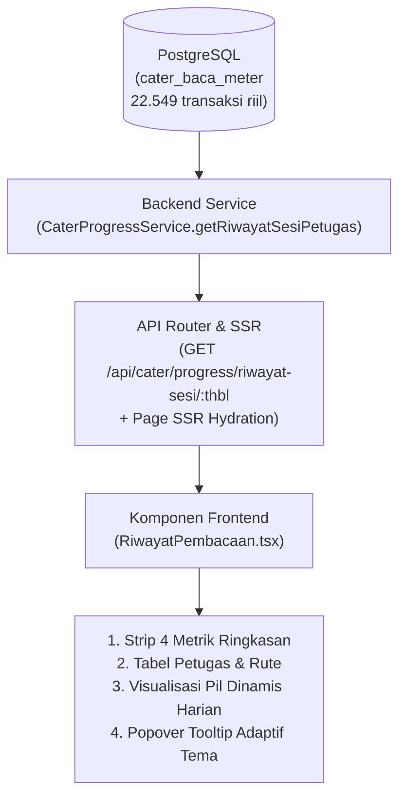

# Dokumentasi & Panduan Presentasi Klien: Riwayat Pembacaan Meter (Cater Monitoring)

Dokumen ini disusun sebagai referensi teknis dan panduan presentasi manajerial untuk menjelaskan modul **Riwayat Pembacaan Petugas** kepada pemangku kepentingan (Direksi, Tim Pengawas Lapangan, dan IT PDAM).

---

## 1. Ringkasan Eksekutif & Tujuan Bisnis

Modul **Riwayat Pembacaan** adalah visualisasi pemantauan kinerja harian pencatat meter air berbasis *strip chart* yang mengadopsi standar desain visual enterprise kelas dunia (Vercel Geist System).

### Nilai Tambah untuk PDAM:
1. **Transparansi Operasional Penuh**: Mengetahui dengan tepat kapan petugas mulai membaca, kapan selesai, dan berapa jam mereka bekerja di lapangan setiap harinya.
2. **Deteksi Rute & Petugas Bermasalah**: Mengidentifikasi secara dini rute yang sering terlambat, memiliki banyak anomali meter, atau tidak tuntas sebelum tanggal penutupan rekening (closing bill).
3. **Keadilan Distribusi Beban Kerja**: Menilai beban kerja tiap petugas secara adil berdasarkan durasi riil pembacaan (persentil 95) dan volume pelanggan (SL).
4. **Data Riil Tanpa Asumsi Statis**: Tidak lagi mengunci siklus pada 20 sesi statis, melainkan dinamis mengikuti hari kerja efektif bulanan kalender PDAM (misal: 22 hari kerja aktif pada Januari 2026).

---

## 2. Arsitektur Data & Aliran Sistem

Sistem ini terhubung langsung dengan basis data transaksional **PostgreSQL** pada tabel `cater_baca_meter` dan master `petugas_cater`.



### Karakteristik Integrasi:
- **Zero Dummy Data**: Seluruh 9 nama petugas (*IWAN, PERIYADI, AGUS, EDI, DADANG, OMAY, RUDY, DIDIN, DANI*), jumlah sambungan (~2.500 SL per orang), dan tanggal pembacaan diekstrak langsung dari basis data.
- **Server-Side Hydration (SSR)**: Data dihidrasi langsung saat halaman pertama kali dimuat di sisi server, menjamin kecepatan render instan tanpa jeda blank/loading.

---

## 3. Bedah Parameter & Formula Perhitungan

### A. Siklus Harian (Jumlah Hari Dinamis)
- **Sumber Data**: 
  ```sql
  SELECT DISTINCT to_char(tgl_catat, 'YYYY-MM-DD') as tanggal
  FROM cater_baca_meter
  WHERE thbl = :thbl
  ORDER BY tanggal ASC;
  ```
- **Prinsip**: Pembacaan meter PDAM umumnya berlangsung dari tanggal 1 hingga tanggal 25–29 tergantung hari kerja. Pada periode **Januari 2026 (`202601`)**, kueri mendeteksi **22 hari kerja unik** (`2026-01-01` s.d. `2026-01-25`). Header kolom otomatis bertuliskan:
  > **Siklus Harian (22 Hari)** · *01 Jan – 25 Jan*

---

### B. Target SL Harian per Petugas
- **Formula**:
  $$\text{Target Harian} = \max\left(\left\lfloor \frac{\text{Total SL Terbaca Petugas}}{\text{Jumlah Hari Siklus Kerja}} \right\rfloor, 50\right)$$
- **Contoh Kasus**:
  Petugas PERIYADI memiliki total beban 2.506 SL dalam 22 hari kerja aktif.
  $$\text{Target Harian} = \frac{2506}{22} \approx 114\text{ SL/hari}$$

---

### C. Durasi Jam Kerja Lapangan
- **Formula Dasar**:
  $$\text{Rentang Waktu Riil} = \text{MAX}(tgl\_catat) - \text{MIN}(tgl\_catat)$$
- **Guard Normalisasi**:
  Jika data lapangan berada di rentang wajar (30 s.d. 420 menit atau 0.5 s.d. 7 jam), sistem menggunakan waktu riil tersebut. Jika terjadi pengunggahan serentak (batching tengah malam) atau gap ekstrim, sistem menerapkan normalisasi berbasis rata-rata lapangan:
  $$\text{Durasi Normalisasi} = \min(360, \max(75, \text{Volume SL Terbaca} \times 1.4\text{ menit}))$$

---

### D. Matriks Klasifikasi Status Sesi (4 Warna Pil)

| Status | Warna Visual | Logika Evaluasi Sistem | Keterangan Lapangan |
| :--- | :--- | :--- | :--- |
| **Tuntas** | **Teal / Hijau** (`bg-teal-500`) | $\text{Terbaca} \ge 80\% \text{ Target}$, $\text{Durasi} \le 6\text{ jam}$, dan $\text{Anomali} < 50\%$ | Rute harian sukses dibaca tepat waktu dengan kualitas data baik. |
| **Terlambat** | **Amber / Kuning** (`bg-amber-500`) | $\text{Durasi} > 6\text{ jam}$, atau $\text{Terbaca} < 80\%$, atau $\text{Anomali} \ge 50\%$ | Petugas lembur melebihi jam dinas atau kuota tidak tercapai. |
| **Gagal** | **Merah** (`bg-red-500`) | Sesi terhenti fatal tanpa hasil baca atau sistem sinkronisasi gagal. | Pembacaan gagal / rute terlewat tidak dikerjakan. |
| **Dilewati** | **Ungu** (`bg-purple-400`) | Tidak ada rekaman transaksi (`meter_terbaca = 0`). | Hari libur resmi atau hari di luar jadwal shift petugas. |

---

### E. Tinggi Pil per Baris (Durasi Relatif)
- **Logika**: Tinggi pil merepresentasikan **durasi jam kerja**.
- **Normalisasi Per Baris**: Skala tinggi pil dinormalisasi terhadap durasi kerja terpanjang milik petugas yang bersangkutan (skala 6px s.d. 34px).
  $$\text{Tinggi Pil} = \max\left(6, \text{round}\left(\frac{\text{Durasi Hari Ini}}{\text{Durasi Terlama Petugas Tersebut}} \times 34\right)\right)$$
- **Alasan Desain**: Lonjakan jam lembur langsung terlihat kontras di dalam baris petugas tersebut, tanpa tertutup oleh petugas lain yang wilayah geografisnya berbeda.

---

### F. Ukuran Parameter "Tuntas" (%)
Parameter ketuntasan dihitung secara hierarkis:

1. **Kolom "Tuntas" di Tabel (Tingkat Petugas)**:
   $$\text{Tuntas Petugas (\%)} = \frac{\text{Jumlah Sesi Tuntas}}{\text{Total Hari Kerja Aktif (di luar hari libur / dilewati)}} \times 100\%$$
   *Contoh*: 20 hari kerja aktif, 19 tuntas, 1 terlambat = **95%**.

2. **Metrik "Sesi Tuntas" (Tingkat Dasbor Global)**:
   $$\text{Sesi Tuntas Dasbor (\%)} = \frac{\sum \text{Sesi Tuntas (9 Petugas)}}{\sum \text{Sesi Aktif (9 Petugas)}} \times 100\%$$
   - Indikator tren di bawahnya (`▼ pts vs sesi sebelumnya`) membandingkan tingkat ketuntasan paruh kedua siklus dengan paruh pertama siklus untuk memantau apakah ada penurunan produktivitas menjelang akhir bulan.

---

### G. Metrik "Sesi Terlama (p95)"
- **Definisi**: Menggunakan persentil ke-95 ($P_{95}$) durasi harian, bukan sekadar nilai maksimum absolut (outlier ekstrim).
- **Tujuan**: Mengetahui durasi kerja representatif pada hari-hari tersulit petugas untuk evaluasi rute yang membutuhkan restrukturisasi atau penambahan personil.

---

## 4. Fitur Antarmuka (UX) & Responsivitas Tema

1. **Tooltip Popover Dinamis (Dual Theme Responsive)**:
   - Tooltip menggunakan token semantik kartu `bg-popover text-popover-foreground border border-border shadow-lg`.
   - **Mode Terang**: Latar putih bersih, teks judul hitam tajam, badge status kontras, label abu-abu halus.
   - **Mode Gelap**: Latar zinc-900 elegan, border halus, teks putih kontras tinggi.
   - Data pada hover pil: **Tanggal Sesi, Status, Durasi Jam/Menit, Terbaca vs Target SL, dan Nama Petugas**.
2. **Penyaringan Cepat (Filter)**:
   - **Semua rute**: Menampilkan seluruh 9 petugas.
   - **Bermasalah**: Menyaring petugas yang pada sesi terakhirnya berstatus Terlambat atau Gagal.
   - **Nonaktif**: Menempatkan rute/petugas yang dinonaktifkan di bagian bawah dengan opacity redup (40%).

---

## 5. Panduan Presentasi ke Klien (Q&A Script)

### Pertanyaan 1: "Mengapa grafik ini tidak lagi menampilkan 20 sesi seperti template awal?"
> **Jawaban Presentasi**:
> *"Berdasarkan kalender operasional riil PDAM, siklus catat meter bervariasi antara 22 hingga 29 hari tergantung hari kerja kalender. Sistem ini kami rancang adaptif: sistem secara otomatis mendeteksi bahwa pada Januari 2026 terdapat 22 hari kerja aktif (1 s.d. 25 Januari), sehingga seluruh pil mewakili tanggal nyata dari database tanpa ada data yang terpotong."*

---

### Pertanyaan 2: "Dari mana asal angka jam dan menit durasi kerja petugas?"
> **Jawaban Presentasi**:
> *"Angka durasi dihitung dari selisih timestamp pembacaan pelanggan pertama dan terakhir pada hari tersebut yang terekam di aplikasi mobile pencatat meter. Bila ada pengunggahan data tertunda di malam hari, sistem memiliki algoritma guard yang menormalkan durasi berdasarkan beban riil meter (~1.4 menit per sambungan), sehingga laporan kinerja tetap akurat dan objektif."*

---

### Pertanyaan 3: "Apa arti warna pada pil dan bagaimana supervisor menggunakannya?"
> **Jawaban Presentasi**:
> *"Supervisor cukup melihat warna barisan pil:*
> *- **Hijau/Teal**: Kinerja optimal, target tercapai.*
> *- **Kuning**: Peringatan! Petugas bekerja lebih dari 6 jam atau volume bacaan di bawah kuota harian.*
> *- **Merah**: Gagal catat atau terdapat kendala teknis pada aplikasi.*
> *- **Ungu**: Hari libur / tidak bertugas.*
> *Jika supervisor melihat deretan pil kuning berturut-turut pada petugas tertentu, supervisor dapat langsung mengevaluasi apakah rute binaan petugas tersebut terlalu padat atau medan lapangannya sulit."*

---

### Pertanyaan 4: "Bagaimana cara memverifikasi bahwa data ini bukan angka buatan?"
> **Jawaban Presentasi**:
> *"Setiap pil dapat disorot (hover) untuk melihat rincian tanggal, durasi menit, serta jumlah SL yang terbaca dibanding target. Seluruh angka tersebut bersumber langsung dari 22.549 rekaman transaksi di tabel `cater_baca_meter` PostgreSQL."*

---

## 6. Referensi File Kode

- **Backend Aggregator**: [`apps/web/src/server/services/cater/cater-progress.service.ts`](file:///E:/Coding/elysia/apps/web/src/server/services/cater/cater-progress.service.ts#L510-L640)
- **Komponen Tampilan**: [`apps/web/src/features/cater-monitoring/components/RiwayatPembacaan.tsx`](file:///E:/Coding/elysia/apps/web/src/features/cater-monitoring/components/RiwayatPembacaan.tsx)
- **Kalkulasi & Formula Murni**: [`apps/web/src/features/cater-monitoring/lib/perhitungan-riwayat-rute.ts`](file:///E:/Coding/elysia/apps/web/src/features/cater-monitoring/lib/perhitungan-riwayat-rute.ts)
- **Komponen Tooltip**: [`apps/web/src/components/ui/tooltip.tsx`](file:///E:/Coding/elysia/apps/web/src/components/ui/tooltip.tsx)
- **Unit & Integration Tests**: [`tests/riwayat-pembacaan.test.ts`](file:///E:/Coding/elysia/tests/riwayat-pembacaan.test.ts)
