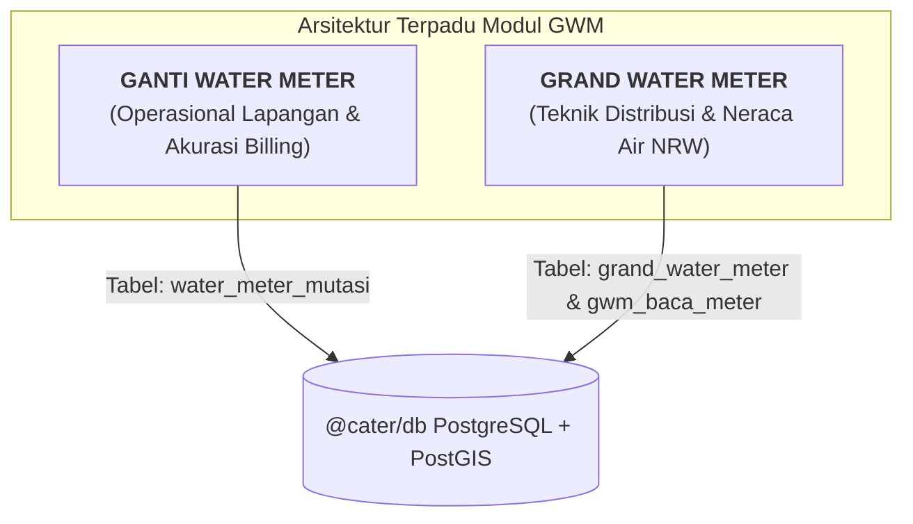

# Domain Context: Dual-Role GWM di Sistem Cater (Perumda Tirtawening)

Dokumen ini menjelaskan secara komprehensif peran, arsitektur, dan implementasi modul **GWM** di aplikasi Baca Meter (Cater).

---

## 1. Latar Belakang & Dua Sisi Makna GWM

Di aplikasi terdahulu (**Aurora Mobile**) dan menu sistem lama, terdapat menu:
- `Tools 7.2: Import Stand Angkat`
- `Tools 7.6: Import Backup Photo GWM`
- `Tools 7.10: Import Data GWM`

Melalui riset teknis dan konfirmasi operasional staf PDAM, singkatan **GWM** memiliki dua fungsi penting yang saling melengkapi:

---

## 2. Bagian 1: GWM sebagai "GANTI WATER METER" (Mutasi Fisik Meter)

### A. Urgensi Bisnis
Ketika meter air pelanggan mengalami kelainan fisik:
- `7` : **MATI ADA AIR** (Macet)
- `O` : **METER RUSAK**
- `6` : **BMK/BMB** (Buram)
- `3` : **MTA** (Meter Tak Ada / Hilang)
- Pelaksanaan **Tera Ulang** berkala (kewajiban metrologi)

Petugas teknisi lapangan melakukan penggantian unit meter. Tanpa modul GWM, sistem penagihan akan membaca angka meter baru (misal stand $5\text{ m}^3$) lebih rendah dibanding stand lama (misal $1.520\text{ m}^3$), berakibat **anomali kubikasi negatif, taksasi keliru, dan komplain rekening**.

### B. Rumus Presisi Perhitungan Kubikasi Ganti Meter
Dalam 1 periode penagihan di mana terjadi pergantian meter, kubikasi air dihitung dengan rumus baku:

$$\text{Total Kubikasi Bulan Ini} = (\text{Stand Angkat} - \text{Stand Lalu}) + (\text{Stand Baca Baru} - \text{Stand Pasang})$$

- **Stand Angkat**: Angka meteran terakhir pada meter lama sebelum dicabut.
- **Stand Pasang**: Angka meteran awal saat meter baru dipasang (biasanya $0\text{ m}^3$).
- **Stand Lalu**: Stand pembacaan resmi bulan sebelumnya.
- **Stand Baca Baru**: Stand pembacaan resmi pada meter baru oleh petugas cater bulan ini.

### C. Skema Database Drizzle: `water_meter_mutasi`
Lokasi: [`packages/db/src/schema/gwm.ts`](file:///C:/Users/DESKTOP/Documents/elysia/packages/db/src/schema/gwm.ts)

Field-field utama:
- `nolg`: Nomor Langganan pelanggan PDAM.
- `periode`: Periode THBL (e.g. `202601`).
- `alasan`: Enum (`RUSAK`, `MATI`, `BURAM`, `HILANG`, `TERA_ULANG`, `UKURAN_BERUBAH`, `LAINNYA`).
- **Data Meter Lama**: `noMeterLama`, `standAngkat`, `fotoStandAngkat`.
- **Data Meter Baru**: `noMeterBaru`, `merkBaru`, `ukuranBaru`, `standPasang`, `noSegelBaru`, `fotoMeterBaru`.
- **Audit & Verifikasi**: `petugasPasang`, `verifikatorId` (Supervisor V1), `statusVerifikasi` (`PENDING`, `APPROVED`, `REJECTED`), `tglVerifikasi`.

---

## 3. Bagian 2: GWM sebagai "GRAND WATER METER" (Meter Induk DMA & Neraca Air)

### A. Urgensi Bisnis
Untuk mengendalikan tingkat kehilangan air (*Non-Revenue Water* / NRW), PDAM memasang meter air induk berdiameter besar ($4"-12"$) di pintu masuk setiap Distrik Meter Area (DMA) atau zona distribusi jaringan perpipaan.

### B. Fungsi Analitik (Water Balance)
$$\text{Kehilangan Air (NRW)} = \text{Total Debit GWM Induk} - \sum \text{Total Pemakaian Meter Pelanggan di Zona}$$

Jika selisihnya melebihi ambang batas toleransi (misal $> 20\%$), sistem menandai zona tersebut mengalami potensi kebocoran pipa bawah tanah atau pencurian air (*illegal tapping*).

### C. Skema Database Drizzle: `grand_water_meter` & `gwm_baca_meter`
Lokasi: [`packages/db/src/schema/gwm.ts`](file:///C:/Users/DESKTOP/Documents/elysia/packages/db/src/schema/gwm.ts)

1. **`grand_water_meter`**:
   - `kodeGwm`: Kode unik alat (e.g. `GWM-PW5-001`).
   - `nama`: Nama unit intake / DMA (e.g. `Master Meter Intake Cibeunying`).
   - `zonaKode`: Relasi ke tabel `zona_distribusi`.
   - `dmaKode`, `ukuranPipa`, `titikLokasi` (PostGIS Point 4326).
2. **`gwmBacaMeter`**:
   - `gwmId`: Relasi ke `grand_water_meter`.
   - `periode`: THBL (e.g. `202601`).
   - `standAwal`, `standAkhir`.
   - `totalDebitM3`: $\text{standAkhir} - \text{standAwal}$ (Volume debit total air masuk zona).
   - `petugasId`, `fotoStand`, `titikLokasi`.

---

## 4. Status Pengujian & Migrasi

- **Migrasi SQL**: [`0005_happy_charles_xavier.sql`](file:///C:/Users/DESKTOP/Documents/elysia/packages/db/src/migrations/0005_happy_charles_xavier.sql)
- **Unit Test Skema**: [`tests/fase1-schema.test.ts`](file:///C:/Users/DESKTOP/Documents/elysia/tests/fase1-schema.test.ts) & [`tests/cater-schema.test.ts`](file:///C:/Users/DESKTOP/Documents/elysia/tests/cater-schema.test.ts)
- **Status Test**: **22 pass / 0 fail** (100% lulus uji integritas relasi dan foreign key).
