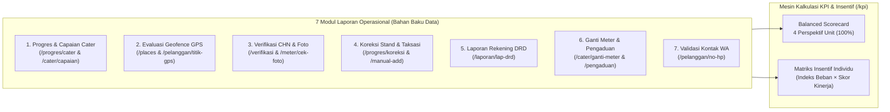

# MATERI PRESENTASI EKSEKUTIF (POWERPOINT DECK)

## Sistem Key Performance Indicator (KPI) & Formulasi Insentif Berbasis Beban Kerja dan Capaian Target M2C

**Perumda Air Minum Tirtawening Kota Bandung — Platform Smart Billing & Meter-to-Cash (M2C)**

---

## SLIDE 1: JUDUL PRESENTASI

- **Judul Utama**: Formulasi KPI & Sistem Insentif Berbasis Beban Kerja & Capaian Target Operasional
- **Subjudul**: Transformasi Evaluasi Kinerja Objektif Berbasis Data Riil Sistem M2C (Meter-to-Cash)
- **Penyusun**: Tim Transformasi Digital & Operasional M2C
- **Poin Kunci Slide**:
  - 100% berbasis data transaksi riil yang terekam otomatis di sistem (Zero Manual Manipulation).
  - Menggabungkan keadilan **Beban Kerja (Workload Volume)** dan **Kualitas Capaian (Quality & SLA)**.

---

## SLIDE 2: LATAR BELAKANG & PERMASALAHAN (MENGAPA PERLU METODE BARU?)

- **Masalah pada Metode Konvensional**:
  1. **Ketidakadilan Beban Kerja**: Petugas dengan rute padat/berat (misal `2.200 SL`) dinilai sama dengan petugas rute ringan (`1.200 SL`) jika hanya melihat persentase selesai (`100%`).
  2. **Fokus Kuantitas Mengorbankan Kualitas**: Petugas mengejar target jumlah bacaan dengan melakukan _tembak angka_ di luar lokasi GPS atau mengunggah foto buram, yang akhirnya membebani tim koreksi dan memicu keluhan pelanggan.
  3. **Penilaian Subjektif & Manual**: Rekapitulasi kinerja bulanan memakan waktu lama dan rawan selisih data.
- **Solusi Sistem M2C Baru**:
  - Seluruh aktivitas di laporan aplikasi (**Progres Cater, Verifikasi CHN, Radar Anomali, Geofence GPS, Koreksi Stand, DRD, dan Kelengkapan Pelanggan**) otomatis dikonversi menjadi **Skor KPI & Indeks Insentif**.

---

## SLIDE 3: ARSITEKTUR SUMBER DATA KPI (SINGLE SOURCE OF TRUTH)

Seluruh indikator KPI ditarik langsung dari 7 modul laporan yang sudah berjalan di sistem:

---

## SLIDE 4: EMPAT PERSPEKTIF BALANCED SCORECARD UNIT (BOBOT 100%)

|  No   | Perspektif / Tahapan M2C                                          |  Bobot  | Sasaran Utama                                                                                                        | Sumber Laporan Sistem                                            |
| :---: | :---------------------------------------------------------------- | :-----: | :------------------------------------------------------------------------------------------------------------------- | :--------------------------------------------------------------- |
| **1** | **Pencatatan Meter Lapangan** _(Petugas Pencatat)_                | **35%** | Keterbacaan rute fisik (_Read Rate_), kepatuhan titik GPS (`≤ 50m`), dan laju produktivitas harian (LPS).            | `/progres/cater`, `/cater/capaian`, `/places`                    |
| **2** | **Verifikasi & Screening Anomali** _(Supervisor V1 & Manager V2)_ | **30%** | Kecepatan verifikasi bacaan harian, penyelesaian audit anomali (ekstrem/nol/turun), dan akurasi foto.                | `/verifikasi/baca-petugas`, `/progres/audit`, `/progres/ekstrim` |
| **3** | **Closing & Penagihan DRD** _(Staff Billing & Senior Manager V3)_ | **20%** | Kesiapan kunci billing (_Locked Billing_), pencapaian target kubikasi air ($m^3$), dan pengendalian taksasi/koreksi. | `/laporan/lap-drd`, `/progres/koreksi`, `/pelanggan/manual-add`  |
| **4** | **Master Data & Respons Layanan** _(Langganan & Distribusi)_      | **15%** | Kelengkapan Geotagging GPS pelanggan, validasi nomor WhatsApp aktif, dan tindak lanjut ganti meter (GWM).            | `/pelanggan/titik-gps`, `/pelanggan/no-hp`, `/cater/ganti-meter` |

---

## SLIDE 5: RINCIAN 11 INDIKATOR KPI & RUMUS PERHITUNGANNYA

### A. Perspektif 1: Pencatatan Meter Lapangan (35%)

1. **Tingkat Keterbacaan Rute Fisik / Read Rate (Bobot 40% | Arah $\uparrow$)**
   $$\text{Read Rate} = \left(\frac{\text{Total SL Terbaca Periode Berjalan}}{\text{Total Target SL Aktif dalam Rute}}\right) \times 100\%$$
   _(Baseline: 91,0% | Target: 98,5%)_
2. **Kepatuhan Koordinat GPS Pelanggan / Geofence $\le 50\text{m}$ (Bobot 35% | Arah $\uparrow$)**
   $$\text{Akurasi GPS} = \left(\frac{\text{Jumlah Bacaan dengan Deviasi Jarak GPS } \le 50\text{m}}{\text{Total SL Terbaca}}\right) \times 100\%$$
   _(Baseline: 74,0% | Target: 95,0%)_
3. **Produktivitas Harian Petugas / LPS (Bobot 25% | Arah $\uparrow$)**
   $$\text{LPS Harian} = \frac{\text{Total SL Terbaca}}{\text{Jumlah Petugas Aktif} \times \text{Hari Kerja Efektif}}$$
   _(Baseline: 150 SL/hari | Target: 220 SL/hari)_

### B. Perspektif 2: Verifikasi & Screening Anomali (30%)

4. **Tingkat Penyelesaian Verifikasi Bacaan V1 Supervisor (Bobot 40% | Arah $\uparrow$)**
   $$\text{Verifikasi V1} = \left(\frac{\text{Bacaan Berstatus Verified / Approved}}{\text{Total Bacaan Masuk}}\right) \times 100\%$$
5. **Resolusi Investigasi Anomali & Cek Ulang Lapangan (Bobot 30% | Arah $\uparrow$)**
   $$\text{Resolusi Anomali} = \left(\frac{\text{Kasus Anomali yang Telah Divalidasi}}{\text{Total Temuan Anomali Kubikasi}}\right) \times 100\%$$
6. **Kualitas Bacaan Tanpa Koreksi / First-Time Right (Bobot 30% | Arah $\uparrow$)**
   $$\text{First-Time Right} = 100\% - \left(\frac{\text{Jumlah Rekening yang Mengalami Revisi/Koreksi Stand}}{\text{Total SL Terbaca}}\right) \times 100\%$$

### C. Perspektif 3: Closing & Penagihan DRD (20%)

7. **Kesiapan Kunci Billing / Locked Billing Readiness (Bobot 35% | Arah $\uparrow$)**
8. **Capaian Realisasi Kubikasi Air Terjual vs Target $m^3$ (Bobot 35% | Arah $\uparrow$)**
9. **Pengendalian Rasio Taksasi / Manual ADD (Bobot 30% | Arah $\downarrow$ Makin Rendah Makin Baik)**

### D. Perspektif 4: Kelengkapan Spasial & Respons Layanan (15%)

10. **Cakupan Geotagging Titik GPS Master Pelanggan (Bobot 50% | Arah $\uparrow$)**
11. **Cakupan Validasi Nomor WhatsApp E-Billing Pelanggan (Bobot 50% | Arah $\uparrow$)**

---

## SLIDE 6: RUMUS PEMBERIAN INSENTIF INDIVIDU (BEBAN KERJA $\times$ CAPAIAN)

Untuk memastikan keadilan antara petugas dengan beban rute besar dan kecil, perhitungan insentif individu menggunakan **3 Komponen Matematis**:

### 1. Indeks Beban Kerja ($I_{\text{beban}}$)

Mengukur rasio beban sambungan (SL) yang diampu seorang petugas terhadap rata-rata beban seluruh petugas:
$$I_{\text{beban}} = \text{Clamp}\left(\frac{\text{Target SL Petugas}}{\text{Rata-rata Target SL Seluruh Petugas}}, \; 0.70, \; 1.40\right)$$

- Jika rata-rata beban adalah `1.500 SL` dan Petugas A memegang `1.800 SL`, maka $I_{\text{beban}} = 1,20\times$ (mendapat pengali beban +20%).

### 2. Skor Komposit Kinerja Individu ($S_{\text{kinerja}}$)

Menggabungkan 4 dimensi kinerja dari laporan sistem (skala $0 - 100$):
$$S_{\text{kinerja}} = (40\% \times \text{Capaian SL}) + (25\% \times \text{Akurasi GPS}) + (20\% \times \text{Kualitas Bebas Anomali/Revisi}) + (15\% \times \text{Skor Kecepatan Baca})$$

### 3. Pengali Tier Grade Kinerja ($M_{\text{grade}}$)

|    Grade    | Rentang Skor ($S_{\text{kinerja}}$) | Status Kinerja                 | Pengali Insentif ($M_{\text{grade}}$) | Keterangan Kebijakan                               |
| :---------: | :---------------------------------: | :----------------------------- | :-----------------------------------: | :------------------------------------------------- |
| **Grade A** |           **$\ge 90,0$**            | Sangat Baik (_Star Performer_) |      **$110\%$ ($1,10\times$)**       | Bonus prestasi penuh + apresiasi kualitas          |
| **Grade B** |          **$75,0 - 89,9$**          | Baik (_On Target_)             |      **$100\%$ ($1,00\times$)**       | Insentif standar sesuai target                     |
| **Grade C** |          **$60,0 - 74,9$**          | Cukup (_Perlu Peningkatan_)    |       **$65\%$ ($0,65\times$)**       | Insentif proporsional (terpotong penalti kualitas) |
| **Grade D** |            **$< 60,0$**             | Kurang (_Pembinaan_)           |       **$0\%$ ($0,00\times$)**        | Tidak memenuhi ambang batas minimal insentif       |

---

## SLIDE 7: FORMULA NOMINAL RUPIAH INSENTIF (TRANSPARAN & FLEKSIBEL)

Manajemen dapat menggunakan kombinasi **Pagu Insentif Dasar** + **Insentif Variabel per SL Valid**:

$$\text{Total Insentif Diterima (Rp)} = \Big(\text{Insentif Dasar} + (\text{SL Valid Terbaca} \times \text{Tarif per SL})\Big) \times I_{\text{beban}} \times M_{\text{grade}}$$

### Contoh Simulasi Nyata:

- **Parameter Perusahaan**: Insentif Dasar = `Rp 500.000`, Tarif per SL = `Rp 400 / SL`, Rata-rata Beban = `1.500 SL`.
- **Petugas A (Beban Tinggi & Kualitas Prima)**:
  - Target: `1.800 SL` ($I_{\text{beban}} = 1,20\times$), Terbaca: `1.780 SL` (`98,9%`), Akurasi GPS: `96%`, Skor KPI: `95,2` (**Grade A** $\rightarrow M_{\text{grade}} = 1,10\times$).
  - $\text{Basis} = \text{Rp } 500.000 + (1.780 \times \text{Rp } 400) = \text{Rp } 1.212.000$.
  - $\text{Total Insentif} = \text{Rp } 1.212.000 \times 1,20 \times 1,10 = \mathbf{\text{Rp } 1.599.840}$.
- **Petugas B (Beban Standar & Kualitas Cukup)**:
  - Target: `1.500 SL` ($I_{\text{beban}} = 1,00\times$), Terbaca: `1.100 SL` (`73,3%`), Akurasi GPS: `70%`, Skor KPI: `68,5` (**Grade C** $\rightarrow M_{\text{grade}} = 0,65\times$).
  - $\text{Basis} = \text{Rp } 500.000 + (1.100 \times \text{Rp } 400) = \text{Rp } 940.000$.
  - $\text{Total Insentif} = \text{Rp } 940.000 \times 1,00 \times 0,65 = \mathbf{\text{Rp } 611.000}$.

---

## SLIDE 8: DAMPAK & MANFAAT BAGI PERUSAHAAN

1. **Objektivitas & Transparansi 100%**: Petugas dan supervisor dapat melihat langsung komponen pembentuk skor mereka dari hasil kerja harian di aplikasi.
2. **Penurunan Drastis Kasus Koreksi Rekening & Komplain**: Karena komponen _Akurasi GPS_ (`25%`) dan _Kualitas Tanpa Revisi_ (`20%`) mengunci nilai insentif, petugas terdorong mencatat di lokasi sebenarnya dengan foto jelas.
3. **Keadilan Distribusi Rute**: Petugas yang ditugaskan di rute padat/berat mendapatkan kompensasi otomatis melalui **Indeks Beban Kerja ($I_{\text{beban}}$)**.
4. **Kecepatan Tutup Buku Bulanan (DRD)**: Target SLA verifikasi berjenjang V1/V2 terukur secara harian sehingga tidak ada penumpukan antrean di akhir bulan.
