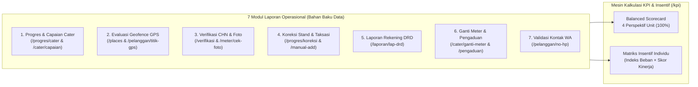
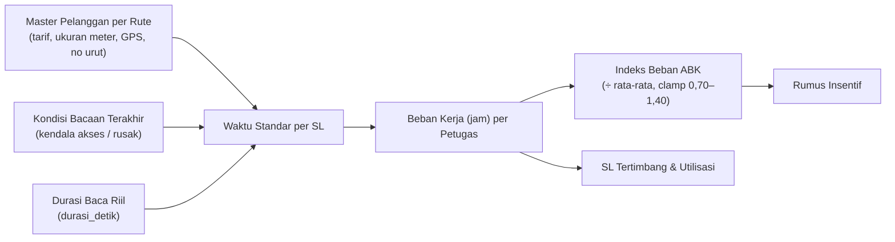

# MATERI PRESENTASI EKSEKUTIF (POWERPOINT DECK)

## Sistem Key Performance Indicator (KPI) & Formulasi Insentif Berbasis Beban Kerja dan Capaian Target M2C

**Perumda Air Minum Tirtawening Kota Bandung — Platform Smart Billing & Meter-to-Cash (M2C)**

---

## SLIDE 1: JUDUL PRESENTASI

- **Judul Utama**: Formulasi KPI & Sistem Insentif Berbasis Beban Kerja & Capaian Target Operasional
- **Subjudul**: Transformasi Evaluasi Kinerja Objektif Berbasis Data Riil Sistem M2C (Meter-to-Cash)
- **Penyusun**: Tim Transformasi Digital & Operasional M2C
- **Poin Kunci Slide**:
  - 100% berbasis data transaksi riil yang terekam otomatis di sistem (Zero Manual Manipulation).
  - Menggabungkan keadilan **Beban Kerja (Workload Volume)** dan **Kualitas Capaian (Quality & SLA)**.

---

## SLIDE 2: LATAR BELAKANG & PERMASALAHAN (MENGAPA PERLU METODE BARU?)

- **Masalah pada Metode Konvensional**:
  1. **Ketidakadilan Beban Kerja**: Petugas dengan rute padat/berat (misal `2.200 SL`) dinilai sama dengan petugas rute ringan (`1.200 SL`) jika hanya melihat persentase selesai (`100%`).
  2. **Fokus Kuantitas Mengorbankan Kualitas**: Petugas mengejar target jumlah bacaan dengan melakukan _tembak angka_ di luar lokasi GPS atau mengunggah foto buram, yang akhirnya membebani tim koreksi dan memicu keluhan pelanggan.
  3. **Penilaian Subjektif & Manual**: Rekapitulasi kinerja bulanan memakan waktu lama dan rawan selisih data.
- **Solusi Sistem M2C Baru**:
  - Seluruh aktivitas di laporan aplikasi (**Progres Cater, Verifikasi CHN, Radar Anomali, Geofence GPS, Koreksi Stand, DRD, dan Kelengkapan Pelanggan**) otomatis dikonversi menjadi **Skor KPI & Indeks Insentif**.

---

## SLIDE 3: ARSITEKTUR SUMBER DATA KPI (SINGLE SOURCE OF TRUTH)

Seluruh indikator KPI ditarik langsung dari 7 modul laporan yang sudah berjalan di sistem:

---

## SLIDE 4: EMPAT PERSPEKTIF BALANCED SCORECARD UNIT (BOBOT 100%)

|  No   | Perspektif / Tahapan M2C                                          |  Bobot  | Sasaran Utama                                                                                                        | Sumber Laporan Sistem                                            |
| :---: | :---------------------------------------------------------------- | :-----: | :------------------------------------------------------------------------------------------------------------------- | :--------------------------------------------------------------- |
| **1** | **Pencatatan Meter Lapangan** _(Petugas Pencatat)_                | **35%** | Keterbacaan rute fisik (_Read Rate_), kepatuhan titik GPS (`≤ 50m`), dan laju produktivitas harian (LPS).            | `/progres/cater`, `/cater/capaian`, `/places`                    |
| **2** | **Verifikasi & Screening Anomali** _(Supervisor V1 & Manager V2)_ | **30%** | Kecepatan verifikasi bacaan harian, penyelesaian audit anomali (ekstrem/nol/turun), dan akurasi foto.                | `/verifikasi/baca-petugas`, `/progres/audit`, `/progres/ekstrim` |
| **3** | **Closing & Penagihan DRD** _(Staff Billing & Senior Manager V3)_ | **20%** | Kesiapan kunci billing (_Locked Billing_), pencapaian target kubikasi air ($m^3$), dan pengendalian taksasi/koreksi. | `/laporan/lap-drd`, `/progres/koreksi`, `/pelanggan/manual-add`  |
| **4** | **Master Data & Respons Layanan** _(Langganan & Distribusi)_      | **15%** | Kelengkapan Geotagging GPS pelanggan, validasi nomor WhatsApp aktif, dan tindak lanjut ganti meter (GWM).            | `/pelanggan/titik-gps`, `/pelanggan/no-hp`, `/cater/ganti-meter` |

---

## SLIDE 5: RINCIAN 11 INDIKATOR KPI & RUMUS PERHITUNGANNYA

### A. Perspektif 1: Pencatatan Meter Lapangan (35%)

1. **Tingkat Keterbacaan Rute Fisik / Read Rate (Bobot 40% | Arah $\uparrow$)**
   $$\text{Read Rate} = \left(\frac{\text{Total SL Terbaca Periode Berjalan}}{\text{Total Target SL Aktif dalam Rute}}\right) \times 100\%$$
   _(Baseline: 91,0% | Target: 98,5%)_
2. **Kepatuhan Koordinat GPS Pelanggan / Geofence $\le 50\text{m}$ (Bobot 35% | Arah $\uparrow$)**
   $$\text{Akurasi GPS} = \left(\frac{\text{Jumlah Bacaan dengan Deviasi Jarak GPS } \le 50\text{m}}{\text{Total SL Terbaca}}\right) \times 100\%$$
   _(Baseline: 74,0% | Target: 95,0%)_
3. **Produktivitas Harian Petugas / LPS (Bobot 25% | Arah $\uparrow$)**
   $$\text{LPS Harian} = \frac{\text{Total SL Terbaca}}{\text{Jumlah Petugas Aktif} \times \text{Hari Kerja Efektif}}$$
   _(Baseline: 150 SL/hari | Target: 220 SL/hari)_

### B. Perspektif 2: Verifikasi & Screening Anomali (30%)

4. **Tingkat Penyelesaian Verifikasi Bacaan V1 Supervisor (Bobot 40% | Arah $\uparrow$)**
   $$\text{Verifikasi V1} = \left(\frac{\text{Bacaan Berstatus Verified / Approved}}{\text{Total Bacaan Masuk}}\right) \times 100\%$$
5. **Resolusi Investigasi Anomali & Cek Ulang Lapangan (Bobot 30% | Arah $\uparrow$)**
   $$\text{Resolusi Anomali} = \left(\frac{\text{Kasus Anomali yang Telah Divalidasi}}{\text{Total Temuan Anomali Kubikasi}}\right) \times 100\%$$
6. **Kualitas Bacaan Tanpa Koreksi / First-Time Right (Bobot 30% | Arah $\uparrow$)**
   $$\text{First-Time Right} = 100\% - \left(\frac{\text{Jumlah Rekening yang Mengalami Revisi/Koreksi Stand}}{\text{Total SL Terbaca}}\right) \times 100\%$$

### C. Perspektif 3: Closing & Penagihan DRD (20%)

7. **Kesiapan Kunci Billing / Locked Billing Readiness (Bobot 35% | Arah $\uparrow$)**
8. **Capaian Realisasi Kubikasi Air Terjual vs Target $m^3$ (Bobot 35% | Arah $\uparrow$)**
9. **Pengendalian Rasio Taksasi / Manual ADD (Bobot 30% | Arah $\downarrow$ Makin Rendah Makin Baik)**

### D. Perspektif 4: Kelengkapan Spasial & Respons Layanan (15%)

10. **Cakupan Geotagging Titik GPS Master Pelanggan (Bobot 50% | Arah $\uparrow$)**
11. **Cakupan Validasi Nomor WhatsApp E-Billing Pelanggan (Bobot 50% | Arah $\uparrow$)**

---

## SLIDE 6: ANALISIS BEBAN KERJA (ABK) PENCATAT METER — DASAR KEADILAN INSENTIF

### Mengapa jumlah SL saja tidak cukup?

Dua petugas yang sama-sama memegang `2.500 SL` belum tentu memiliki beban yang sama:

- Petugas A: rute padat perumahan, meter di depan rumah, jarak antar meter ±15 m.
- Petugas B: rute niaga/industri, banyak meter di dalam bangunan/terkunci, jarak antar meter ±60 m.

Petugas B membutuhkan **waktu kerja jauh lebih banyak** untuk jumlah SL yang sama. Karena itu, mengikuti praktik umum perusahaan air minum dan metode **Analisis Beban Kerja (ABK)** yang lazim dipakai BUMD/instansi pemerintah, beban kerja diukur dalam **jam kerja yang dibutuhkan**, bukan jumlah SL mentah.

> **Catatan**: Tidak ada satu angka regulasi "SL per pencatat" yang baku secara nasional. Angka yang umum di lapangan (±150–250 SL/hari untuk area perkotaan) adalah kebiasaan industri, sehingga parameter di bawah **wajib dikalibrasi** dengan data riil perusahaan.

### Rumus ABK yang diterapkan di sistem (`/kpi` → Matriks Insentif & Faktor Medan)

$$\text{Waktu Standar per SL} = \underbrace{\Big(T_{\text{baca}} \times F_{\text{kelas}} \times F_{\text{kondisi}} \times \big[1 + 0{,}5(F_{\text{medan}}-1)\big]\Big)}_{\text{waktu manuver di titik meter}} + \underbrace{\left(\frac{\text{Jarak antar Meter}}{\text{Kecepatan Tempuh}} \times F_{\text{medan}}\right)}_{\text{waktu tempuh antar meter}}$$

$$\text{Beban Kerja (jam)} = \frac{\sum_{\text{SL di rute petugas}} \text{Waktu Standar per SL}}{3600}$$

$$\text{SL Tertimbang} = \frac{\text{Beban Kerja (detik)}}{\text{Waktu Standar SL Acuan}} \qquad I_{\text{beban}} = \text{Clamp}\left(\frac{\text{Beban Kerja Petugas}}{\text{Rata-rata Beban Kerja}},\ 0{,}70,\ 1{,}40\right)$$

$$\text{Utilisasi} = \frac{\text{Beban Kerja (jam)}}{\text{Jam Efektif/Hari} \times \text{Hari Kerja Baca}}$$

### Komponen & sumber data

| Komponen | Nilai awal (asumsi kalibrasi) | Sumber data sistem | Keterangan |
| :-- | :-- | :-- | :-- |
| $T_{\text{baca}}$ — waktu baca + foto + input | **45 detik/SL** | `cater_baca_meter.durasi_detik` (median periode) | Otomatis memakai median riil bila ≥30% bacaan memiliki durasi > 0 |
| Jarak antar meter | **25 m** (default) | Urutan titik GPS `pelanggan.titik_lokasi` per rute (`no_urut_rute`) | Dipakai bila cakupan GPS rute ≥ 60% & ≥ 10 titik; dibatasi 5–200 m |
| Kecepatan tempuh | **1,2 m/detik** (jalan kaki) | Parameter | Waktu SL acuan = 45 + 25/1,2 = **65,8 detik** |
| $F_{\text{medan}}$ — faktor topografi & akses rute | **1,00x s/d 1,40x** | Modul `/kpi/faktor-medan` (tabel `pengaturan_konten`) | Datar (1,00x), Bergelombang (1,10x), Berbukit (1,20x), Curam/Tangga (1,30x), Ekstrem (1,40x) |
| $F_{\text{kelas}}$ — kelas pelanggan | Domestik **1,0** · Niaga Kecil (3A) **1,1** · Niaga Besar/Khusus/Instansi (3B, 3C, 2B) **1,2** · Industri (4A/4B) atau meter ≥ 3/4" **1,3** | `pelanggan.tarif_kode`, `pelanggan.ukuran_meter` | Meter niaga/industri umumnya di dalam bangunan & perlu izin akses |
| $F_{\text{kondisi}}$ — kendala akses / kerusakan fisik | **1,2** | Kode kondisi bacaan terakhir (`tmss` → `master_kondisi_catat.is_kendala_akses` / kategori `KENDALA_AKSES`, `KERUSAKAN_FISIK`) | Contoh: Terhalang, Ada Anjing, Meter Rusak, Meter Terbalik |
| Kapasitas kerja | **6 jam efektif × 15 hari baca** = 90 jam/periode | Parameter | Untuk indikator utilisasi (bukan pengali insentif) |
| Batas indeks | **0,70 – 1,40** | Parameter | Mencegah ketimpangan ekstrem |

Seluruh parameter terpusat di `apps/web/src/server/services/kpi/beban-kerja.ts` (`PARAMETER_ABK`) dan dapat dikonfigurasi per rute langsung melalui halaman **`/kpi/faktor-medan`** atau Tab 3 di menu Scorecard KPI.

---

## SLIDE 7: HASIL PENERAPAN ABK PADA DATA RIIL (PERIODE NOV 2026 / THBL 202611)

| No | Petugas | Target SL | Realisasi | Beban (jam) | SL Tertimbang | Faktor Kesulitan | % SL Non-Domestik | % SL Kendala | Indeks Lama (SL) | **Indeks ABK** | Skor KPI |
| :-: | :-- | --: | --: | --: | --: | :-: | --: | --: | :-: | :-: | :-: |
| 1 | Peryadi | 2.546 | 2.545 | 49,5 | 2.707 | 1,06 | 20,9% | 27,8% | 1,02 | **1,02** | 98,5 |
| 2 | Agus Gantina H. | 2.527 | 2.336 | 50,7 | 2.774 | 1,10 | 30,9% | 15,4% | 1,01 | **1,05** | 95,5 |
| 3 | Isa Septian (EDI) | 2.525 | 2.301 | 47,2 | 2.580 | 1,02 | 8,3% | 9,7% | 1,01 | **0,98** | 94,9 |
| 4 | Iwan Sudirman | 2.541 | 2.196 | 49,0 | 2.682 | 1,06 | 20,9% | 21,8% | 1,02 | **1,02** | 93,1 |
| 5 | Omay | 2.498 | 2.133 | 47,7 | 2.610 | 1,04 | 16,6% | 17,9% | 1,00 | **0,99** | 92,7 |
| 6 | Dani Budiman | 2.450 | 1.944 | 47,5 | 2.598 | 1,06 | 26,4% | 20,0% | 0,98 | **0,98** | 90,2 |
| 7 | Didin Rosidin | 2.463 | 1.740 | 47,0 | 2.571 | 1,04 | 21,5% | 12,5% | 0,98 | **0,97** | 86,7 |
| 8 | Dadang Sopyan | 2.491 | 1.383 | 48,6 | 2.660 | 1,07 | 26,2% | 10,0% | 1,00 | **1,01** | 80,7 |
| 9 | Rudy Kurnia | 2.490 | 1.156 | 47,3 | 2.589 | 1,04 | 18,8% | 11,6% | 0,99 | **0,98** | 77,1 |

_Rata-rata beban: **48,3 jam/petugas** · Total 22.531 SL = **23.771 SL tertimbang** · Utilisasi ±52–56% dari kapasitas 90 jam._
_Catatan: periode Nov 2026 masih berjalan, sehingga kondisi meter acuan diambil dari bacaan yang sudah masuk._

### Interpretasi

1. **Distribusi rute saat ini sudah relatif merata** (2.450–2.546 SL/petugas), sehingga indeks beban hanya bergerak di rentang **0,97–1,05**. Ini kabar baik dari sisi keadilan pembagian rute.
2. **ABK menggeser urutan beban**: Agus (30,9% pelanggan non-domestik, jarak tempuh lebih panjang) naik dari 1,01 → **1,05**, sedangkan EDI (rute dominan rumah tangga, kendala rendah) turun dari 1,01 → **0,98**. Indeks lama berbasis SL tidak bisa membedakan hal ini.
3. **Pengaruh terbesar pada insentif tetap dari Grade KPI** (pengali 0%–110%), bukan dari indeks beban (±5%). Hal ini sesuai prinsip: beban menjawab _"seberapa berat tugasnya"_, grade menjawab _"seberapa baik dikerjakan"_.

---

## SLIDE 8: TEMUAN KUALITAS DATA YANG MEMPENGARUHI KEADILAN KPI

> **Penting**: Temuan di bawah ini harus diselesaikan agar skor KPI benar-benar mencerminkan kinerja, bukan nilai pengganti (fallback).

| # | Temuan (data riil Nov 2026) | Dampak saat ini | Rekomendasi |
| :-: | :-- | :-- | :-- |
| 1 | **`durasi_detik` = 0 pada 100% bacaan** (belum terekam dari aplikasi mobile) | Skor Kecepatan (bobot 15%) otomatis 100 untuk semua petugas; waktu baca ABK memakai asumsi 45 detik | Aplikasi mobile wajib merekam durasi (buka form → simpan). Setelah tersedia, sistem otomatis memakai median riil |
| 2 | **Lokasi GPS bacaan (`lokasi_gps`) & jarak geofence (`jarak_pelanggan_meter`) kosong di 100% bacaan** | Akurasi GPS (bobot 25%) memakai nilai pengganti **94%** untuk semua petugas, sehingga pada Okt 2026 seluruh petugas memperoleh skor identik **98,5** | Wajibkan GPS saat simpan bacaan & hitung jarak ke titik pelanggan |
| 3 | **Titik GPS master pelanggan baru 916 dari 22.531 (4,1%)** | Jarak tempuh ABK hanya riil di 6 rute; sisanya memakai default 25 m | Program geotagging bertahap (bisa ditangkap otomatis dari bacaan pertama yang ber-GPS) |
| 4 | Periode bawaan halaman KPI adalah **Sep 2026** yang belum memiliki bacaan | Semua petugas tampil skor 0 / Grade D saat halaman dibuka | Default ke periode berjalan (Nov 2026) |
| 5 | **Belum ada revisi (`pakai_m3_revisi`) maupun status `NEED_RESURVEY`/`ANOMALI`** pada bacaan Okt & Nov 2026 | Pilar Kualitas (20%) bernilai 100 untuk semua petugas, sehingga belum membedakan petugas | Pastikan alur koreksi stand & verifikasi menulis hasilnya ke tabel bacaan |

**Kesimpulan**: Saat ini hanya pilar **Capaian SL (40%)** yang benar-benar membedakan petugas. Tiga pilar lainnya (60% bobot) masih bergantung pada nilai pengganti hingga data GPS, durasi, dan koreksi terekam lengkap.

---

## SLIDE 9: RUMUS PEMBERIAN INSENTIF INDIVIDU (BEBAN KERJA $\times$ CAPAIAN)

Untuk memastikan keadilan antara petugas dengan beban rute besar dan kecil, perhitungan insentif individu menggunakan **3 Komponen Matematis**:

### 1. Indeks Beban Kerja ABK ($I_{\text{beban}}$)

Mengukur rasio **jam kerja** yang dibutuhkan rute seorang petugas terhadap rata-rata seluruh petugas (lihat Slide 6):
$$I_{\text{beban}} = \text{Clamp}\left(\frac{\text{Beban Kerja Petugas (jam)}}{\text{Rata-rata Beban Kerja (jam)}}, \; 0.70, \; 1.40\right)$$

- Jika rata-rata beban adalah `48 jam` dan Petugas A membutuhkan `57,6 jam` (rute jauh/niaga), maka $I_{\text{beban}} = 1,20\times$ (mendapat pengali beban +20%).
- Indeks lama (Target SL ÷ Rata-rata Target SL) tetap ditampilkan sebagai pembanding pada tooltip & unduhan CSV.

### 2. Skor Komposit Kinerja Individu ($S_{\text{kinerja}}$)

Menggabungkan 4 dimensi kinerja dari laporan sistem (skala $0 - 100$):
$$S_{\text{kinerja}} = (40\% \times \text{Capaian SL}) + (25\% \times \text{Akurasi GPS}) + (20\% \times \text{Kualitas Bebas Anomali/Revisi}) + (15\% \times \text{Skor Kecepatan Baca})$$

| Pilar | Rumus | Nilai pengganti bila data kosong |
| :-- | :-- | :-- |
| Capaian SL (40%) | $\min(100, \frac{\text{Realisasi SL}}{\text{Target SL}} \times 100)$ | — |
| Akurasi GPS (25%) | $\frac{\text{Bacaan jarak} \le 50\text{m}}{\text{Bacaan ber-jarak GPS}} \times 100$ | 94% |
| Kualitas (20%) | $100 - \frac{1{,}5 \times \text{Revisi} + 0{,}5 \times \text{Anomali}}{\text{Realisasi SL}} \times 100$ (batas 50–100) | — |
| Kecepatan (15%) | Rata-rata durasi ≤ 40 dtk → 100 · ≤ 60 dtk → 90 · > 60 dtk → 78 | Durasi dianggap 38 dtk (→ 100) |

### 3. Pengali Tier Grade Kinerja ($M_{\text{grade}}$)

|    Grade    | Rentang Skor ($S_{\text{kinerja}}$) | Status Kinerja                 | Pengali Insentif ($M_{\text{grade}}$) | Keterangan Kebijakan                               |
| :---------: | :---------------------------------: | :----------------------------- | :-----------------------------------: | :------------------------------------------------- |
| **Grade A** |           **$\ge 90,0$**            | Sangat Baik (_Star Performer_) |      **$110\%$ ($1,10\times$)**       | Bonus prestasi penuh + apresiasi kualitas          |
| **Grade B** |          **$75,0 - 89,9$**          | Baik (_On Target_)             |      **$100\%$ ($1,00\times$)**       | Insentif standar sesuai target                     |
| **Grade C** |          **$60,0 - 74,9$**          | Cukup (_Perlu Peningkatan_)    |       **$65\%$ ($0,65\times$)**       | Insentif proporsional (terpotong penalti kualitas) |
| **Grade D** |            **$< 60,0$**             | Kurang (_Pembinaan_)           |       **$0\%$ ($0,00\times$)**        | Tidak memenuhi ambang batas minimal insentif       |

---

## SLIDE 10: FORMULA NOMINAL RUPIAH INSENTIF (TRANSPARAN & FLEKSIBEL)

Manajemen dapat menggunakan kombinasi **Pagu Insentif Dasar** + **Insentif Variabel per SL Valid**:

$$\text{Total Insentif Diterima (Rp)} = \Big(\text{Insentif Dasar} + (\text{SL Valid Terbaca} \times \text{Tarif per SL})\Big) \times I_{\text{beban}} \times M_{\text{grade}}$$

### Contoh Simulasi dengan Data Riil Nov 2026

- **Parameter Perusahaan**: Insentif Dasar = `Rp 500.000`, Tarif per SL = `Rp 400 / SL`.
- **Agus Gantina H. (beban tertinggi, Grade A)**:
  - Terbaca `2.336 SL`, Beban `50,7 jam` ($I_{\text{beban}} = 1,05\times$), Skor KPI `95,5` (**Grade A** → $1,10\times$).
  - $\text{Basis} = \text{Rp } 500.000 + (2.336 \times \text{Rp } 400) = \text{Rp } 1.434.400$.
  - $\text{Total} = \text{Rp } 1.434.400 \times 1,05 \times 1,10 = \mathbf{\text{Rp } 1.656.732}$.
- **Rudy Kurnia (capaian terendah, Grade B)**:
  - Terbaca `1.156 SL`, Beban `47,3 jam` ($I_{\text{beban}} = 0,98\times$), Skor KPI `77,1` (**Grade B** → $1,00\times$).
  - $\text{Basis} = \text{Rp } 500.000 + (1.156 \times \text{Rp } 400) = \text{Rp } 962.400$.
  - $\text{Total} = \text{Rp } 962.400 \times 0,98 \times 1,00 = \mathbf{\text{Rp } 943.152}$.

### Contoh Ilustratif (Ketimpangan Beban Besar)

- **Petugas A (Beban Tinggi & Kualitas Prima)**: Beban `57,6 jam` vs rata-rata `48 jam` ($I_{\text{beban}} = 1,20\times$), Terbaca `1.780 SL`, Skor KPI `95,2` (**Grade A**).
  - $(\text{Rp } 500.000 + 1.780 \times \text{Rp } 400) \times 1,20 \times 1,10 = \mathbf{\text{Rp } 1.599.840}$.
- **Petugas B (Beban Standar & Kualitas Cukup)**: Beban `48 jam` ($I_{\text{beban}} = 1,00\times$), Terbaca `1.100 SL`, Skor KPI `68,5` (**Grade C**).
  - $(\text{Rp } 500.000 + 1.100 \times \text{Rp } 400) \times 1,00 \times 0,65 = \mathbf{\text{Rp } 611.000}$.

---

## SLIDE 11: POIN KEPUTUSAN MANAJEMEN (BAHAN PERTIMBANGAN)

| # | Keputusan yang diperlukan | Opsi | Rekomendasi |
| :-: | :-- | :-- | :-- |
| 1 | **Parameter ABK** (waktu baca 45 dtk, jarak default 25 m, kecepatan 1,2 m/dtk, faktor kelas & kondisi) | Setujui nilai awal / lakukan uji waktu (_time study_) 1–2 minggu di 3 rute sampel | Uji waktu di rute padat, sedang, dan jarang sebelum dipakai untuk pembayaran |
| 2 | **Faktor medan & akses per rute** (perbukitan, gang sempit, tangga) | Halaman konfigurasi sudah selesai di `/kpi/faktor-medan` (tersedia fitur edit individual & massal per seksi) | Lakukan verifikasi lapangan bersama supervisor seksi untuk finalisasi bobot rute berbukit/tangga |
| 3 | **Komponen variabel insentif** | (a) SL terbaca mentah × tarif (saat ini) · (b) SL tertimbang × tarif | Pertahankan (a). Opsi (b) ditambah indeks beban akan menghitung beban dua kali |
| 4 | **Penanganan pilar yang datanya belum ada** (GPS 25%, Kecepatan 15%) | Tetap nilai pengganti / bobot dialihkan sementara ke Capaian & Kualitas / insentif ditahan hingga data lengkap | Masa transisi 1–2 periode dengan bobot dialihkan, lalu wajib data riil |
| 5 | **Kapasitas kerja normatif** (6 jam × 15 hari) | Sesuaikan dengan jadwal baca resmi | Selaraskan dengan SK jadwal baca meter |
| 6 | **Batas indeks beban 0,70–1,40** | Persempit (0,85–1,20) / tetap | Tetap, karena distribusi saat ini sudah merata (0,97–1,05) |

---

## SLIDE 12: DAMPAK & MANFAAT BAGI PERUSAHAAN

1. **Objektivitas & Transparansi 100%**: Petugas dan supervisor dapat melihat langsung komponen pembentuk skor mereka dari hasil kerja harian di aplikasi.
2. **Penurunan Drastis Kasus Koreksi Rekening & Komplain**: Karena komponen _Akurasi GPS_ (`25%`) dan _Kualitas Tanpa Revisi_ (`20%`) mengunci nilai insentif, petugas terdorong mencatat di lokasi sebenarnya dengan foto jelas.
3. **Keadilan Distribusi Rute Berbasis Waktu Kerja**: Petugas di rute niaga/industri, jarak tempuh jauh, atau banyak kendala akses mendapat kompensasi otomatis melalui **Indeks Beban ABK**, bukan sekadar jumlah SL.
4. **Dasar Perencanaan SDM & Rotasi Rute**: Indikator **utilisasi** (jam beban ÷ kapasitas) menunjukkan apakah jumlah pencatat sudah ideal dan rute mana yang perlu dipecah/digabung.
5. **Kecepatan Tutup Buku Bulanan (DRD)**: Target SLA verifikasi berjenjang V1/V2 terukur secara harian sehingga tidak ada penumpukan antrean di akhir bulan.
