# Panduan & Roadmap Refactoring: Hono-Prisma ke Elysia-Drizzle

Dokumen ini menjadi acuan kerja resmi untuk memigrasikan dan merefaktor backend **Hono + Prisma** ([`backend-hono-prisma/`](file:///C:/Users/DESKTOP/Documents/elysia/backend-hono-prisma)) ke dalam arsitektur modern **Next.js + ElysiaJS + Drizzle ORM + PostGIS**.

---

## 1. Analisis & Rekonsiliasi Skema Database

Dari audit terhadap 30+ model Prisma di `backend-hono-prisma/prisma/schema/` dibandingkan dengan skema Drizzle di `packages/db/src/schema/`, berikut keputusan penyelarasan skema agar sistem **solid, efisien, dan tidak campur aduk**:

### A. Tabel yang Sudah Selaras (Sudah Ada di Drizzle)
| Entitas Domain | Model Prisma Lama | Tabel Drizzle Baru | Status |
| :--- | :--- | :--- | :---: |
| **Autentikasi User** | `User`, `Session`, `Account` | `user`, `session`, `account` (Better Auth) | ✅ Selaras |
| **Struktur Organisasi**| `Pencatat`, `PenugasanRute` | `pegawai`, `user_roles`, `user_rute_assignment` | ✅ Selaras |
| **Wilayah Administratif**| `WilayahAdm`, `Kecamatan`, `Kelurahan` | `wilayah_administrasi`, `kecamatan`, `kelurahan` | ✅ Selaras |
| **Distribusi & Rute** | `Zona`, `Rute`, `SeksiCater` | `zona_distribusi`, `rute_cater` | ✅ Selaras |
| **Pelanggan & Meter** | `Pelanggan`, `Meter` | `pelanggan`, `water_meter` | ✅ Selaras |
| **Kamus Kondisi Catat**| `KondisiCatat` (Enum) | `master_kondisi_catat` (22 Kode Resmi STI) | ✅ Selaras |
| **Audit Trail Verifikasi**| `AuditLog` | `cater_verifikasi_log` | ✅ Selaras |
| **Baca Mandiri Pelanggan**| `LaporanMandiri`, `KirimanLaporanMandiri` | `cater_mandiri_pelanggan` (PostGIS Geofence) | ✅ Selaras |

---

### B. Skema Kritis yang Perlu Ditambahkan / Disamakan
Agar formula tarif, siklus penutupan buku (*closing*), dan anomali 100% presisi dengan logika PDAM Tirtawening:

| No | Skema yang Ditambahkan | Tujuan Bisnis & Fungsi | Prioritas |
| :---: | :--- | :--- | :---: |
| **1** | **`tarif_blok` & `biaya_tetap`** | **Perhitungan Tarif Progresif**: Menampung tarif per blok konsumsi air (Blok 1: 0-10 m³, Blok 2: 11-20 m³, Blok 3: 21-30 m³, Blok 4: >30 m³) dan biaya beban tetap per ukuran meter ($1/2"$, $3/4"$, dll.). Tanpa tabel ini, nominal rupiah rekening air tidak bisa dihitung akurat. | 🔴 **Sangat Tinggi** |
| **2** | **`periode_penagihan`** | **Penguncian Siklus Closing (THBL)**: Menandai status periode bulan (e.g. `202601`): `BERJALAN`, `TERKUNCI`, atau `DITUTUP`. Mencegah perubahan data pada bulan yang sudah diterbitkan tagihannya. | 🔴 **Sangat Tinggi** |
| **3** | **`daftar_catat` (DPM)** | **Beban Kerja Petugas (Daftar Pelanggan Menjadi)**: Daftar pelanggan aktif yang ditugaskan untuk dibaca pada periode berjalan. Menjadi dasar perhitungan *Read Rate %* (Berapa yang sudah dibaca vs total target). | 🟡 **Tinggi** |
| **4** | **`water_meter_mutasi` (GWM Sisi Lapangan)** | **Ganti Water Meter & Stand Angkat**: Pencatatan mutasi penggantian fisik meter air (rusak, mati, hilang, tera) beserta stand angkat meter lama dan stand pasang meter baru untuk menjamin akurasi billing. | 🔴 **Sangat Tinggi** |
| **5** | **`grand_water_meter` & `gwm_baca_meter` (GWM Sisi Teknik)** | **Grand Water Meter & Neraca Air**: Meter induk zona distribusi / DMA untuk monitoring debit masuk dan deteksi tingkat kebocoran (*Non-Revenue Water* / NRW). | 🟡 **Tinggi** |
| **6** | **`kunjungan_anomali`** | **Penanganan Kasus Tidak Terukur**: Mencatat hasil tindak lanjut lapangan untuk pelanggan yang berbulan-bulan statusnya `DK`, `TTB`, atau taksiran berulang. | 🟢 **Sedang** |
| **7** | **`pengaduan` & `riwayat_pengaduan`**| **Modul Komplain Pelanggan**: Penanganan tiket aduan fisik (kebocoran pipa) maupun sengketa rekening tagihan. | 🟢 **Sedang** |

---

## 2. Peta Jalan Refactoring (5 Fase Pengerjaan)

```mermaid
flowchart TD
    subgraph FASE_1["Fase 1: Penyelarasan Skema Drizzle (Pondasi Data)"]
        F1A["Tambah tabel tarif_blok & biaya_tetap"]
        F1B["Tambah tabel periode_penagihan"]
        F1C["Tambah tabel daftar_catat (DPM)"]
        F1D["Generate & Review Migrasi Drizzle"]
    end

    subgraph FASE_2["Fase 2: Domain Engine (Pure Business Logic)"]
        F2A["Porting Mesin Hitung Tarif (Tagihan.ts)"]
        F2B["Porting Logika Jendela Waktu Mandiri WIB (LaporMandiri.ts)"]
        F2C["Porting Logika Taksasi & Ganti Meter MB (TaksasiManual.ts)"]
        F2D["Porting Deteksi Anomali Sambungan (Anomali.ts)"]
    end

    subgraph FASE_3["Fase 3: Service Layer Refactoring (Drizzle Query Builder)"]
        F3A["Refactor Closing & Batch DRD Generation (Closing.service)"]
        F3B["Refactor Verifikasi V1-V2-V3 & Massal (LaporanHarianVerifikasi)"]
        F3C["Refactor Approval Baca Mandiri & Override DK (LaporanMandiriVerifikasi)"]
        F3D["Refactor Service Master & Lookup Wilayah"]
    end

    subgraph FASE_4["Fase 4: Elysia Route Modules (API Endpoints)"]
        F4A["Mounting /api/cater/verify (V1, V2, V3)"]
        F4B["Mounting /api/cater/mandiri (Submit, PostGIS Geofence, Approval)"]
        F4C["Mounting /api/closing (Pratinjau, Eksekusi, Kunci Periode)"]
        F4D["Mounting /api/anomali & /api/laporan (Daftar Anomali & Rekap DRD)"]
    end

    subgraph FASE_5["Fase 5: Quality Gate & Paritas Data"]
        F5A["Uji Paritas Matematis Tarif (Verifikasi 22.516 Baris)"]
        F5B["Typecheck Monorepo (Strict Mode ON)"]
        F5C["Unit Tests Suite (Bun Test)"]
    end

    FASE_1 --> FASE_2 --> FASE_3 --> FASE_4 --> FASE_5
```

---

## 3. Matriks Pemetaan Router Hono ke Modul Elysia

| Endpoint Hono Lama | Modul Elysia Baru | RBAC Guard | Deskripsi Fungsi |
| :--- | :--- | :---: | :--- |
| `POST /api/v1/laporan-harian/:id/verif-1` | `POST /api/cater/verify/v1` | `VERIFIKATOR_1` | Verifikasi awal Supervisor tingkat rute |
| `POST /api/v1/laporan-harian/:id/verif-2` | `POST /api/cater/verify/v2` | `VERIFIKATOR_2` | Verifikasi Manager Cabang / Wilayah |
| `POST /api/v1/laporan-harian/:id/verif-3` | `POST /api/cater/verify/v3` | `VERIFIKATOR_3`, `EXECUTIVE` | Pengesahan akhir Senior Manager / Direksi |
| `POST /api/v1/laporan-harian/verif-massal` | `POST /api/cater/verify/massal`| `VERIFIKATOR_2`, `VERIFIKATOR_3` | Verifikasi massal data normal (clean readings) |
| `POST /api/v1/laporan-mandiri/:id/verifikasi`| `POST /api/cater/mandiri/verify` | `VERIFIKATOR_1`, `VERIFIKATOR_2` | Setujui & Override DK dari kiriman warga |
| `POST /api/public/lapor-mandiri` | `POST /api/public/cater/mandiri` | Publik (No Auth) | Upload foto & stand warga (Jendela 1-25 WIB) |
| `GET /api/v1/closing/pratinjau` | `GET /api/closing/pratinjau` | `STAFF_ADMIN_BILLING`, `MANAGER` | Preview kelayakan penutupan periode |
| `POST /api/v1/closing/eksekusi` | `POST /api/closing/eksekusi` | `STAFF_ADMIN_BILLING`, `MANAGER` | Batch generate `rekening_drd` (Tagihan) |
| `GET /api/v1/anomali` | `GET /api/cater/anomali` | `SUPERVISOR`, `STAFF` | Daftar sambungan tak terukur / taksiran berulang |

---

## 4. Lembar Pelacak Kemajuan (Progress Tracking Checklist)

- [x] **Fase 0**: Audit menyeluruh berkas `backend-hono-prisma` (Dokumentasi, Skema, dan Router).
- [x] **Fase 1**: Penyelarasan skema Drizzle komprehensif: `tarif_blok`, `biaya_tetap`, `periode_penagihan`, `daftar_catat`, serta modul GWM (`water_meter_mutasi`, `grand_water_meter`, `gwm_baca_meter`) & pengujian skema (22 test passing 100%).
- [ ] **Fase 2**: Porting fungsi domain murni (`Tagihan.ts`, `LaporMandiri.ts`, `TaksasiManual.ts`).
- [ ] **Fase 3**: Konversi Service Layer (Taksasi, Verifikasi V1-V3, Closing, Override DK) ke Drizzle ORM.
- [ ] **Fase 4**: Pembuatan Route Handler Elysia terintegrasi TypeBox Schema & Macro RBAC.
- [ ] **Fase 5**: Verifikasi Paritas Data & Quality Assurance (Typecheck, Lint, Test).
