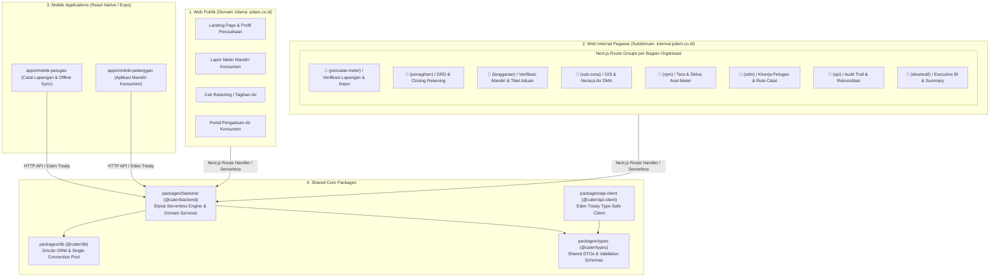
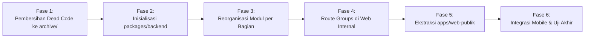

# Blueprint Arsitektur: Restrukturisasi Monorepo, Shared Serverless Backend & Pemisahan Web Publik vs Internal

> **Status:** Disetujui (Approved Architecture RFC)  
> **Target:** Perumda Air Minum (PDAM) Sistem Cater  
> **Pola Arsitektur:** 2 Web Apps (Publik & Internal) + 1 Shared Serverless Backend + Mobile Apps + Root Archive  
> **Prinsip Utama:** Ramah Tier Gratis (Zero Extra Hosting Cost), Anti-CORS Nightmare, Isolasi Keamanan, dan Domain-Driven Organisasi PDAM.

---

## 1. Ringkasan Eksekutif & Keputusan Desain

Berdasarkan evaluasi batasan operasional (kuota Vercel Free Tier, kuota koneksi database serverless PostgreSQL, dan risiko Third-Party Cookie CORS pada Better-Auth), sistem **TIDAK** dipecah menjadi 6–8 web terpisah yang rapuh. 

Sebaliknya, sistem menerapkan arsitektur **"The Golden Duo Web + Shared Serverless Core"**:



---

## 2. Keunggulan Arsitektur: Mengapa Pola Ini Paling Kuat?

1. **100% Serverless & Hemat Kuota Free Tier:**
   * Hanya ada **2 project web** di Vercel/Cloudflare (Publik dan Internal).
   * Backend Elysia di-mount langsung di Next.js App Router API Route (`app.fetch`) sehingga tidak membutuhkan server VPS terpisah.
   * Total konsumsi serverless execution time dan bandwidth tetap berada di dalam kuota gratis (Hobby tier).

2. **Bebas Masalah CORS & Cookie (*Zero CORS Hassle*):**
   * Seluruh dashboard pegawai berada di satu domain/subdomain (`internal.pdam.co.id`).
   * Autentikasi Better-Auth memakai *HttpOnly Session Cookie* first-party yang aman dari pemblokiran browser modern tanpa perlu konfigurasi SSO yang rumit.

3. **Hemat Koneksi Database PostgreSQL (*Anti-Connection Exhaustion*):**
   * Menghindari pembukaan connection pool berlebih. Pooler PostgreSQL (seperti Neon / Supabase connection pooler) hanya melayani 2 consumer web, menjaga koneksi selalu di bawah ambang batas free tier (20–50 *concurrent connections*).

4. **Isolasi Keamanan Publik vs Internal:**
   * Kode internal, dashboard pegawai, dan tabel sensitif sama sekali tidak ada di bundle `apps/web-publik`.
   * Web publik dapat di-cache agresif di CDN Edge (SSG/ISR), menghasilkan kecepatan akses super instan untuk pelanggan dan **hampir 0 biaya komputasi**.

---

## 3. Peta Direktori Monorepo Baru

```text
elysia/ (Root Monorepo)
├── apps/
│   ├── web-publik/                     # [Aplikasi 1] Portal Konsumen & Landing Page
│   │   ├── src/
│   │   │   ├── app/
│   │   │   │   ├── (marketing)/        # Landing page, berita, info tarif, profil
│   │   │   │   ├── lapor-meter/        # Lapor mandiri konsumen
│   │   │   │   ├── cek-tagihan/        # Cek rekening air
│   │   │   │   ├── pengaduan/          # Form pengaduan pelanggan
│   │   │   │   └── api/[[...slugs]]/   # Route handler serverless (endpoint publik)
│   │   │   └── components/             # Layout publik, navbar publik, footer
│   │   └── package.json
│   │
│   ├── web-internal/                   # [Aplikasi 2] Backoffice & Dashboard Pegawai
│   │   ├── src/
│   │   │   ├── app/
│   │   │   │   ├── (auth)/             # Login pegawai, reset sandi
│   │   │   │   ├── (dashboard)/        # Dikelompokkan per Bagian Organisasi:
│   │   │   │   │   ├── pencatat-meter/ # Verifikasi Lapangan, Impor LapDataMeter, Anomali
│   │   │   │   │   ├── penagihan/      # Closing DRD, Piutang Rekening, Locked Billing
│   │   │   │   │   ├── langganan/      # Verifikasi Mandiri, Tiket Pengaduan, Master Pelanggan
│   │   │   │   │   ├── sub-zona/       # GIS Peta Jaringan, DMA, Neraca Air
│   │   │   │   │   ├── rpm/            # Tera, Siklus Aset Meter, Penggantian Meter Rusak
│   │   │   │   │   ├── sdm/            # Rute Catat, Kinerja/Insentif Petugas, User Management
│   │   │   │   │   ├── spi/            # Audit Trail, Log Verifikasi/Unverify, Rekonsiliasi
│   │   │   │   │   └── eksekutif/      # Dashboard Ringkasan Direksi & Analitik BI
│   │   │   │   └── api/[[...slugs]]/   # Route handler serverless (mount @cater/backend)
│   │   │   └── features/               # Fitur UI internal per bagian organisasi
│   │   └── package.json
│   │
│   ├── mobile-petugas/                 # [Aplikasi 3] Mobile App Petugas Lapangan (Expo/RN)
│   └── mobile-pelanggan/               # [Aplikasi 4] Mobile App Konsumen Mandiri (Expo/RN)
│
├── packages/
│   ├── backend/                        # [@cater/backend] Serverless Elysia Core Engine
│   │   ├── src/
│   │   │   ├── index.ts                # Main Elysia app export
│   │   │   ├── plugins/                # Auth, CORS, Logger, Error Handler
│   │   │   ├── modules/                # HTTP Endpoints per Bagian Organisasi:
│   │   │   │   ├── pencatat-meter/     # verifikasi.router.ts, cater.router.ts, import.router.ts
│   │   │   │   ├── penagihan/          # drd.router.ts, closing.router.ts
│   │   │   │   ├── langganan/          # mandiri.router.ts, pengaduan.router.ts, pelanggan.router.ts
│   │   │   │   ├── sub-zona/           # geo.router.ts, dma.router.ts
│   │   │   │   ├── rpm/                # meter-aset.router.ts, tera.router.ts
│   │   │   │   ├── sdm/                # rute.router.ts, kpi.router.ts, pegawai.router.ts
│   │   │   │   ├── spi/                # audit-log.router.ts, rekonsiliasi.router.ts
│   │   │   │   ├── eksekutif/          # ringkasan-eksekutif.router.ts
│   │   │   │   └── core/               # health.router.ts, media.router.ts, broadcast.router.ts
│   │   │   └── services/               # Business Logic & Database Services:
│   │   │       ├── pencatat-meter/     # cater-verifikasi.service, verifikasi-grid.service, anomali.service
│   │   │       ├── penagihan/          # closing-drd.service, billing.service
│   │   │       ├── langganan/          # mandiri.service, pengaduan.service
│   │   │       ├── sub-zona/           # geo.service, gis.service
│   │   │       ├── rpm/                # meter-lifecycle.service
│   │   │       ├── sdm/                # kpi-petugas.service, rute.service
│   │   │       └── spi/                # audit-trail.service, deviasi-meter.service
│   │   ├── package.json
│   │   └── tsconfig.json
│   │
│   ├── db/                             # [@cater/db] Drizzle ORM Single Source of Truth
│   ├── types/                          # [@cater/types] Shared Contracts & Enums
│   ├── api-client/                     # [@cater/api-client] Eden Treaty Type-Safe Fetcher
│   └── ui-mobile/                      # [@cater/ui-mobile] Komponen Mobile Bersama
│
├── archive/                            # [Root Arsip] Dead Code & Legacy Files
│   ├── legacy-components/              # Duplikasi komponen verifikasi lama & tabel lama
│   ├── legacy-backend/                 # Sisa modul transisi lama
│   └── scratch/                        # Script percobaan sekali pakai
│
├── docs/                               # Dokumentasi Arsitektur, User Guide & Runbook
├── tests/                              # Automated Unit, Integration & Conflict Tests
├── package.json                        # Monorepo Root Workspaces
└── turbo.json                          # Turborepo Build Cache Orchestration
```

---

## 4. Pemetaan Tugas Pokok & Modul per Bagian Organisasi

| Bagian Organisasi (PDAM) | Modul Backend (`packages/backend`) | Rute UI Web (`apps/web-internal`) | Peran Pengguna (RBAC) |
| :--- | :--- | :--- | :--- |
| **Pencatat Meter** | `modules/pencatat-meter/`<br>`services/pencatat-meter/` | `(dashboard)/pencatat-meter/verifikasi`<br>`(dashboard)/pencatat-meter/import`<br>`(dashboard)/pencatat-meter/anomali` | `STAFF_CATER`<br>`VERIFIKATOR_1`<br>`VERIFIKATOR_2`<br>`VERIFIKATOR_3` |
| **Penagihan & Rekening** | `modules/penagihan/`<br>`services/penagihan/` | `(dashboard)/penagihan/drd`<br>`(dashboard)/penagihan/closing`<br>`(dashboard)/penagihan/piutang` | `STAFF_ADMIN_BILLING`<br>`MANAGER_BILLING` |
| **Hubungan Langganan** | `modules/langganan/`<br>`services/langganan/` | `(dashboard)/langganan/mandiri`<br>`(dashboard)/langganan/pengaduan`<br>`(dashboard)/langganan/pelanggan` | `VERIFIKATOR_1`<br>`CUSTOMER_SERVICE`<br>`MANAGER_HUBLANG` |
| **Sub Zona & Distribusi** | `modules/sub-zona/`<br>`services/sub-zona/` | `(dashboard)/sub-zona/peta-gis`<br>`(dashboard)/sub-zona/dma`<br>`(dashboard)/sub-zona/neraca-air` | `STAFF_DISTRIBUSI`<br>`SUPERVISOR_GIS`<br>`MANAGER_DISTRIBUSI` |
| **Rencana & Pengembang (RPM)** | `modules/rpm/`<br>`services/rpm/` | `(dashboard)/rpm/tera-meter`<br>`(dashboard)/rpm/peremajaan-meter`<br>`(dashboard)/rpm/aset-meter` | `PETUGAS_TERA`<br>`MANAGER_RPM` |
| **SDM & Kepegawaian** | `modules/sdm/`<br>`services/sdm/` | `(dashboard)/sdm/rute-petugas`<br>`(dashboard)/sdm/kpi-insentif`<br>`(dashboard)/sdm/manajemen-user` | `ADMIN_SDM`<br>`SUPERVISOR_RUTE`<br>`SUPERADMIN` |
| **Satuan Pengawas Internal (SPI)** | `modules/spi/`<br>`services/spi/` | `(dashboard)/spi/audit-trail`<br>`(dashboard)/spi/log-pembatalan`<br>`(dashboard)/spi/rekonsiliasi` | `AUDITOR_SPI`<br>`KEPALA_SPI` |
| **Direksi & Eksekutif** | `modules/eksekutif/`<br>`services/eksekutif/` | `(dashboard)/eksekutif/overview`<br>`(dashboard)/eksekutif/tren-pendapatan` | `EXECUTIVE`<br>`DIREKSI` |

---

## 5. Rencana Pelaksanaan Bertahap (Non-Breaking Action Plan)

Untuk memastikan sistem **tetap berjalan stabil tanpa downtime (*zero regression*)**, migrasi dibagi menjadi 6 tahap terukur:



### Tahap 1: Pembersihan Dead Code ke `archive/` *(Aman & Instan)*
1. Membuat direktori root `archive/`.
2. Memindahkan duplikasi komponen lama (misal komponen verifikasi duplikat di `components/tanstacktable/`), script sementara (`scratch/`), dan modul eksperimen lama yang sudah tidak aktif.
3. Menambahkan `"archive/**"` ke daftar `exclude` pada `tsconfig.json` root.
4. Menjalankan `bun run --filter @cater/web typecheck` untuk memastikan zero breaking changes.

### Tahap 2: Inisialisasi Package Shared Backend (`packages/backend`)
1. Membuat `packages/backend/package.json` dan `packages/backend/tsconfig.json`.
2. Memindahkan logika serverless dari `apps/web/src/server/` ke `packages/backend/src/`.
3. Di `apps/web/src/app/api/[[...slugs]]/route.ts`, ganti import internal menjadi:
   ```typescript
   import { app } from "@cater/backend";
   export const GET = app.fetch;
   export const POST = app.fetch;
   export const PATCH = app.fetch;
   export const DELETE = app.fetch;
   ```
4. Menjalankan test suite: `bun test tests/verifikasi-skenario-konflik.test.ts`.

### Tahap 3: Reorganisasi Internal Backend per Bagian Organisasi
1. Menata folder `packages/backend/src/modules/` dan `packages/backend/src/services/` sesuai 8 bagian organisasi:
   * `pencatat-meter/`
   * `penagihan/`
   * `langganan/`
   * `sub-zona/`
   * `rpm/`
   * `sdm/`
   * `spi/`
   * `core/`
2. Menghubungkan seluruh router ke `index.ts` utama di `@cater/backend`.
3. Verifikasi dengan `bun test` untuk memastikan semua endpoint bekerja normal.

### Tahap 4: Penataan Route Groups di Web Internal (`apps/web`)
1. Mengelompokkan halaman backoffice di bawah `src/app/(dashboard)/`:
   * `(pencatat-meter)/`
   * `(penagihan)/`
   * `(langganan)/`
   * `(sub-zona)/`
   * `(rpm)/`
   * `(sdm)/`
   * `(spi)/`
2. Memperbarui Sidebar navigasi agar membaca izin role (RBAC) pegawai.
3. Tetap berada di 1 domain (`internal.pdam.co.id`), mempertahankan satu sesi Better-Auth tanpa hambatan CORS.

### Tahap 5: Ekstraksi Halaman Publik ke `apps/web-publik`
1. Membuat `apps/web-publik` (Next.js 16) yang khusus memuat:
   * Halaman Landing & Profil Perusahaan
   * Lapor Meter Mandiri Konsumen
   * Cek Rekening Tagihan Air
   * Pengaduan Pelanggan
2. Mengonfigurasi `apps/web-publik` agar menembak endpoint publik `@cater/backend`.
3. Menerapkan Edge Caching agresif untuk memaksimalkan performa dan menekan biaya komputasi hingga Rp 0.

### Tahap 6: Integrasi Mobile Client & Uji Menyeluruh
1. Menghubungkan `apps/mobile-petugas` dan `apps/mobile-pelanggan` ke endpoint backend via `@cater/api-client`.
2. Menjalankan end-to-end regression test:
   * Alur catat petugas $\rightarrow$ verifikasi V1/V2/V3 $\rightarrow$ closing billing.
   * Alur lapor mandiri konsumen $\rightarrow$ verifikasi mandiri $\rightarrow$ pemulihan data petugas.
   * Pembatalan verifikasi (*unverify*) langsung kembali ke `SUBMITTED`.
