# Roadmap & Tracking Perkembangan Proyek: Sistem Baca Meter (Cater)

Dokumen ini melacak kemajuan (*progress tracking*), arsitektur keputusan, hasil audit data riil, dan tahapan peta jalan (*roadmap*) pengembangan aplikasi Baca Meter dan Penagihan (Billing).

---

## 1. Status Terkini (Current State)

| Komponen | Status | Catatan Teknis |
| :--- | :---: | :--- |
| **Hirarki Kepegawaian (HR Level)** | ✅ **Selesai** | 6 Tingkat: Direksi $\rightarrow$ Senior Manager $\rightarrow$ Manager $\rightarrow$ Supervisor $\rightarrow$ Staff $\rightarrow$ Pelaksana. |
| **RBAC Sistem (V1, V2, V3, Staff, Pencatat)** | ✅ **Selesai** | Terpetakan di `packages/db/src/schema/rbac.ts` dan guard di ElysiaJS. |
| **Audit Log & Guard Koreksi Staff** | ✅ **Selesai** | Tabel `cater_verifikasi_log` dengan *conditional guard* (hanya aktif jika data sudah memiliki riwayat verifikasi). |
| **Audit Data Nyata Lapangan (STI)** | ✅ **Selesai** | Audit 22.549 baris data dari `ProgresCater-PW5.csv` dan `lapdatametertes.csv`. |
| **Master Kamus Kondisi Catat (22 Kode)** | ✅ **Selesai** | Tabel `master_kondisi_catat` (`kode_tmss`, `nama`, `kategori`, `trigger_baca_mandiri`). |
| **Skema Baca Mandiri Pelanggan** | ✅ **Selesai** | Tabel `cater_mandiri_pelanggan` dengan PostGIS Geofencing (`lokasi_gps`, `jarak_dari_rumah_meter`). |
| **Migrasi Database PostgreSQL** | ✅ **Selesai** | Berkas migrasi `0002_heavy_stature.sql` & `0003_same_leopardon.sql` tervalidasi. |
| **Audit Backend Hono-Prisma** | ✅ **Selesai** | Analisis mendalam 30+ model Prisma, RBAC, dan 25 sub-modul router di `backend-hono-prisma`. |
| **Refactor Hono -> Elysia (5 Fase)**| ✅ **Selesai** | 5 Fase pengerjaan tuntas 100% (Domain Engines, Services, Routers, Quality Gate). |
| **Penyelarasan Modul Aurora Sidebar**| ✅ **Selesai** | 9 Modul sidebar Aurora terpetakan dan terpasang penuh di backend Elysia. |
| **Pengujian Otomatis (Unit & Integration)**| ✅ **Selesai** | 91 Pengujian lulus 100% (0 error) mencakup 6 kasus bisnis kritis & sidebar. |
| **Pengembangan Frontend** | 🚀 **Siap Dimulai** | Seluruh API, kontrak data TypeBox, dan pondasi backend telah siap 100%. |

---

## 2. Temuan Audit Ground-Truth Data (Januari PW5)

Berdasarkan analisis file produksi `ProgresCater-PW5.csv` dan `lapdatametertes.csv`:

### A. Potensi Penurunan Kasus DK & Peningkatan Akurasi
- **`2` - DK (Dikunci)**: 408 pelanggan
- **`N` - STAND TEMPEL**: 1.249 pelanggan *(kertas tempel di pagar/pintu)*
- **`Z` - STAND-KONSUMEN**: 554 pelanggan *(lapor lisan/mandiri)*
- **Total Potensi Digitalisasi Mandiri**: **2.211 Pelanggan (9,81% dari total pelanggan)**

### B. Kamus Lengkap 22 Kode Kelainan STI (`master_kondisi_catat`)
1. ` ` / `-` : **Normal** (62,66%)
2. `H` : **TIDAK DIPAKAI** (12,05%)
3. `R` : **RUMAH KOSONG** (5,69%)
4. `N` : **STAND TEMPEL** (5,54%) — *Bisa dialihkan ke Baca Mandiri*
5. `Z` : **STAND-KONSUMEN** (2,46%) — *Embrionya Baca Mandiri*
6. `P` : **REV.PENCATAT** (2,17%)
7. `2` : **DK** (1,81%) — *Target utama eliminasi via Baca Mandiri*
8. `8` : **TIDAK ADA AIR** (1,50%)
9. `7` : **MATI ADA AIR** (1,39%) — *Trigger ganti meter*
10. `3` : **MTA** (1,21%) — *Meter Tak Ada*
11. `5` : **TTB** (1,16%) — *Tidak Terbaca (tertimbun)*
12. `6` : **BMK/BMB** (1,01%) — *Bodi/Kaca Meter Buram*
13. `E` : **TERHALANG** (0,67%)
14. `O` : **METER RUSAK** (0,45%)
15. `D` : **DICABUT** (0,12%)
16. `4` : **MB** (0,03%)
17. `Q` : **ADA ANJING** (0,03%)
18. `F` : **METER MUNDUR** (0,03%)
19. `U` : **MUDA KEMBALI** (0,01%) — *Roll-over 9999 -> 0000*
20. `T` : **METER TERBALIK** (0,00%)
21. `9` : **LOS METER** (0,00%)
22. `AA`: **Meter Dalam Air** (0,02%)

---

## 3. Roadmap Tahapan Pengembangan (Phased Roadmap)

```mermaid
flowchart TD
    subgraph FASE_1["Fase 1: Pondasi Database (SELESAI)"]
        F1A["Skema Drizzle ORM Relasional"]
        F1B["RBAC 6 Level Kepegawaian"]
        F1C["Master Kamus Kondisi Catat (22 Kode)"]
        F1D["Skema Baca Mandiri & PostGIS Geofence"]
        F1E["Skema GWM (Mutasi & Grand Water Meter)"]
        F1F["Migrasi Database Versioned"]
    end

    subgraph FASE_2["Fase 2: Domain Engine Murni (SELESAI)"]
        F2A["Tagihan & Tarif Progresif 4 Blok"]
        F2B["Taksasi Rata-12B, 3-Tertinggi, Rollover"]
        F2C["GWM: Pasang/Angkat & Neraca Air NRW"]
        F2D["Mandiri: Waktu WIB & PostGIS Geofence <= 50m"]
        F2E["Evaluasi Anomali Meter & 6 Kasus Kritis"]
    end

    subgraph FASE_3["Fase 3: Service Layer SoC (SELESAI)"]
        F3A["Closing & Buka Bulan Baru DPM"]
        F3B["Mandiri Service & Dual-Track Approval"]
        F3C["GWM Service & Mutasi Meter"]
        F3D["Cater Kueri & Verifikasi V1-V3 Service"]
        F3E["Rute, Pelanggan, Progress, & Spatial Map Service"]
    end

    subgraph FASE_4["Fase 4: Elysia Routers & TypeBox (SELESAI)"]
        F4A["Cater Router: Rute, Pelanggan, Progress, Map"]
        F4B["Closing Router: Pratinjau, Eksekusi, Bulan-Baru"]
        F4C["Mandiri Router: Lapor, Riwayat, Verifikasi"]
        F4D["GWM Router: Mutasi, Debit, Neraca Air"]
        F4E["RBAC Macro Enforcement di Seluruh Endpoint"]
    end

    subgraph FASE_5["Fase 5: Quality Gate & Sidebar Aurora (SELESAI)"]
        F5A["91 Automated Tests (100% Pass)"]
        F5B["TypeScript NoEmit (0 Error)"]
        F5C["Turbo ESLint (0 Error)"]
        F5D["9 Modul Aurora Sidebar Terpetakan Penuh"]
    end

    subgraph FASE_NEXT["Tahap Berikutnya: Implementasi UI Frontend"]
        FN1["Aplikasi Mobile Petugas Lapangan (Android)"]
        FN2["Portal Publik Baca Mandiri Pelanggan (Web/PWA)"]
        FN3["Dashboard Web Backoffice (Next.js App Router)"]
    end

    FASE_1 --> FASE_2 --> FASE_3 --> FASE_4 --> FASE_5 --> FASE_NEXT
```

---

## 4. Status Integrasi 9 Modul Aurora Sidebar

Seluruh logika bisnis, kalkulasi volume air, agregasi progress, manajemen rute, dan administrasi pelanggan yang berasal dari menu sidebar Aurora telah selesai diimplementasikan ke dalam arsitektur backend modern. Rincian pemetaan endpoint HTTP dan servicenya dapat dilihat pada [`SIDEBAR_REFERENCE.md`](file:///C:/Users/DESKTOP/Documents/elysia/docs/SIDEBAR_REFERENCE.md).
