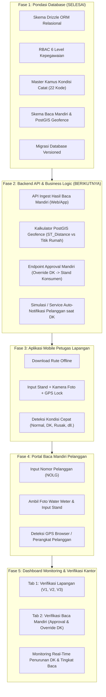

# Roadmap & Tracking Perkembangan Proyek: Sistem Baca Meter (Cater)

Dokumen ini melacak kemajuan (*progress tracking*), arsitektur keputusan, hasil audit data riil, dan tahapan peta jalan (*roadmap*) pengembangan aplikasi Baca Meter dan Penagihan (Billing).

---

## 1. Status Terkini (Current State)

| Komponen | Status | Catatan Teknis |
| :--- | :---: | :--- |
| **Hirarki Kepegawaian (HR Level)** | ✅ **Selesai** | 6 Tingkat: Direksi $\rightarrow$ Senior Manager $\rightarrow$ Manager $\rightarrow$ Supervisor $\rightarrow$ Staff $\rightarrow$ Pelaksana. |
| **RBAC Sistem (V1, V2, V3, Staff, Pencatat)** | ✅ **Selesai** | Terpetakan di `packages/db/src/schema/rbac.ts` dan guard di ElysiaJS. |
| **Audit Log & Guard Koreksi Staff** | ✅ **Selesai** | Tabel `cater_verifikasi_log` dengan *conditional guard* (hanya aktif jika data sudah memiliki riwayat verifikasi). |
| **Audit Data Nyata Lapangan (STI)** | ✅ **Selesai** | Audit 22.549 baris data dari `ProgresCater-PW5.csv` dan `lapdatametertes.csv`. |
| **Master Kamus Kondisi Catat (22 Kode)** | ✅ **Selesai** | Tabel `master_kondisi_catat` (`kode_tmss`, `nama`, `kategori`, `trigger_baca_mandiri`). |
| **Skema Baca Mandiri Pelanggan** | ✅ **Selesai** | Tabel `cater_mandiri_pelanggan` dengan PostGIS Geofencing (`lokasi_gps`, `jarak_dari_rumah_meter`). |
| **Migrasi Database PostgreSQL** | ✅ **Selesai** | Berkas migrasi `0002_heavy_stature.sql` & `0003_same_leopardon.sql` tervalidasi. |
| **Pengembangan Frontend** | ⏸️ **Ditunda** | Sesuai instruksi, fokus diselesaikan pada database dan backend sebelum masuk ke UI. |

---

## 2. Temuan Audit Ground-Truth Data (Januari PW5)

Berdasarkan analisis file produksi `ProgresCater-PW5.csv` dan `lapdatametertes.csv`:

### A. Potensi Penurunan Kasus DK & Peningkatan Akurasi
- **`2` - DK (Dikunci)**: 408 pelanggan
- **`N` - STAND TEMPEL**: 1.249 pelanggan *(kertas tempel di pagar/pintu)*
- **`Z` - STAND-KONSUMEN**: 554 pelanggan *(lapor lisan/mandiri)*
- **Total Potensi Digitalisasi Mandiri**: **2.211 Pelanggan (9,81% dari total pelanggan)**

### B. Kamus Lengkap 22 Kode Kelainan STI (`master_kondisi_catat`)
1. ` ` / `-` : **Normal** (62,66%)
2. `H` : **TIDAK DIPAKAI** (12,05%)
3. `R` : **RUMAH KOSONG** (5,69%)
4. `N` : **STAND TEMPEL** (5,54%) — *Bisa dialihkan ke Baca Mandiri*
5. `Z` : **STAND-KONSUMEN** (2,46%) — *Embrionya Baca Mandiri*
6. `P` : **REV.PENCATAT** (2,17%)
7. `2` : **DK** (1,81%) — *Target utama eliminasi via Baca Mandiri*
8. `8` : **TIDAK ADA AIR** (1,50%)
9. `7` : **MATI ADA AIR** (1,39%) — *Trigger ganti meter*
10. `3` : **MTA** (1,21%) — *Meter Tak Ada*
11. `5` : **TTB** (1,16%) — *Tidak Terbaca (tertimbun)*
12. `6` : **BMK/BMB** (1,01%) — *Bodi/Kaca Meter Buram*
13. `E` : **TERHALANG** (0,67%)
14. `O` : **METER RUSAK** (0,45%)
15. `D` : **DICABUT** (0,12%)
16. `4` : **MB** (0,03%)
17. `Q` : **ADA ANJING** (0,03%)
18. `F` : **METER MUNDUR** (0,03%)
19. `U` : **MUDA KEMBALI** (0,01%) — *Roll-over 9999 -> 0000*
20. `T` : **METER TERBALIK** (0,00%)
21. `9` : **LOS METER** (0,00%)
22. `AA`: **Meter Dalam Air** (0,02%)

---

## 3. Roadmap Tahapan Pengembangan (Phased Roadmap)

---

## 4. Rincian Pekerjaan Fase 2 (Backend Service Layer)

Setelah skema database selesai dan terkunci:
1. **Service Geofence PostGIS**:
   - Query otomatis:
     $$\text{jarak} = \text{ST\_Distance}(\text{cater\_mandiri.lokasi\_gps}, \text{pelanggan.titik\_lokasi})$$
   - Jika jarak $\le 50\text{ meter}$, tandai `isLokasiValid = true`. Jika $> 50\text{ meter}$, flag `isLokasiValid = false` untuk peringatan verifikator.
2. **API Verifikasi & Override DK**:
   - `POST /api/cater/mandiri/verify`:
     - Tindakan `APPROVE`:
       1. Update status `cater_mandiri_pelanggan` menjadi `APPROVED`.
       2. Update transaksi utama `cater_baca_meter`: isi `stma` mandiri, ubah `tmss` dari `'2'` (DK) menjadi `'Z'` (STAND-KONSUMEN), ubah `sumberCatat` menjadi `'MANDIRI_WEB'/'MANDIRI_APP'`.
       3. Catat di `cater_verifikasi_log`.
     - Tindakan `REJECT`:
       1. Simpan alasan penolakan (misal foto buram / bukan meter air).
       2. Notifikasi ulang pelanggan untuk submit foto yang lebih jelas.
