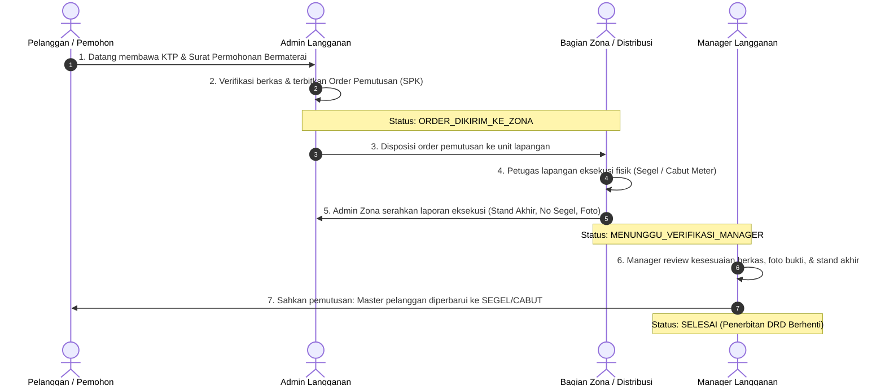
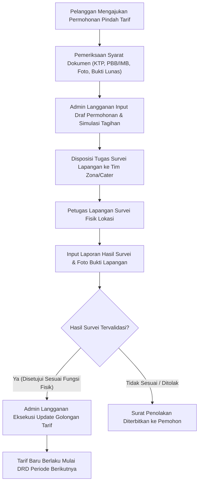
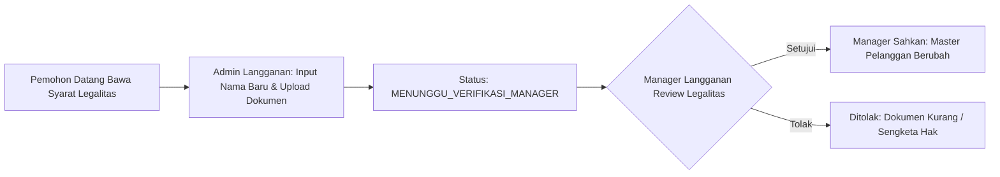

# Standar Operasional Prosedur (SOP) & Arsitektur Alur Kerja: Pemutusan, Pindah Tarif, dan Balik Nama Pelanggan

Dokumen ini disusun berdasarkan hasil wawancara langsung dengan **Admin Bagian Langganan** serta analisis tata kelola operasional PDAM/Tirtawening. Dokumen ini dirancang sebagai acuan resmi pengembang, bahan presentasi ke manajemen/direksi, dan pedoman kepatuhan audit sistem informasi (*Segregation of Duties*).

---

## 1. Ringkasan Eksekutif & Prinsip Tata Kelola

Tiga proses administrasi pelanggan memiliki karakteristik risiko tinggi terhadap pendapatan (*revenue assurance*), integritas data penagihan (*DRD*), serta aset fisik meter air PDAM. Oleh karena itu, sistem menerapkan prinsip **Pemisahan Kewenangan (*Four-Eyes Principle / Segregation of Duties*)**:

```
┌─────────────────────────┐       ┌─────────────────────────┐       ┌─────────────────────────┐
│   BAGIAN LANGGANAN      │       │     BAGIAN ZONA /       │       │   MANAGER LANGGANAN     │
│  (Customer Service)     │──────▶│       DISTRIBUSI        │──────▶│      (Otorisator)       │
│                         │       │   (Eksekutor Fisik)     │       │                         │
│ • Pelayanan Pemohon     │       │ • Survei Lapangan       │       │ • Validasi Berkas Legal │
│ • Validasi Dokumen      │       │ • Pasang Dop Segel      │       │ • Verifikasi Stand Akhir│
│ • Penerbitan Order SPK  │       │ • Cabut Water Meter     │       │ • Eksekusi Final Master │
└─────────────────────────┘       └─────────────────────────┘       └─────────────────────────┘
```

Tiga pilar alur kerja:
1. **Pemutusan Pelanggan**: *Langganan Buat Order ➔ Zona Eksekusi Lapangan ➔ Manager Langganan Verifikasi & Sahkan*.
2. **Pindah Tarif (Reklasifikasi)**: *Pengajuan Pemohon ➔ Tim Lapangan Survei Fisik ➔ Admin Langganan Eksekusi Hasil Valid*.
3. **Balik Nama**: *Input Dokumen oleh Admin Langganan ➔ Otorisasi Tunggal oleh Manager Langganan*.

---

## 2. Alur 1: Proses Pemutusan Sambungan Pelanggan (Sementara & Permanen)

### A. Latar Belakang & Klasifikasi Pemutusan
Pemutusan sambungan air minum terdiri dari dua jenis:
1. **Pemutusan Sementara (Segel Dop)**: Aliran air diputus sementara menggunakan segel kawat/stop kran atas permohonan pelanggan (misalnya rumah kosong sementara) atau akibat tunggakan pembayaran. Water meter fisik **tetap berada di lokasi**.
2. **Pemutusan Permanen (Cabut Meter)**: Pelanggan berhenti berlangganan secara permanen atau terkena sanksi pelanggaran berat. Water meter fisik **dicabut dan diserahkan ke gudang meter**.

### B. Diagram Alir Komunikasi Lintas Departemen


### C. Rincian Langkah Operasional
1. **Tahap 1: Inisiasi Order oleh Admin Langganan**
   - Pelanggan mendatangi kantor pelayanan langganan dan menyerahkan:
     - Fotokopi KTP / Identitas pemilik sah.
     - Surat Permohonan Pemutusan bermaterai cukup (atau Berita Acara Tunggakan dari Bagian Penagihan).
     - Bukti pelunasan seluruh tagihan air dan rekening denda berjalan.
   - Admin Langganan membuka modul **Mutasi Pelanggan ➔ Order Pemutusan**, mengunggah draf permohonan, mencatat alasan pemutusan, dan menerbitkan **Nomor Order / Surat Perintah Kerja (SPK)**.
   - Status sistem: `ORDER_DIKIRIM_KE_ZONA`.

2. **Tahap 2: Eksekusi Lapangan oleh Tim Zona / Distribusi**
   - Bagian Zona menerima lembar kerja SPK dan menugaskan petugas teknisi lapangan.
   - Petugas Lapangan menuju lokasi pelanggan dan wajib melakukan:
     - **Pencatatan Stand Meter Akhir (Stand Angkat)**: Angka stand meter terakhir saat air diputus. Ini krusial untuk penagihan kubikasi penutupan (*closing billing*) agar tidak terjadi sengketa angka meter.
     - **Tindakan Fisik**:
       - *Sementara*: Memasang stop kran terkunci dan dop segel berlogo resmi.
       - *Permanen*: Melepas unit water meter, menutup pipa dinas, dan membawa meteran ke gudang aset.
     - **Pengambilan Dokumentasi Foto**: Foto meter dengan angka stand jelas, foto segel terpasang, dan foto tampak depan rumah/persil.
   - Petugas menyerahkan formulir Berita Acara Lapangan ke Admin Zona.
   - Admin Zona menginput data eksekusi ke sistem (tanggal eksekusi, nama petugas, angka stand angkat, nomor segel, dan foto bukti).
   - Status sistem: `MENUNGGU_VERIFIKASI_MANAGER`.

3. **Tahap 3: Verifikasi Akhir oleh Manager Langganan**
   - Data laporan yang telah diselesaikan Zona secara otomatis masuk ke antrean verifikasi **Manager Langganan**.
   - Manager Langganan memeriksa:
     - Legalitas berkas permohonan bermaterai.
     - Kesesuaian foto meter dan angka stand angkat yang dilaporkan petugas zona.
   - Manager menekan tombol **"Sahkan & Eksekusi Pemutusan"**:
     - Sistem otomatis mengubah status pelanggan di tabel master `pelanggan`:
       - Menjadi `SEGEL SEMENTARA` (jika pemutusan sementara), atau
       - Menjadi `CABUT METER / NON AKTIF` (jika pemutusan permanen).
     - Angka stand angkat dikunci ke data rekening penagihan terakhir.
     - Penerbitan rekening air (DPM/DRD) periode berikutnya otomatis dinonaktifkan untuk pelanggan ini.
   - Status sistem: `SELESAI`.

---

## 3. Alur 2: Proses Pindah Tarif (Reklasifikasi Tarif Pelanggan)

### A. Latar Belakang
Reklasifikasi tarif dilakukan saat fungsi pemanfaatan air pada persil pelanggan mengalami perubahan, misalnya:
- Hunian rumah tangga dialihfungsikan menjadi tempat usaha (ruko, salon, kafe, bengkel, kos-kosan komersial), sehingga tarif naik dari `2A1/2A2` ke `3A/3B (Niaga)`.
- Usaha niaga tutup dan persil kembali murni dihuni sebagai rumah tinggal, sehingga tarif turun dari `Niaga` ke `Rumah Tangga`.
- Pelanggan mengajukan program tarif Masyarakat Berpenghasilan Rendah (MBR).

### B. Diagram Alir


### C. Rincian Langkah Operasional
1. **Tahap 1: Pengajuan & Verifikasi Berkas (Front Office)**
   - Pelanggan datang ke kantor langganan membawa berkas:
     - KTP Pemilik / Penyewa yang sah.
     - Bukti kepemilikan/penguasaan bangunan (PBB/IMB/Perjanjian Sewa).
     - Foto kondisi fisik aktivitas di persil/bangunan.
     - Bukti lunas rekening air bulan terakhir.
   - Admin Langganan memeriksa riwayat pemakaian air (12 bulan terakhir).
   - Admin menjalankan **Simulasi Dampak Tagihan (*Billing Impact Matrix*)** untuk melihat estimasi kenaikan/penurunan tagihan sebelum permohonan diajukan.
   - Admin menerbitkan tiket permohonan. Status: `MENUNGGU_SURVEI`.

2. **Tahap 2: Survei Fisik Lapangan (Tim Lapangan / Zona)**
   - Tim pemeriksa/survei lapangan mendatangi persil pelanggan untuk verifikasi faktual:
     - Memeriksa apakah terdapat aktivitas niaga (meja kasir, etalase, inventaris bengkel, kamar kos disewakan).
     - Menghitung jumlah kran dan titik keluaran air.
   - Petugas mengisi Berita Acara Survei Lapangan:
     - Rekomendasi: `DISETUJUI (Sesuai Usulan)` / `DIREKLASIFIKASI KE TARIF LAIN` / `DITOLAK (Tidak Berubah)`.
     - Catatan temuan lapangan dan foto bukti fisik.
   - Status: `SURVEI_SELESAI / SIAP_EKSEKUSI`.

3. **Tahap 3: Validasi & Eksekusi Pembaruan Tarif (Admin Langganan)**
   - Admin Langganan membuka berkas permohonan yang telah dilengkapi hasil survei lapangan.
   - Jika hasil survei menyatakan **Sesuai**:
     - Admin menekan tombol **"Eksekusi Reklasifikasi Tarif"**.
     - Sistem memperbarui kolom `pelanggan.tarifKode = tarifBaru`.
     - Nomor Berita Acara dan tanggal mutasi tercatat ke riwayat log mutasi tarif.
     - Perubahan tarif akan otomatis dipakai oleh mesin billing kalkulasi DRD pada periode cetak berikutnya.
   - Jika survei menyatakan **Tidak Sesuai**:
     - Tiket ditandai `DITOLAK` dengan alasan resmi yang dapat dicetak sebagai balasan surat pelanggan.

---

## 4. Alur 3: Proses Balik Nama Pelanggan

### A. Latar Belakang
Balik nama adalah pembaruan identitas nama pelanggan resmi pada master rekening air akibat transaksi jual-beli properti, peralihan hak waris, atau perpanjangan hak sewa jangka panjang. Karena nama pelanggan berkaitan erat dengan keabsahan bukti pembayaran dan legalitas sambungan langganan, perubahan nama **wajib diotorisasi oleh pejabat struktural (Manager Langganan)**.

### B. Diagram Alir


### C. Rincian Langkah Operasional
1. **Tahap 1: Pengajuan & Pemeriksaan Persyaratan (Admin Langganan)**
   - Pemohon menyerahkan dokumen:
     - Fotokopi KTP / identitas pemohon baru.
     - Bukti sah kepemilikan/penguasaan persil (Sertifikat Tanah / AJB / Surat Keterangan Waris / Surat Perjanjian Sewa).
     - Surat Kuasa bermaterai (bila dikuasakan).
     - Bukti lunas tagihan rekening air berjalan.
   - Admin Langganan menginput pada modul **Mutasi Pelanggan ➔ Balik Nama**:
     - Nama Pemilik Lama (otomatis dari sistem).
     - Nama Pemilik Baru.
     - NIK / No. KTP Pemilik Baru.
     - No. HP / WhatsApp Pemilik Baru (sekaligus validasi kontak).
     - Jenis & nomor dokumen dasar peralihan hak.
   - Status: `MENUNGGU_VERIFIKASI_MANAGER`.

2. **Tahap 2: Otorisasi & Pengesahan Akhir (Manager Langganan)**
   - Tiket permohonan masuk ke dashboard persetujuan khusus Manager Langganan.
   - Manager Langganan memeriksa keabsahan dokumen dasar hukum yang dilampirkan.
   - Manager menekan tombol **"Sahkan Balik Nama"**:
     - Sistem memperbarui kolom `pelanggan.nama = namaBaru`.
     - Nomor telepon pelanggan otomatis diperbarui.
     - Sistem mencatat log audit permanen: siapa pemohon, nama lama, nama baru, admin yang menginput, dan manager yang mengesahkan.
   - Status: `SELESAI`.

---

## 5. Matriks Peran & Hak Akses (RBAC Matrix)

Mengacu pada tabel peran `app_role` pada database (`packages/db/src/schema/rbac.ts`):

| Aksi Fungsional | Staf / Admin Langganan (`STAFF_ADMIN_BILLING` / `STAFF`) | Petugas Lapangan & Admin Zona (`PENCATAT` / `VERIFIKATOR_1`) | Manager Langganan (`VERIFIKATOR_2`/`3` / `MANAGER`) | Superadmin (`SUPERADMIN`) |
|---|:---:|:---:|:---:|:---:|
| **Pindah Tarif: Buat Pengajuan & Simulasi** | ✅ Ya | ❌ Tidak | ✅ Ya | ✅ Ya |
| **Pindah Tarif: Input Hasil Survei Lapangan** | ❌ Tidak | ✅ Ya | ✅ Ya | ✅ Ya |
| **Pindah Tarif: Eksekusi Update Tarif** | ✅ Ya | ❌ Tidak | ✅ Ya | ✅ Ya |
| **Pemutusan: Terbitkan Order Pemutusan (SPK)** | ✅ Ya | ❌ Tidak | ✅ Ya | ✅ Ya |
| **Pemutusan: Input Hasil Eksekusi & Stand Akhir** | ❌ Tidak | ✅ Ya | ✅ Ya | ✅ Ya |
| **Pemutusan: Final Approval & Ubah Status Pelanggan** | ❌ Dibatasi (Hanya Lihat) | ❌ Dibatasi | ✅ **Otoritas Tunggal** | ✅ Ya (Override) |
| **Balik Nama: Input Permohonan Nama Baru** | ✅ Ya | ❌ Tidak | ✅ Ya | ✅ Ya |
| **Balik Nama: Final Approval & Ubah Nama Master** | ❌ Dibatasi (Hanya Lihat) | ❌ Dibatasi | ✅ **Otoritas Tunggal** | ✅ Ya (Override) |

---

## 6. Desain Entitas Database & Status Siklus Hidup (*State Machine*)

Untuk mendukung ketiga alur kerja tanpa langsung menimpa tabel master `pelanggan` sebelum disahkan, sistem menyiapkan 3 tabel transaksi workflow:

### A. Tabel `order_pemutusan`
```sql
CREATE TABLE order_pemutusan (
  id VARCHAR(36) PRIMARY KEY,
  nomor_spk VARCHAR(50) NOT NULL UNIQUE,
  nolg VARCHAR(20) NOT NULL REFERENCES pelanggan(nolg),
  jenis_pemutusan VARCHAR(20) NOT NULL, -- 'SEMENTARA' | 'PERMANEN'
  alasan VARCHAR(100) NOT NULL,
  no_surat_pemohon VARCHAR(100),
  syarat_ktp BOOLEAN DEFAULT FALSE,
  syarat_surat_bermaterai BOOLEAN DEFAULT FALSE,
  
  -- Status Siklus Hidup:
  -- 'ORDER_DIBUAT' -> 'DIKIRIM_KE_ZONA' -> 'EKSEKUSI_SELESAI' -> 'DISETUJUI_MANAGER' | 'DIBATALKAN'
  status_tahap VARCHAR(30) NOT NULL DEFAULT 'ORDER_DIBUAT',
  
  -- Bagian Langganan (Inisiator)
  admin_langganan_id TEXT REFERENCES user(id),
  tgl_order TIMESTAMP DEFAULT NOW(),
  
  -- Bagian Zona (Eksekutor Fisik)
  zona_kode VARCHAR(20),
  petugas_eksekusi_nama VARCHAR(100),
  tgl_eksekusi TIMESTAMP,
  stand_angkat_akhir INT,               -- Angka stand meter terakhir saat dicabut/disegel
  no_segel VARCHAR(50),
  foto_eksekusi_url TEXT,
  catatan_zona TEXT,
  
  -- Manager Langganan (Verifikator Akhir)
  manager_id TEXT REFERENCES user(id),
  tgl_verifikasi_manager TIMESTAMP,
  catatan_manager TEXT,
  
  created_at TIMESTAMP DEFAULT NOW(),
  updated_at TIMESTAMP DEFAULT NOW()
);
```

### B. Tabel `permohonan_pindah_tarif`
```sql
CREATE TABLE permohonan_pindah_tarif (
  id VARCHAR(36) PRIMARY KEY,
  nomor_tiket VARCHAR(50) NOT NULL UNIQUE,
  nolg VARCHAR(20) NOT NULL REFERENCES pelanggan(nolg),
  tarif_lama VARCHAR(10) NOT NULL,
  tarif_usulan VARCHAR(10) NOT NULL,
  alasan VARCHAR(150) NOT NULL,
  dokumen_pendukung TEXT,
  
  -- Status: 'PENGAJUAN' -> 'MENUNGGU_SURVEI' -> 'SURVEI_SELESAI' -> 'DISETUJUI' | 'DITOLAK'
  status_tahap VARCHAR(30) NOT NULL DEFAULT 'PENGAJUAN',
  
  -- Tim Survei Zona
  petugas_survei_nama VARCHAR(100),
  tgl_survei TIMESTAMP,
  hasil_survei VARCHAR(20),             -- 'SESUAI' | 'TIDAK_SESUAI'
  catatan_survei TEXT,
  foto_survei_url TEXT,
  
  -- Eksekusi Admin
  admin_eksekusi_id TEXT REFERENCES user(id),
  tgl_eksekusi TIMESTAMP,
  
  created_at TIMESTAMP DEFAULT NOW(),
  updated_at TIMESTAMP DEFAULT NOW()
);
```

### C. Tabel `permohonan_balik_nama`
```sql
CREATE TABLE permohonan_balik_nama (
  id VARCHAR(36) PRIMARY KEY,
  nomor_tiket VARCHAR(50) NOT NULL UNIQUE,
  nolg VARCHAR(20) NOT NULL REFERENCES pelanggan(nolg),
  nama_lama VARCHAR(150) NOT NULL,
  nama_baru VARCHAR(150) NOT NULL,
  nik_baru VARCHAR(30) NOT NULL,
  no_telp_baru VARCHAR(30),
  jenis_dokumen_hak VARCHAR(50) NOT NULL, -- 'SERTIFIKAT' | 'AJB' | 'WARIS' | 'SEWA'
  nomor_dokumen_hak VARCHAR(100) NOT NULL,
  
  -- Status: 'PENGAJUAN' -> 'MENUNGGU_VERIFIKASI_MANAGER' -> 'DISETUJUI' | 'DITOLAK'
  status_tahap VARCHAR(30) NOT NULL DEFAULT 'PENGAJUAN',
  
  admin_input_id TEXT REFERENCES user(id),
  tgl_pengajuan TIMESTAMP DEFAULT NOW(),
  
  manager_id TEXT REFERENCES user(id),
  tgl_verifikasi_manager TIMESTAMP,
  catatan_manager TEXT,
  
  created_at TIMESTAMP DEFAULT NOW(),
  updated_at TIMESTAMP DEFAULT NOW()
);
```

---

## 7. Rencana Penyesuaian Antarmuka Pengguna (UI Layout)

Tampilan frontend pada `features/dashboard/pelanggan/` diselaraskan menjadi berbasis tahapan pipa kerja (*workflow pipeline tabs*):

1. **Halaman Pemutusan & Mutasi (`/pelanggan/mutasi`)**:
   - **Tab 1: Order Pemutusan**:
     - *Sub-tab 1: Form Buat Order Pemutusan* (Input berkas KTP, surat bermaterai, pilih jenis sementara/cabut).
     - *Sub-tab 2: Antrean Lapangan Zona* (Input stand angkat akhir, nomor segel, upload foto eksekusi).
     - *Sub-tab 3: Verifikasi Manager Langganan* (Kartu approval untuk Manager dengan tombol "Sahkan Pemutusan").
   - **Tab 2: Balik Nama**:
     - *Sub-tab 1: Form Input Permohonan* (Nama baru, NIK, jenis dokumen).
     - *Sub-tab 2: Verifikasi Manager* (Tabel persetujuan dengan rincian dokumen peralihan hak).
   - **Tab 3: Alamat & Koordinat GPS**:
     - Form pembaruan alamat fisik dan koordinat spasial PostGIS latitude/longitude.

2. **Halaman Pindah Tarif (`/pelanggan/pindah-tarif`)**:
   - **Tab 1: Pengajuan & Simulasi**: Pencarian pelanggan, pilihan tarif baru, kalkulator simulasi dampak tagihan.
   - **Tab 2: Antrean Survei Lapangan**: Input Berita Acara survei lapangan dari tim zona.
   - **Tab 3: Siap Eksekusi**: Antrean pengajuan yang tervalidasi hasil surveinya untuk dieksekusi admin.
   - **Tab 4: Riwayat Reklasifikasi**: Log Berita Acara perubahan tarif yang telah selesai.

---

*Dokumen ini sah dan menjadi rujukan utama dalam pengembangan modul administrasi pelanggan pada sistem Tirtawening / Elysia.*
