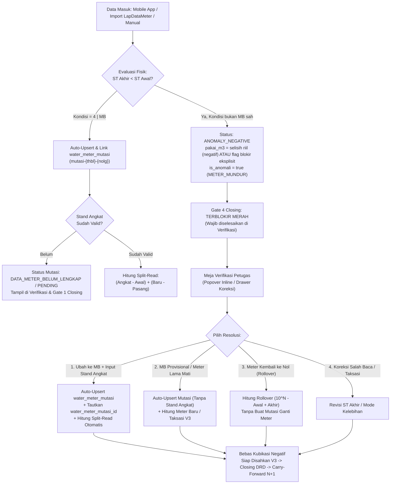

# Riset & Arsitektur Tahan Banting: Penanganan Meter Baru (MB), Stand Angkat, dan Kubikasi Negatif

Dokumen ini merangkum hasil **audit forensik kode proyek saat ini**, **referensi standar sistem *billing* utilitas air (PDAM / Perumda Air Minum, SAP IS-U, Oracle Utilities CC&B/MDM)**, serta **rancangan arsitektur *end-to-end*** agar penanganan kasus Meter Baru (`MB`) dan pemakaian minus (`-`) berjalan matang, bebas *deadlock*, dan tidak pernah bocor saat Tutup Bulan (*Closing DRD*).

---

## 1. Bedah Forensik: Mengapa Sistem Saat Ini Bermasalah?

Hasil penelusuran kode dari hulu (Import/Mobile) hingga hilir (Verifikasi & Closing) menemukan **5 cacat arsitektural utama** yang menjelaskan persis gejala yang Anda alami:

### Temuan 1 — *Deadlock* Alert: *"Stand angkat hanya dapat disimpan jika laporan terhubung ke data mutasi meter"*
Pada [verifikasi.router.ts](file:///C:/Users/DESKTOP/Documents/elysia/packages/backend/src/modules/pencatat-meter/verifikasi/verifikasi.router.ts#L1043-L1082), endpoint `PATCH /v1/laporan-harian/:id/koreksi` mengecek kolom `cater_baca_meter.water_meter_mutasi_id`. Jika `NULL`, server langsung menolak dengan HTTP `400 METER_MUTASI_REQUIRED`.

Padahal di lapangan, kolom `water_meter_mutasi_id` hampir selalu `NULL` karena 3 sebab:
1. **Jalur Import LapDataMeter** ([import-data.service.ts](file:///C:/Users/DESKTOP/Documents/elysia/packages/backend/src/services/pencatat-meter/import/import-data.service.ts#L1077-L1124)): Saat mengimpor CSV yang memiliki kondisi `4 | MB`, kode impor **tidak pernah membuat maupun menautkan** baris ke tabel `water_meter_mutasi`.
2. **Temuan Baru di Meja Verifikasi**: Petugas lapangan sering mencatat dengan kondisi `Normal` (misal Stand Awal `1.450`, Stand Akhir `12`), baru saat Verifikator memeriksa foto terlihat bahwa meternya adalah **Meter Baru**. Ketika Verifikator mengubah kelainan menjadi `MB` dan mengisi Stand Angkat di [ModalKoreksi.tsx](file:///C:/Users/DESKTOP/Documents/elysia/apps/web/src/features/pencatat-meter/verifikasi/components/modal/ModalKoreksi.tsx#L297-L315) atau Popover inline [SelEditInline.tsx](file:///C:/Users/DESKTOP/Documents/elysia/apps/web/src/features/pencatat-meter/verifikasi/components/tabel/SelEditInline.tsx#L291-L300), server menolak karena menuntut data mutasi sudah ada lebih dulu (*Catch-22*).
3. **Bug Relasi pada Mobile Submit** ([cater-verifikasi.service.ts](file:///C:/Users/DESKTOP/Documents/elysia/packages/backend/src/services/pencatat-meter/cater/cater-verifikasi.service.ts#L371-L487)): Jika mutasi sudah diinput tim Teknik lebih dulu (`mutasiMb` ditemukan di baris 198), blok `insert`/`onConflictDoUpdate` `cater_baca_meter` justru lupa mengisi `waterMeterMutasiId: mutasiMb.id`.

---

### Temuan 2 — Mengapa Pemakaian Minus (`-`) Terbaca `"0 anomali"` di Konsol Tutup Bulan (Gate 4)?
Di halaman Konsol Tutup Bulan ([ClosingWizardStepper.tsx](file:///C:/Users/DESKTOP/Documents/elysia/apps/web/src/features/penagihan/closing/components/ClosingWizardStepper.tsx#L580-L616)), **Gate 4 (4. Bebas Anomali & Kubikasi Negatif)** membaca nilai `verifKoreksiCount` dari `closing.service.ts`. Angka ini terbaca **`0 anomali`** akibat **4 lubang berantai**:

1. **Clamping Paksa `pakai_m3 = 0` di Database**:
   - Di [import-data.service.ts](file:///C:/Users/DESKTOP/Documents/elysia/packages/backend/src/services/pencatat-meter/import/import-data.service.ts#L1073-L1075): `if (pakaiM3 < 0) { pakaiM3 = 0; }`.
   - Di [cater-verifikasi.service.ts](file:///C:/Users/DESKTOP/Documents/elysia/packages/backend/src/services/pencatat-meter/cater/cater-verifikasi.service.ts#L250): `const pakaiM3Fisik = Math.max(0, hasilMode.selisihFisikM3)`.
   - Akibatnya, meskipun `stma (12) < stml (1450)`, angka di kolom `pakai_m3` database tersimpan `0`, **bukan `-1438`**.
2. **Status `ANOMALY_NEGATIVE` Terlewat dari Daftar Blokir Closing**:
   - `cater-verifikasi.service.ts` (baris 281) memberi status `'ANOMALY_NEGATIVE'` untuk meter mundur.
   - Namun [closing.service.ts](file:///C:/Users/DESKTOP/Documents/elysia/packages/backend/src/services/penagihan/closing/closing.service.ts#L187-L191) hanya memblokir `new Set(['NEED_RESURVEY', 'ANOMALY', 'DRAFT'])` (begitu pula SQL di baris 719 & 996). Status `'ANOMALY_NEGATIVE'` **lolos tanpa terdeteksi** dan masuk ke `barisSiapDisahkan`!
3. **Import LapDataMeter Menyimpan Status `'SUBMITTED'` & Closing Mengabaikan `is_anomali` / `stma < stml`**:
   - Baris impor disimpan sebagai `statusVerifikasi = 'SUBMITTED'`, `pakaiM3 = '0'`, `isAnomali = true`, `kodeAnomaliUtama = 'METER_MUNDUR'`.
   - Saat [closing.service.ts](file:///C:/Users/DESKTOP/Documents/elysia/packages/backend/src/services/penagihan/closing/closing.service.ts#L447-L456) mengecek `BLOCKING_VERIFIKASI_STATUSES.has(status) || vol < 0`, keduanya bernilai `false` (`'SUBMITTED'` tidak diblokir, dan `0 < 0` adalah `false`). Closing sama sekali tidak memeriksa apakah `stma_efektif < stml_efektif`!
4. **Perbedaan Rumus UI Verifikasi vs Database**:
   - Di UI Verifikasi ([hasil-pembacaan.ts](file:///C:/Users/DESKTOP/Documents/elysia/apps/web/src/features/pencatat-meter/verifikasi/lib/hasil-pembacaan.ts#L55-L68)), kalkulasi sel menghitung `standAkhir - standAwal` secara langsung sehingga menampilkan angka **minus** di layar verifikator, sementara Konsol Closing melaporkan **`0 anomali`**.

> [!CAUTION]
> **Risiko Fatal Jika Dibiarkan**: Apabila operator menekan *"Sahkan Seluruh Bacaan Meter"* lalu *"Kunci Buku"*, bacaan `stma < stml` yang belum diselesaikan sebagai Meter Baru akan terbit menjadi tagihan `0 m³`, dan bulan depannya `stand_awal` pelanggan langsung melompat turun tanpa rekam mutasi meter!

---

### Temuan 3 — *Split-Brain* antara Modul Verifikasi, Modul GWM, dan Konsol Closing
Saat ini ada **dua tempat penyimpanan** data ganti meter yang tidak saling menyinkronkan:
- Koreksi dari **Verifikasi Petugas** ([verifikasi.router.ts](file:///C:/Users/DESKTOP/Documents/elysia/packages/backend/src/modules/pencatat-meter/verifikasi/verifikasi.router.ts#L1173-L1200)) menulis ke `cater_baca_meter.stand_angkat_revisi`, tetapi **tidak mengupdate** `water_meter_mutasi.stand_angkat`.
- Sebaliknya, persetujuan Stand Angkat dari **Konsol Closing** ([closing.service.ts](file:///C:/Users/DESKTOP/Documents/elysia/packages/backend/src/services/penagihan/closing/closing.service.ts#L1840-L1899) `verifikasiStandAngkat`) hanya mengubah status `water_meter_mutasi` menjadi `'APPROVED'`, **tanpa menghitung ulang kubikasi di `cater_baca_meter`** dan **tanpa mengupdate nomor meter baru di tabel `pelanggan`** (berbeda dari [gwm.service.ts](file:///C:/Users/DESKTOP/Documents/elysia/packages/backend/src/services/rpm/gwm/gwm.service.ts#L393-L501)).

---

### Temuan 4 — Bug Evaluasi Anomali & Penimpaan Angka Asli Saat Koreksi MB
Di [verifikasi.router.ts](file:///C:/Users/DESKTOP/Documents/elysia/packages/backend/src/modules/pencatat-meter/verifikasi/verifikasi.router.ts#L1165-L1185):
- Saat verifikator mengubah kondisi menjadi `'MB'`, router mengirim `kodeTmss: 'MB'` (nama kondisi, bukan kode `'4'`) ke `evaluasiAnomaliBaris`. Akibatnya, mesin anomali ([anomali-evaluator.ts](file:///C:/Users/DESKTOP/Documents/elysia/packages/backend/src/domain/cater/anomali-evaluator.ts#L175-L180)) gagal mengenali baris tersebut sebagai Meter Baru dan justru menandainya sebagai anomali `METER_MUNDUR`!
- Selain itu, baris 1175–1176 menimpa kolom asli `stml` & `stma` milik petugas alih-alih menyimpannya di kolom revisi (`stml_revisi` & `stma_revisi`), sehingga jejak bacaan awal lapangan hilang.

---

### Temuan 5 — *Carry-Forward* Bulan Baru Mengabaikan `ket_catat_revisi`
Di [carry-forward.ts](file:///C:/Users/DESKTOP/Documents/elysia/packages/db/src/carry-forward.ts#L305-L435), fungsi pembukaan DPM bulan berikutnya hanya membaca `caterLalu.ketCatat` (belum memprioritaskan `ketCatatRevisi`), serta belum memiliki cabang eksplisit `modeKondisi === 'METER_BARU'` untuk menjamin `akumulasi_taksasi_m3` meter lama di-reset ke `'0.00'`.

---

## 2. Referensi Standar Industri & Praktik Terbaik Utilitas Air (PDAM & Enterprise CIS)

Berdasarkan standar operasional **Perumda Air Minum / PDAM di Indonesia** (prosedur Berita Acara / SPPK Ganti Meter & Perdir Penagihan) serta arsitektur **Enterprise Utility CIS/MDM** (**SAP IS-U Device Management** & **Oracle Utilities CC&B / Meter Data Management VEE**), terdapat **5 prinsip emas** penanganan pergantian meter:

### A. Rumus Baku *Split-Read* (Dua Segmen Satu Siklus)
Ketika meter diganti di tengah periode berjalan, konsumsi air dihitung dari penjumlahan dua segmen fisik:

$$\text{Volume Meter Lama } (V_1) = \text{Stand Angkat} - \text{Stand Awal Bulan Ini}$$
$$\text{Volume Meter Baru } (V_2) = \text{Stand Akhir Bulan Ini} - \text{Stand Pasang}$$
$$\text{Total Pemakaian Fisik } (V_{\text{total}}) = V_1 + V_2$$

- **Stand Pasang ($\ge 0$)**: Meter baru dari pabrik sering tidak mulai dari `0` mutlak (misal `1` atau `2 m³` sisa uji tera pabrik/bench test), begitu pula meter rekondisi tera ulang. Sistem wajib menyediakan field `Stand Pasang` (default `0`, dapat diubah).
- **Syarat Validitas Segmen**: Secara fisik pada meter sehat, $V_1 \ge 0$ ($\text{Stand Angkat} \ge \text{Stand Awal}$) dan $V_2 \ge 0$ ($\text{Stand Akhir Baru} \ge \text{Stand Pasang}$).

### B. Realitas Dua Jalur Kedatangan Data (*Out-of-Sequence Field Events*)
Dalam literatur CIS (SAP IS-U & Oracle CC&B), pergantian meter selalu terjadi melalui **2 jalur yang waktunya tidak selalu berurutan**:
1. **Top-Down (SPPK / Berita Acara Teknik Masuk Duluan)**:
   Tim Distribusi/Teknik mengganti meter di lapangan dan menginput BA Ganti Meter (`No. Meter Lama`, `Stand Angkat`, `No. Meter Baru`, `Stand Pasang`). Saat petugas baca meter datang akhir bulan, sistem sudah mengetahui adanya mutasi.
2. **Bottom-Up / *Field-Discovered Meter Swap* (Ditemukan Petugas Cater / Verifikator Duluan)**:
   *Ini kasus paling sering di PDAM!* Tim Teknik sudah mengganti meter fisik di rumah pelanggan, tetapi berkas SPPK belum diinput ke komputer. Petugas Cater memotret meter baru berangka kecil (misal `14`, padahal bulan lalu `1.820`).
   - **Standar CIS**: Verifikator **WAJIB BISA** menginisiasi/mencatat status `Meter Baru (MB)` beserta `Stand Angkat` (jika tertera di kartu pelanggan/tembok/konfirmasi WA teknik) **langsung dari layar Verifikasi**, dan sistem secara transaksional **membuat/meng-upsert dokumen mutasi otomatis** di latar belakang tanpa melempar error!

### C. Membedakan 4 Penyebab `Stand Akhir < Stand Awal` (Jangan Dicampur!)
Di Oracle MDM (VEE Rules) dan SAP IS-U (`EA05` Outsorting), tidak semua `stma < stml` adalah Ganti Meter. Sistem yang matang menyediakan jalur resolusi yang tegas untuk **4 skenario berbeda**:

| Skenario Fisik | Ciri di Lapangan / Foto | Cara Hitung Pemakaian yang Benar | Efek ke Master & Bulan Depan ($N+1$) |
| :--- | :--- | :--- | :--- |
| **1. Ganti Meter (`4 \| MB`)** | Fisik meter baru, segel baru, no seri berubah | $( \text{Stand Angkat} - \text{ST Awal} ) + ( \text{ST Baru} - \text{Stand Pasang} )$ | Reset kredit taksasi ke `0`; `stand_awal(N+1) = ST Baru`; update `no_meter` (bila ada) |
| **2. Meter Putar Penuh / Kembali ke Nol (*Dial Rollover*)** | Fisik meter **masih meter lama**, bulan lalu mis. `9.992`, bulan ini `0.015` (melewati `9999` / `99999`) | $(10^D - \text{ST Awal}) + \text{ST Akhir}$, di mana $D \in \{4, 5\}$ digit roda meter | `no_meter` tetap sama; tidak butuh BA Ganti Meter; `stand_awal(N+1) = ST Akhir` (`15`) |
| **3. Kelebihan Taksasi / Salah Catat Lalu (`M \| KELEBIHAN` / `REV_PENCATAT`)** | Meter lama, bulan lalu ditaksir/dicatat ketinggian (mis. `250`), fisik asli baru `235` | Rekonsiliasi kredit taksasi (`KREDIT_TAKSASI`) atau revisi `stml_revisi` | Mengurangi saldo kredit taksasi atau menyesuaikan basis stand |
| **4. Meter Rusak / Terbalik (`METER_MUNDUR` / `METER_RUSAK`)** | Jarum/angka bergerak mundur atau kaca hancur | Taksasi sesuai Perdir (pakai lalu / rata-rata 3 bln / minimum); tahan `stma_efektif = stml` | Menerbitkan *flag* wajib ganti meter ke tim Teknik; stand tidak boleh turun liar |

### D. Bagaimana Jika Meter Lama Rusak Total / Hilang atau BA Stand Angkat Belum Turun Saat Closing?
Di lapangan PDAM sering terjadi: meter diganti karena **pecah/buram total/dicuri (`MTA`)** sehingga `Stand Angkat` meter lama mustahil dibaca, ATAU kertas BA dari tim Teknik belum turun hingga batas waktu Tutup Bulan:
- **Sub-Mode Penyelesaian Meter Lama pada Kondisi `MB`**:
  1. **`STAND_ANGKAT_NORMAL` (Default)**: `Stand Angkat >= Stand Awal` wajib diisi. Kubikasi = pemakaian meter lama + meter baru.
  2. **`TANPA_STAND_ANGKAT_PROVISIONAL` (BA Teknik Menyusul)**: Hanya menghitung pemakaian meter baru `max(ST Baru - Stand Pasang, Minimum)` (atau taksasi V3), **otomatis menandai mutasi sebagai `DATA_METER_BELUM_LENGKAP`**. Ketika BA Teknik masuk bulan berikutnya, fitur `hitungKoreksiMbSusulan` (yang sudah ada fondasinya di [gwm.engine.ts](file:///C:/Users/DESKTOP/Documents/elysia/packages/backend/src/domain/gwm/gwm.engine.ts#L141-L169)!) menghitung selisih kurang/lebih tagih secara akurat tanpa merusak stand berjalan.
  3. **`METER_LAMA_MATI_ATAU_HILANG` (Final Tanpa Stand Angkat)**: Karena meter lama mati/buram/hilang, Stand Angkat diset tidak terbaca (`NULL`), dan pemakaian ditetapkan berdasarkan pemakaian meter baru saja atau penetapan taksasi V3 dengan alasan berita acara wajib.

---

## 3. Rancangan Arsitektur Solusi di Proyek Ini

Berikut alur terpadu (*Single Source of Truth*) yang menyatukan **Import/Mobile**, **Verifikasi Petugas**, **Modul GWM/Stand Angkat**, dan **Konsol Tutup Bulan**:

---

## 4. Rencana Perbaikan Teknis Berlapis (Siap Eksekusi)

### Lapisan 1 — Sabuk Pengaman Anti-Bocor pada Database, Import, & Gate 4 Closing
1. **Perketat Deteksi Anomali & Kubikasi Negatif di [closing.service.ts](file:///C:/Users/DESKTOP/Documents/elysia/packages/backend/src/services/penagihan/closing/closing.service.ts)**:
   - Masukkan `'ANOMALY_NEGATIVE'`, `'ANOMALY_HIGH'`, `'ANOMALY_LOW'` ke dalam `BLOCKING_VERIFIKASI_STATUSES` (serta klausa SQL di `postingDatameterMassal` dan `eksekusiClosing`).
   - Tambahkan pengecekan fisik langsung (**Invarian Stand Mundur**): setiap baris yang **bukan** `MB` valid / `ROLLOVER` / `KREDIT_TAKSASI`, apabila `COALESCE(stma_revisi, stma) < COALESCE(stml_revisi, stml)` atau `pakaiEfektif < 0`, **WAJIB** masuk ke `barisButuhKoreksi` dan memblokir **Gate 4 (`4. Bebas Anomali & Kubikasi Negatif`)**!
   - Dengan demikian, kasus pemakaian minus tidak akan pernah lagi terbaca `"0 anomali"` di Konsol Tutup Bulan.
2. **Perbaiki [import-data.service.ts](file:///C:/Users/DESKTOP/Documents/elysia/packages/backend/src/services/pencatat-meter/import/import-data.service.ts)**:
   - Jika baris CSV memiliki `stma < stml` dan bukan `MB`, jangan disamarkan menjadi `'SUBMITTED'` biasa dengan `pakaiM3 = 0`—beri `statusVerifikasi = 'ANOMALY_NEGATIVE'` (dan simpan selisih negatif riil atau tandai blokir eksplisit) agar langsung muncul merah di Verifikasi & Gate 4 Closing.
   - Jika baris CSV memiliki `tmss = '4'` atau `ketCatat = 'MB'`, otomatis *upsert* draft `water_meter_mutasi` (`mutasi-${thbl}-${nolg}`) dan isi `waterMeterMutasiId` pada `cater_baca_meter`.

### Lapisan 2 — Hilangkan *Deadlock* & Satukan *Single Source of Truth* Mutasi Meter
1. **Auto-Upsert `water_meter_mutasi` dari Halaman Verifikasi ([verifikasi.router.ts](file:///C:/Users/DESKTOP/Documents/elysia/packages/backend/src/modules/pencatat-meter/verifikasi/verifikasi.router.ts#L1043-L1205))**:
   - Hapus blokir *Catch-22* `"Stand angkat hanya dapat disimpan jika laporan terhubung ke data mutasi meter."`!
   - Ketika Verifikator menyimpan koreksi dengan kondisi `MB` (baik dari Popover 2-input tabel maupun Drawer `ModalKoreksi`), jika `row.waterMeterMutasiId` masih `NULL`, backend di dalam satu transaksi DB **otomatis membuat/meng-upsert** baris `water_meter_mutasi` (`id = mutasi-${row.thbl}-${row.nolg}`), mengisi `noMeterLama` dari master pelanggan, menyimpan `standAngkat` & `standPasang`, serta menautkan `water_meter_mutasi_id` ke `cater_baca_meter`!
   - Validasi matematis ketat via `hitungKubikasiGantiMeter`: pastikan `standAngkat >= stml` dan `standMeterBaru >= standPasang` (kecuali dipilih sub-opsi Meter Lama Rusak / BA Menyusul).
2. **Jaga Kemurnian Data Asli Petugas & Perbaiki Kode TMSS `'4'`**:
   - Saat koreksi di `verifikasi.router.ts`, **jangan timpa** `cater_baca_meter.stml` dan `cater_baca_meter.stma` asli! Simpan perubahan murni di `stml_revisi`, `stma_revisi`, `pakai_m3_revisi`, `ket_catat_revisi`, `stand_angkat_revisi`, `stand_meter_baru_revisi`.
   - Petakan `'MB'` -> `kodeTmss = '4'` sebelum memanggil `evaluasiAnomaliBaris` agar hasil koreksi MB tidak salah dicap `METER_MUNDUR`.
3. **Satukan Logika Approval Mutasi di [closing.service.ts](file:///C:/Users/DESKTOP/Documents/elysia/packages/backend/src/services/penagihan/closing/closing.service.ts#L1840-L1899) & [gwm.service.ts](file:///C:/Users/DESKTOP/Documents/elysia/packages/backend/src/services/rpm/gwm/gwm.service.ts)**:
   - Saat admin menyetujui mutasi dari Konsol Closing (`1. Ganti Meter`), panggil alur sinkronisasi yang sama dengan `gwmService.verifikasiMutasiGantiMeter` sehingga `cater_baca_meter` dan `pelanggan.no_meter` selalu ikut tersinkronisasi 100%.

### Lapisan 3 — Pematangan UI/UX di Halaman Verifikasi Petugas
1. **Upgrade Popover MB ([SelEditInline.tsx](file:///C:/Users/DESKTOP/Documents/elysia/apps/web/src/features/pencatat-meter/verifikasi/components/tabel/SelEditInline.tsx)) & Drawer Koreksi ([ModalKoreksi.tsx](file:///C:/Users/DESKTOP/Documents/elysia/apps/web/src/features/pencatat-meter/verifikasi/components/modal/ModalKoreksi.tsx))**:
   - Tampilkan **Rincian Kalkulasi Split-Read Langsung (*Live Breakdown*)**:
     - `Pakai Meter Lama`: `Stand Angkat (1.460) − Stand Awal (1.450) = 10 m³`
     - `Pakai Meter Baru`: `Stand Baru (15) − Stand Pasang (0) = 15 m³`
     - `Total Pemakaian`: **`25 m³`**
   - Tambahkan field opsional **`Stand Pasang`** (default `0`) dan **`No. Meter Baru`** (opsional jika sudah diketahui dari foto meter baru!).
   - Sediakan toggle/pilihan eksplisit jika **Stand Angkat Tidak Terbaca / BA Teknik Menyusul** (agar verifikator tidak terpaksa memalsukan `Stand Angkat = Stand Awal` saat meter lama pecah/buram/BA belum turun).
   - Pada baris yang memiliki `ST Akhir < ST Awal`, tampilkan *Smart Action Hint* di Drawer Koreksi: apakah ini **Ganti Meter Baru (`MB`)**, **Meter Putar Penuh ke Nol (`Rollover`)**, atau **Salah Baca Stand**.

### Lapisan 4 — Ketahanan *Carry-Forward* Bulan Baru ($N+1$)
1. Di [carry-forward.ts](file:///C:/Users/DESKTOP/Documents/elysia/packages/db/src/carry-forward.ts#L305-L435):
   - Prioritaskan `COALESCE(ket_catat_revisi, ket_catat)` dan `COALESCE(stand_meter_baru_revisi, stma_revisi, stma)` saat membawa `stand_awal` ke periode $N+1$.
   - Jika periode $N$ adalah `METER_BARU`, paksa `akumulasi_taksasi_m3 = '0.00'` agar sisa taksasi meter lama tidak terbawa memotong meter baru.

---

## 5. Keputusan Desain yang Perlu Konfirmasi Anda Sebelum Eksekusi

Agar implementasinya 100% selaras dengan aturan bisnis operasional PDAM Anda, mohon konfirmasi 3 poin singkat berikut:

1. **Kasus BA Teknik Belum Masuk / Meter Lama Mati Saat Ganti Meter**:
   Apakah di halaman Verifikasi kita izinkan mode **"Stand Angkat Belum Ada / Meter Lama Rusak"** (di mana pemakaian bulan berjalan dihitung dari meter baru `Stand Baru - Stand Pasang` atau taksasi V3, lalu mutasi ditandai `DATA_METER_BELUM_LENGKAP`), atau **Stand Angkat wajib diisi angka minimal sama dengan Stand Awal** di semua kasus `MB`?
2. **Persetujuan Mutasi yang Diinput oleh Verifikator**:
   Jika Verifikator (V1/V2/V3) sudah mengisi `Stand Angkat` + `Stand Meter Baru` langsung di halaman Verifikasi Petugas, apakah status mutasi di Gate 1 Closing otomatis dianggap **`PENDING`** (tetap perlu diklik *Setujui* sekali lagi di Konsol Tutup Bulan bila disertai No. Meter Baru) atau langsung siap lanjut ke V3 tanpa menghambat Gate 1?
3. **Kasus Meter Putar Penuh Kembali ke Nol (*Dial Rollover*, misal `9995` -> `0012` tanpa ganti meter)**:
   Apakah di tempat Anda pernah terjadi kasus meter lama kembali ke `0000` karena penuh (*rollover* 4/5 digit) dan perlu kita sediakan tombol/kondisi hitung otomatisnya sekalian, atau fokus penuh pada `MB` & blokir kubikasi negatif terlebih dahulu?
