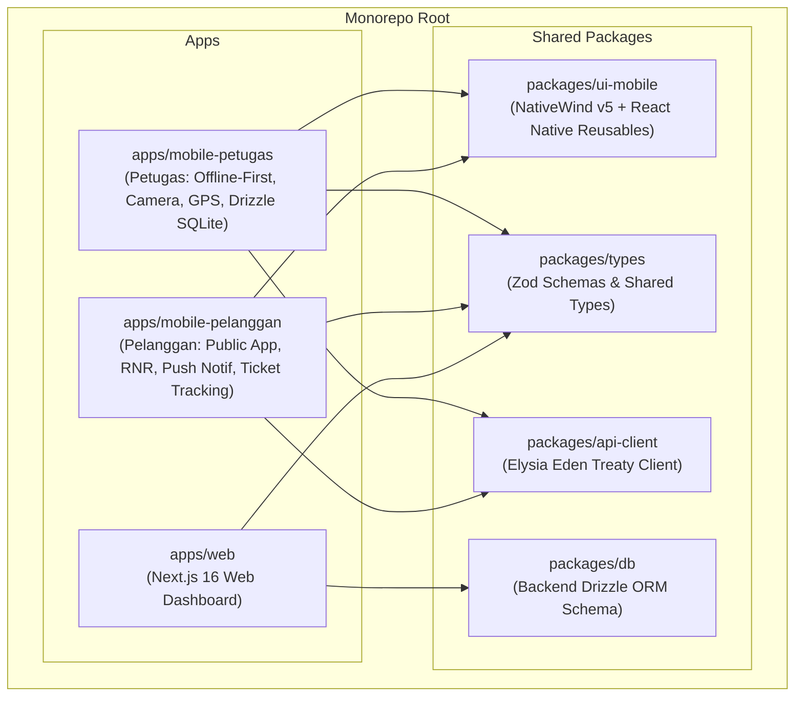
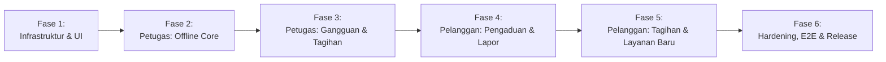

# Master Blueprint: Mobile Apps Architecture, Coding Standards & Roadmap
**Sistem Utilitas Air (Cater Monorepo): Petugas Lapangan & Pelanggan Mandiri**

---

## 1. Arsitektur Tingkat Tinggi (High-Level Architecture)

Aplikasi mobile dibangun dalam ekosistem **Turborepo** yang telah ada (`apps/*` dan `packages/*`), memaksimalkan *code-sharing* tanpa duplikasi kode.



---

## 2. Struktur Root Folder & Monorepo Layout

Berikut struktur direktori yang disarankan untuk mengintegrasikan dua aplikasi mobile ke dalam proyek:

```plaintext
elysia/
├── apps/
│   ├── web/                          # Existing Next.js 16 web app
│   ├── mobile-petugas/               # Aplikasi Khusus Petugas Lapangan
│   │   ├── app/                      # Expo Router (File-based routes)
│   │   │   ├── (auth)/               # Login Petugas & Verifikasi Device
│   │   │   │   └── login.tsx
│   │   │   ├── (tabs)/               # Bottom Tabs Dashboard
│   │   │   │   ├── _layout.tsx
│   │   │   │   ├── index.tsx         # Ringkasan Tugas & Status Sync
│   │   │   │   ├── baca-meter/       # Daftar Rute & Eksekusi Baca Meter
│   │   │   │   │   ├── index.tsx
│   │   │   │   │   ├── [nolg].tsx    # Form Catat Stand + Kamera + GPS
│   │   │   │   │   └── rute-map.tsx  # Peta Sebaran Pelanggan di Rute
│   │   │   │   ├── gangguan/         # Laporan Temuan Lapangan
│   │   │   │   │   ├── index.tsx
│   │   │   │   │   └── buat.tsx
│   │   │   │   ├── langganan/        # Pencarian Data & Histori Pelanggan
│   │   │   │   └── tagihan/          # Info Tunggakan & Tagihan
│   │   │   └── _layout.tsx           # Root Provider & Offline Sync Watcher
│   │   ├── src/
│   │   │   ├── core/
│   │   │   │   ├── db/               # Local SQLite (expo-sqlite + Drizzle)
│   │   │   │   │   ├── schema.ts     # Schema tabel lokal: rute, baca_meter, outbox_queue
│   │   │   │   │   ├── client.ts
│   │   │   │   │   └── migrations/
│   │   │   │   ├── sync/             # Offline-First Sync Engine (Outbox Pattern)
│   │   │   │   │   ├── sync-manager.ts
│   │   │   │   │   ├── sync-queue.ts
│   │   │   │   │   └── use-sync-status.ts
│   │   │   │   ├── location/         # GPS Geofencing & Location Helper
│   │   │   │   └── storage/          # SecureStore untuk Token Petugas
│   │   │   └── features/             # Feature-sliced modules
│   │   │       ├── baca-meter/
│   │   │       │   ├── components/   # MeterCameraView, StandInput, WatermarkCanvas
│   │   │       │   ├── hooks/        # useMeterReading, useOfflineRute
│   │   │       │   └── types.ts
│   │   │       ├── gangguan/
│   │   │       └── langganan/
│   │   ├── app.json
│   │   ├── package.json
│   │   └── tailwind.config.js        # NativeWind configuration
│   │
│   └── mobile-pelanggan/             # Aplikasi Khusus Pelanggan / Publik
│       ├── app/
│       │   ├── (auth)/               # Login No. Pelanggan + OTP
│       │   ├── (tabs)/
│       │   │   ├── index.tsx         # Dashboard Pelanggan & Status Air Hari Ini
│       │   │   ├── pengaduan/        # Pengaduan Air & Tracking Tiket
│       │   │   │   ├── index.tsx
│       │   │   │   ├── buat.tsx      # Form Lapor Kerusakan / Air Mati
│       │   │   │   └── [id].tsx      # Timeline Tracking Penanganan Tiket
│       │   │   ├── meter-mandiri/    # Lapor Angka Meter Mandiri (Periode Tertentu)
│       │   │   ├── tagihan/          # Cek Tagihan, Rincian & Riwayat Pemakaian
│       │   │   └── layanan/          # Permohonan Sambungan Baru / Pemutusan
│       │   └── _layout.tsx
│       ├── src/
│       │   └── features/
│       │       ├── pengaduan/
│       │       ├── meter-mandiri/
│       │       └── tagihan/
│       ├── app.json
│       ├── package.json
│       └── tailwind.config.js
│
└── packages/
    ├── ui-mobile/                    # Shared Mobile UI Design System
    │   ├── src/
    │   │   ├── components/           # React Native Reusables (RNR)
    │   │   │   ├── button.tsx
    │   │   │   ├── card.tsx
    │   │   │   ├── dialog.tsx
    │   │   │   ├── input.tsx
    │   │   │   ├── badge.tsx
    │   │   │   ├── progress.tsx
    │   │   │   ├── tabs.tsx
    │   │   │   └── typography.tsx
    │   │   ├── lib/
    │   │   │   └── utils.ts          # cn() helper (clsx + tailwind-merge)
    │   │   └── index.ts
    │   └── package.json
    ├── api-client/                   # Shared Elysia Eden Treaty Client
    │   ├── src/
    │   │   ├── client.ts             # treaty<App>(BACKEND_URL)
    │   │   └── index.ts
    │   └── package.json
    ├── types/                        # Existing: Shared Zod Schemas & Domain Types
    └── db/                           # Existing: PostgreSQL Schema & Migrations
```

---

## 3. Standar & Konvensi Penulisan Kode (Coding Standards)

### A. Konvensi Penamaan (Naming Conventions)

| Tipe | Format | Contoh | Aturan |
| :--- | :--- | :--- | :--- |
| **Files & Folders** | `kebab-case` | `baca-meter-card.tsx`, `use-sync-status.ts` | Folder fitur dan file komponen selalu huruf kecil dipisah strip. |
| **Routes (Expo Router)** | `kebab-case` | `[nolg].tsx`, `rute-map.tsx` | Mengikuti aturan file-based route. |
| **Komponen UI** | `PascalCase` | `MeterCameraPreview`, `TicketTimelineCard` | Nama deskriptif yang mencerminkan fungsinya. |
| **Hooks** | `camelCase` (diawali `use`) | `useOfflineQueue()`, `useMeterCamera()` | Mengembalikan tuple/objek yang jelas. |
| **Zod Schemas** | `camelCase` (diakhiri `Schema`) | `catatMeterInputSchema`, `pengaduanFormSchema` | Terletak di `@cater/types`. |
| **Tipe / Interface** | `PascalCase` | `PelangganRecord`, `MeterReadingItem` | Tanpa prefix `I` atau `T`. |
| **Database Tables (SQLite)** | `snake_case` (jamak/kata benda) | `local_baca_meter`, `sync_outbox` | Konsisten dengan tabel database PostgreSQL backend. |

---

### B. Prinsip Pemisahan Tanggung Jawab (Separation of Concerns - SoC)

Kode harus dibagi ke dalam 4 lapisan terpisah (*Strict Layering*):

```
┌────────────────────────────────────────────────────────┐
│ 1. Presentation Layer (Pure UI / RNR Components)       │
│    -> Hanya merender JSX & NativeWind classes          │
│    -> Menerima data & callback via Props (Stateless)   │
└───────────────────────────▲────────────────────────────┘
                            │
┌───────────────────────────┴────────────────────────────┐
│ 2. Feature / Controller Hook                           │
│    -> State mesin layar (React Hook Form, TanStack Q) │
│    -> Menghubungkan UI ke domain logic                │
└───────────────────────────▲────────────────────────────┘
                            │
┌───────────────────────────┴────────────────────────────┐
│ 3. Domain & Offline Sync Engine                        │
│    -> Outbox Queue, Drizzle SQLite, Storage lokal      │
│    -> Validasi Geotagging & Kompresi Foto              │
└───────────────────────────▲────────────────────────────┘
                            │
┌───────────────────────────┴────────────────────────────┐
│ 4. Network / Transport Layer (@elysiajs/eden)          │
│    -> Type-safe Eden Treaty Client ke Backend Elysia   │
└────────────────────────────────────────────────────────┘
```

#### Contoh Penerapan SoC pada Fitur Baca Meter:

1. **Layer 1: Component UI (`components/meter-form.tsx`)**
```tsx
// UI murni tanpa fetch langsung
interface MeterFormProps {
  initialStand: number;
  onSubmit: (standBaru: number, photoUri: string) => Promise<void>;
  isSubmitting: boolean;
}

export function MeterForm({ initialStand, onSubmit, isSubmitting }: MeterFormProps) {
  // Hanya validasi form lokal dan styling NativeWind
}
```

2. **Layer 2: Hook (`hooks/use-meter-submission.ts`)**
```tsx
// Mengelola state, kalkulasi konsumsi, dan pemicu storage
export function useMeterSubmission(nolg: string) {
  const { queueReading } = useSyncQueue();

  const handleSave = async (data: FormInput) => {
    // 1. Ambil koordinat GPS akurat
    const coords = await getCurrentCoords();
    // 2. Kompres foto
    const compressed = await compressMeterPhoto(data.photoUri);
    // 3. Masukkan ke antrean lokal (Outbox Pattern)
    await queueReading({ nolg, stand: data.stand, coords, photo: compressed });
  };

  return { handleSave };
}
```

3. **Layer 3: Sync Engine (`core/sync/sync-queue.ts`)**
```tsx
// Menyimpan ke SQLite lokal terlebih dahulu (Zero Data Loss)
export async function insertOutbox(entry: ReadingPayload) {
  await localDb.insert(syncOutboxTable).values({
    id: crypto.randomUUID(),
    payload: JSON.stringify(entry),
    status: 'PENDING',
    retryCount: 0,
    createdAt: new Date(),
  });
}
```

---

### C. Pola Idiomatik React Native & NativeWind v5

1. **Gunakan React Native Reusables & Primitives**:
   - Selalu gunakan komponen dasar dari `packages/ui-mobile` (`Button`, `Card`, `Input`, `Dialog`).
   - Hindari membuat elemen styling manual berulang-ulang dengan `StyleSheet.create`.
2. **List Virtualization**:
   - Jangan gunakan `ScrollView` dengan map untuk daftar pelanggan atau riwayat pengaduan ratusan item.
   - Gunakan **`@shopify/flash-list`** untuk daftar rute meteran agar *frame rate* tetap 60–120 FPS di perangkat Android lapangan berdaya rendah.
3. **Penanganan Area Layar (Safe Area & Keyboard)**:
   - Gunakan `useSafeAreaInsets` dari `react-native-safe-area-context`.
   - Gunakan `KeyboardAvoidingView` dengan `behavior={Platform.OS === 'ios' ? 'padding' : undefined}` pada form isian stand meter atau pengaduan.
4. **Keamanan & Kredensial**:
   - Jangan simpan token login / refresh token di `AsyncStorage`.
   - Selalu gunakan **`expo-secure-store`** untuk token JWT atau data sensitif petugas.

---

## 4. Roadmap Pengembangan



### Detail Milestone:

- **Fase 1: Foundation, Shared UI & Monorepo Setup (Sprint 1)**
  - Setup paket `packages/ui-mobile` dengan **NativeWind v5** & **React Native Reusables**.
  - Setup paket `packages/api-client` menggunakan `@elysiajs/eden`.
  - Inisialisasi `apps/mobile-petugas` dan `apps/mobile-pelanggan` menggunakan Expo SDK terbaru & Expo Router.

- **Fase 2: Aplikasi Petugas - Offline Engine & Baca Meter (Sprint 2 - 3)**
  - Implementasi schema SQLite lokal (`expo-sqlite` + `drizzle-orm`).
  - Fitur download data rute baca meter (500–2000 pelanggan per rayon) ke database lokal.
  - Modul Kamera (`expo-camera`) + Kompresi gambar (`expo-image-manipulator`) + GPS Geotagging (`expo-location`).
  - *Outbox sync engine*: otomatis kirim data ketika koneksi internet pulih.

- **Fase 3: Aplikasi Petugas - Gangguan, Langganan & Tagihan (Sprint 4)**
  - Modul Lapor Gangguan/Kebocoran Lapangan dengan Pinpoint Map (`react-native-maps`).
  - Pencarian offline cepat data pelanggan (Full-Text Search SQLite).
  - Cek tunggakan tagihan di lapangan & grafik pemakaian 6 bulan terakhir.

- **Fase 4: Aplikasi Pelanggan - Pengaduan Air & Lapor Mandiri (Sprint 5)**
  - Sistem autentikasi pelanggan (No. Pelanggan / No. Meter + OTP WhatsApp/SMS).
  - Modul Pengaduan Air dengan form terstruktur dan **Tracking Timeline Tiket** real-time.
  - Setup push notification (`expo-notifications`) untuk status tiket.
  - Modul Lapor Meter Mandiri dengan overlay panduan kamera dan validasi stand.

- **Fase 5: Aplikasi Pelanggan - Cek Tagihan & Layanan Baru (Sprint 6)**
  - Tampilan tagihan bulanan interaktif (rincian biaya abonemen, kubikasi, denda).
  - Formulir pendaftaran sambungan baru (Multi-step form wizard + upload KTP/PBB).
  - Permohonan pemutusan sementara / balik nama pelanggan.

- **Fase 6: Testing, Keamanan & Deployment (Sprint 7)**
  - Simulasi uji offline di area *blind spot* (matikan internet saat pencatatan meter).
  - Konfigurasi EAS Build (`eas.json`) untuk APK Android Petugas & AAB Play Store Pelanggan.
  - Integrasi Sentry untuk *crash reporting* di perangkat mobile.

---

## 5. Session Track (Panduan Eksekusi Bertahap)

| Track | Target Eksekusi | Kriteria Selesai (Definition of Done) |
| :---: | :--- | :--- |
| **Sesi 1** | **Setup Shared UI & Client** | `packages/ui-mobile` terkonfigurasi NativeWind v5; komponen Button, Input, Card dari RNR siap dipakai; `@elysiajs/eden` terhubung ke backend Elysia. |
| **Sesi 2** | **App Shell & Auth Petugas** | `apps/mobile-petugas` memiliki bottom tabs; login petugas terhubung ke Better-Auth backend via SecureStore. |
| **Sesi 3** | **SQLite & Offline Outbox Sync** | Tabel SQLite lokal berhasil di-generate dengan Drizzle; sinkronisasi antrean berfungsi dua arah (download rute & upload hasil baca). |
| **Sesi 4** | **Fitur Eksekusi Baca Meter** | Kamera foto meteran mengompresi gambar < 300KB; koordinat GPS terkunci otomatis; data tersimpan di SQLite lokal tanpa jeda. |
| **Sesi 5** | **Modul Gangguan & Peta Petugas** | Petugas dapat mengirim laporan pipa bocor dengan foto dan titik peta; data tersinkron ke dashboard web pengaduan. |
| **Sesi 6** | **App Shell & Auth Pelanggan** | `apps/mobile-pelanggan` terpasang; login menggunakan Nomor Pelanggan berhasil memuat info saldo dan data meter. |
| **Sesi 7** | **Modul Pengaduan & Tracking Tiket** | Pelanggan dapat membuat pengaduan air; kartu status tiket menampilkan tahapan (*Lapor -> Verifikasi -> Selesai*). |
| **Sesi 8** | **Lapor Mandiri & Cek Tagihan** | Kamera lapor mandiri dengan overlay bingkai kaca meter; rincian tagihan air bulanan tampil detail. |
| **Sesi 9** | **Formulir Sambungan Baru** | Form wizard step-by-step pendaftaran pelanggan baru dengan upload dokumen (`expo-document-picker`). |
| **Sesi 10** | **Build & Optimasi Rilis** | Build EAS APK untuk pengujian internal petugas lapangan; pengujian performa memori dan baterai. |

---

## 6. Pola Ketahanan Khusus (Resilience & Edge Cases)

1. **Anti-Nembak Meter (Geofencing Validation)**:
   - Saat petugas menekan tombol simpan stand meter, hitung jarak Euclidean/Haversine antara koordinat GPS ponsel saat ini dengan koordinat rumah pelanggan yang tersimpan.
   - Jika jarak > 50 meter, beri *warning badge* atau minta konfirmasi khusus untuk mencegah petugas mencatat dari jauh tanpa mendatangi meteran.
2. **Watermarking Foto Meteran**:
   - Foto yang disimpan diinjeksi metadata visual (*watermark timestamp*, tanggal, jam, dan koordinat GPS) sebagai bukti otentik fisik.
3. **Background Sync Retry Policy**:
   - Outbox queue menggunakan strategi *exponential backoff* jika server backend Elysia sedang sibuk atau sinyal buruk, sehingga tidak menguras baterai ponsel petugas.
