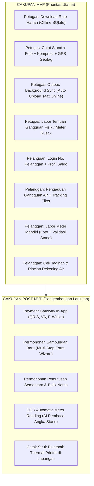
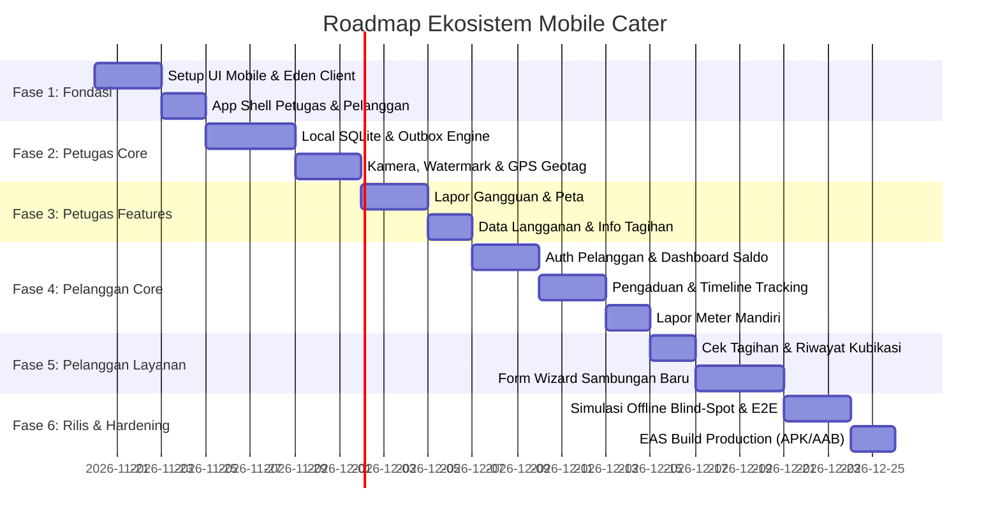

# Product Requirements Document (PRD), MVP Scope & Master Roadmap
**Ekosistem Aplikasi Mobile Cater (Petugas Lapangan & Pelanggan Mandiri)**
*Versi: 1.0.0 | Status: Active | Stack: Expo SDK, React Native Reusables, NativeWind v5, Elysia Eden, Drizzle SQLite*

---

## 1. Executive Summary & Visi Produk

Sistem Manajemen Utilitas Air (Cater) memerlukan ekstensi mobile untuk dua target pengguna dengan karakteristik ekstrem yang berbeda:
1. **Petugas Lapangan (Field Officer)**: Beroperasi di kondisi lapangan (gang sempit, area minim sinyal/offline, cuaca terik), membutuhkan kecepatan input, ketahanan data (zero data loss), GPS geotagging akurat, dan kompresi foto meteran.
2. **Pelanggan Mandiri (Customer / Citizen)**: Membutuhkan transparansi tagihan air, kemudahan lapor mandiri bulanan, dan kepastian tindak lanjut tiket pengaduan kebocoran/gangguan air.

Aplikasi mobile ini dibangun di atas monorepo Turborepo yang telah berjalan, terhubung langsung ke backend ElysiaJS via `@elysiajs/eden`, menggunakan sistem desain seragam berbasis **React Native Reusables (RNR)** dan **NativeWind v5**.

---

## 2. Pengguna Sasaran (User Personas)

| Persona | Peran | Kebutuhan Utama | Lingkungan Penggunaan |
| :--- | :--- | :--- | :--- |
| **Pak Budi (Petugas Cater)** | Petugas pembaca meter keliling | Membaca 300–800 meter/hari, simpan cepat, kamera responsif, bisa kerja tanpa kuota/sinyal (offline). | Lapangan, *device* Android *entry/mid-range*, outdoor, koneksi seluler tidak stabil. |
| **Pak Roni (Petugas Gangguan/Teknis)** | Petugas lapangan penanganan aduan | Menerima SPK/tiket gangguan pipa, navigasi rute ke lokasi, foto bukti perbaikan fisik. | Lapangan, sepeda motor, butuh peta dan geotagging akurat. |
| **Ibu Siti (Pelanggan Rumah Tangga)** | Pemilik sambungan air rumah | Cek rincian tagihan bulanan, lapor meter mandiri tanggal 20–25, lapor jika air mati/keruh. | Rumah/kantor, jaringan Wi-Fi/4G, membutuhkan UI yang intuitif dan bersih. |

---

## 3. Cakupan Minimum Viable Product (MVP) vs Post-MVP

Untuk menjamin kecepatan rilis dan stabilitas, fitur dikelompokkan ke dalam batas MVP:

---

## 4. Persyaratan Fungsional (Functional Requirements)

### Modul A: Petugas Lapangan (`apps/mobile-petugas`)
- **FR-P01 (Offline-First Route Sync)**: Sistem wajib mengunduh daftar rute pelanggan ke database SQLite lokal saat petugas berada di kantor/terhubung internet.
- **FR-P02 (Pencatatan Stand Meter)**: Petugas dapat menginput angka stand meter saat ini. Sistem otomatis menghitung konsumsi ($m^3 = \text{stand kini} - \text{stand lalu}$) dan memberi peringatan jika angka melonjak drastis atau lebih kecil.
- **FR-P03 (Kamera & Geotagging)**: Aplikasi mengambil foto meteran, melakukan kompresi otomatis menjadi $\le 300\text{ KB}$, mengunci koordinat GPS, dan memberi cap visual (*watermark* timestamp & GPS).
- **FR-P04 (Outbox Queue)**: Semua hasil pembacaan wajib tersimpan di tabel lokal `sync_outbox` berstatus `PENDING` sebelum di-upload, memastikan tidak ada data hilang jika aplikasi ditutup paksa.
- **FR-P05 (Lapor Gangguan)**: Petugas dapat melaporkan meter macet, segel putus, atau pipa bocor disertai foto dan titik pin map.
- **FR-P06 (Info Pelanggan & Tunggakan)**: Pencarian cepat pelanggan via nama/nolg di lokal SQLite untuk melihat histori pemakaian dan status rekening.

### Modul B: Pelanggan Mandiri (`apps/mobile-pelanggan`)
- **FR-C01 (Autentikasi Sederhana)**: Login menggunakan Nomor Pelanggan (NOLG) / Nomor Meter + verifikasi PIN / OTP.
- **FR-C02 (Pengaduan Terpadu)**: Pelanggan dapat membuat tiket keluhan (Air Mati, Air Keruh, Kebocoran Pipa, Meter Rusak) dengan foto bukti dan deskripsi.
- **FR-C03 (Timeline Tracking Tiket)**: Pelanggan dapat melihat status penanganan secara *real-time*: `Terkirim` $\rightarrow$ `Diverifikasi` $\rightarrow$ `Petugas Ditugaskan` $\rightarrow$ `Proses Perbaikan` $\rightarrow$ `Selesai`.
- **FR-C04 (Lapor Meter Mandiri)**: Fitur pelaporan mandiri pada tanggal aktif bulanan, dilengkapi bingkai pembidik kamera untuk memastikan foto tegak lurus dan terbaca.
- **FR-C05 (Rincian Rekening & Riwayat)**: Informasi tagihan air bulan berjalan (biaya air, biaya beban/administrasi, denda, status lunas/belum).

---

## 5. Persyaratan Non-Fungsional (Non-Functional Requirements)

1. **Performa Offline**: Pembukaan halaman baca meter dan pencarian pelanggan lokal harus berespons dalam $< 100\text{ ms}$ pada 2.000 data di SQLite lokal.
2. **Kinerja Memori & List**: Daftar rute pelanggan wajib menggunakan `@shopify/flash-list` dengan *frame rate* stabil $\ge 60\text{ fps}$.
3. **Efisiensi Jaringan**: Setiap foto yang dikirim dari lapangan wajib dikompresi maksimal lebar 1280px dan kualitas JPEG 70% ($\sim 150-300\text{ KB}$).
4. **Ketahanan Baterai**: Pelacakan GPS hanya aktif saat layar pembacaan dibuka dan dimatikan kembali setelah koordinat terkunci (*one-shot location fix*).
5. **Keamanan Data**: Kredensial autentikasi Better-Auth disimpan menggunakan `expo-secure-store` terenkripsi AES-256 tingkat OS.

---

## 6. Master Roadmap & Rencana Rilis

