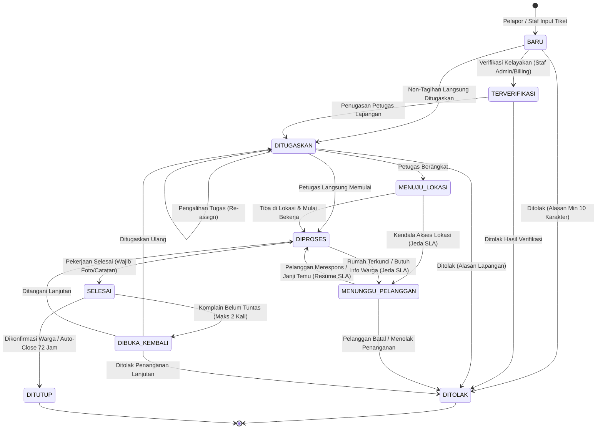

# Alur & State Machine Modul Pengaduan Tirtawening

Dokumen ini menjelaskan spesifikasi arsitektur domain, state machine tiket, aturan Service Level Agreement (SLA), matriks hak akses otorisasi, penanganan jeda pengerjaan, penutupan otomatis, serta siklus pembukaan kembali tiket pengaduan pelanggan Perumda Tirtawening.

Setiap nilai parameter yang saat ini masih menggunakan nilai asumsi awal ditandai secara eksplisit dengan label **[ASUMSI TODO-SOP]**.

---

## 1. Diagram State Machine (Alur Status Tiket)

Diagram alur status tiket menggunakan finite state machine (FSM) yang didefinisikan secara deterministik pada engine domain:

### Karakteristik Graf & Aturan Transisi
1. **Titik Awal & Jalur**: Semua tiket berawal dari status `BARU`. Seluruh status non-terminal dijamin memiliki jalur menuju status akhir (`DITUTUP` atau `DITOLAK`).
2. **Terminal**: Status `DITUTUP` dan `DITOLAK` bersifat terminal (tidak dapat diubah ke status mana pun, kecuali pembukaan kembali resmi melalui aksi `DIBUKA_KEMBALI` dari status `SELESAI`).
3. **Pemisahan Jalur Penugasan (B7)**: Status `DITUGASKAN` hanya dapat dicapai melalui endpoint penugasan khusus (`/tugaskan`), bukan melalui patch status langsung.
4. **Wajib Verifikasi untuk Tagihan (K1)**: Pengaduan dengan klasifikasi `NILAI_TAGIHAN_REKENING` dilarang keras melompat langsung dari `BARU` ke `DITUGASKAN`. Tiket wajib melewati `TERVERIFIKASI` terlebih dahulu.

---

## 2. Tabel Durasi & Target SLA (Service Level Agreement)

Durasi dihitung secara dinamis dari saat tiket dicatat (`createdAt`):

| Prioritas | Target Respons (`responsAt`) | Target Penyelesaian (`targetSelesaiAt`) | Keterangan Standar Asumsi |
| :--- | :---: | :---: | :--- |
| **DARURAT** | 1 Jam | 6 Jam | Kebocoran pipa dinas besar, pipa transmisi pecah [ASUMSI TODO-SOP] |
| **TINGGI** | 2 Jam | 24 Jam | Air tidak mengalir, air keruh pekat/bau [ASUMSI TODO-SOP] |
| **NORMAL** | 6 Jam | 48 Jam | Lapor stand meter, anomali lonjakan kubikasi [ASUMSI TODO-SOP] |
| **RENDAH** | 12 Jam | 72 Jam | Pergantian stop kran, administrasi rute baca [ASUMSI TODO-SOP] |

### Aturan Override SLA per Jenis Pengaduan
Secara bawaan durasi mengikuti tingkat prioritas tiket. Namun engine menyediakan wadah konfigurasi `SLA_OVERRIDE_PER_JENIS` di `pengaduan.config.ts` untuk memfasilitasi kebutuhan durasi khusus per jenis gangguan lapangan bila diatur oleh divisi terkait.

---

## 3. Aturan Jeda Pengerjaan (Status `MENUNGGU_PELANGGAN`) (K3)

Kondisi lapangan sering kali terhambat faktor eksternal (misal: pelanggan tidak berada di tempat, gerbang digembok, atau membutuhkan penggalian izin khusus).

1. **Mulai Dijeda**: Saat tiket dialihkan ke status `MENUNGGU_PELANGGAN`, sistem mencatat timestamp `jedaMulaiAt = now`.
2. **Pembekuan Sisa Waktu SLA (B9)**: Selama berstatus `MENUNGGU_PELANGGAN`, sisa menit SLA dibekukan dan tiket tidak dikategorikan melanggar SLA.
3. **Lanjut Pengerjaan (Resume SLA)**: Saat tiket kembali beralih keluar dari status `MENUNGGU_PELANGGAN` (menjadi `DIPROSES`):
   - Durasi jeda dihitung: `durasiJeda = now - jedaMulaiAt`.
   - Total jeda diakumulasi: `jedaTotalMenit = jedaTotalMenit + durasiJeda`.
   - Target batas selesai digeser secara adil: `targetSelesaiAt = targetSelesaiAt + durasiJeda`.
   - Kolom `jedaMulaiAt` dikosongkan kembali (`null`).

---

## 4. Matriks Hak Akses & Otorisasi Per Role (B6)

| Aksi Sistem | Role yang Diizinkan | Pembatasan Khusus |
| :--- | :--- | :--- |
| **BACA** (Daftar, Detail, Statistik) | `SUPERADMIN`, `EXECUTIVE`, `VERIFIKATOR_1..3`, `STAFF_ADMIN_BILLING`, `PELAKSANA` | `EXECUTIVE` hanya memiliki hak baca tanpa wewenang mutasi |
| **BUAT** (Registrasi Internal) | `SUPERADMIN`, `VERIFIKATOR_1..3`, `STAFF_ADMIN_BILLING`, `PELAKSANA` | Staf internal mencatat pengaduan warga via desk |
| **VERIFIKASI** (`TERVERIFIKASI`, `DITOLAK`) | `SUPERADMIN`, `VERIFIKATOR_1..3`, `STAFF_ADMIN_BILLING` | `STAFF_ADMIN_BILLING` **hanya** berwenang pada klasifikasi `NILAI_TAGIHAN_REKENING` |
| **TUGASKAN** | `SUPERADMIN`, `VERIFIKATOR_1..3` | Petugas penerima tugas harus berstatus aktif dengan role lapangan layak |
| **STATUS LAPANGAN** (`MENUJU_LOKASI`, `DIPROSES`, `MENUNGGU_PELANGGAN`, `SELESAI`) | `SUPERADMIN`, `VERIFIKATOR_1..3`, `PELAKSANA` | Role `PELAKSANA` **wajib** merupakan penerima tugas tiket tersebut (`penerimaTugasId === aktorId`) |
| **ESKALASI** | `SUPERADMIN`, `VERIFIKATOR_1..3`, `PELAKSANA` | Role `PELAKSANA` harus penerima tugas tiket. Eskalasi hanya boleh menaikkan tingkat prioritas |
| **TUTUP** (`DITUTUP`) | `SUPERADMIN`, `VERIFIKATOR_1..3` | Staf layanan dapat menutup pengaduan secara manual |
| **BUKA KEMBALI** (`DIBUKA_KEMBALI`) | `SUPERADMIN`, `VERIFIKATOR_1..3` | Maksimal 2 kali pembukaan kembali [ASUMSI TODO-SOP] |
| **CATATAN / CHAT** | Semua role internal kecuali `EXECUTIVE` | Dilarang menambahkan catatan/chat pada tiket berstatus `DITUTUP` |

---

## 5. Penutupan Otomatis (Auto-Close) & Pembukaan Kembali (Reopen) (K4, K6)

### Penutupan Otomatis
1. Saat tiket berstatus `SELESAI`, sistem secara otomatis mengeset `konfirmasiBatasAt = now + 72 Jam` [ASUMSI TODO-SOP].
2. Pelanggan diberikan waktu 72 jam untuk memeriksa hasil perbaikan dan melakukan konfirmasi selesai atau membuka kembali jika kendala masih ada.
3. Skrip otomatis (`scripts/tutup-pengaduan-otomatis.ts`) berjalan secara berkala:
   - Mencari tiket `SELESAI` di mana `konfirmasiBatasAt < now`.
   - Mengubah status ke `DITUTUP` secara atomik per tiket dengan pengunci optimistik.
   - Mencatat linimasa `DITUTUP_OTOMATIS` yang dapat dilihat oleh publik.
4. **Proteksi Backlog Lama**: Tiket `SELESAI` lawas sebelum sistem ini diterapkan (`konfirmasiBatasAt` bernilai `null`) tidak akan ditutup otomatis untuk mencegah lonjakan penutupan massal yang tidak terkontrol.

### Pembukaan Kembali (Reopen)
1. Pembukaan kembali oleh pelanggan hanya dapat dilakukan jika:
   - Tiket saat ini berstatus `SELESAI`.
   - Masih dalam jendela batas konfirmasi (`now <= konfirmasiBatasAt`).
   - Jumlah buka kembali belum mencapai batas maksimal (`jumlahDibukaKembali < 2`) [ASUMSI TODO-SOP].
   - Alasan pembukaan kembali wajib diisi dengan jelas.
2. Ketika dibuka kembali:
   - Status berubah ke `DIBUKA_KEMBALI`.
   - Counter `jumlahDibukaKembali` bertambah 1.
   - Durasi SLA baru dihitung ulang dari saat pembukaan kembali.
   - Kolom `selesaiAt` dan `konfirmasiBatasAt` di-reset.

---

## 6. Definisi Metrik Statistik Kinerja Pelayanan (B11)

Perhitungan statistik antrean desk dashboard menggunakan agregasi query PostgreSQL murni:

- **Total Pengaduan**: Seluruh baris tiket yang tercatat pada sistem.
- **Antrean Terbuka**: Tiket dengan status aktif: `BARU`, `TERVERIFIKASI`, `DITUGASKAN`, `MENUJU_LOKASI`, `DIPROSES`, `MENUNGGU_PELANGGAN`, `DIBUKA_KEMBALI`.
- **Belum Ditugaskan**: Tiket berstatus **terbuka** yang kolom `ditugaskanKeId`-nya bernilai `NULL`. (Tiket `DITOLAK` atau `DITUTUP` tidak dihitung sebagai tiket belum ditugaskan).
- **Melanggar SLA**: Tiket **terbuka**, tidak sedang dalam jeda (`status <> 'MENUNGGU_PELANGGAN'`), dan waktu saat ini telah melewati batas penyelesaian (`targetSelesaiAt < now`).
- **Tingkat Kepuasan (Rating)**: Rata-rata nilai kepuasan (bintang 1 hingga 5) yang diberikan secara mandiri oleh pelapor setelah tiket dinyatakan `SELESAI` atau `DITUTUP`.
